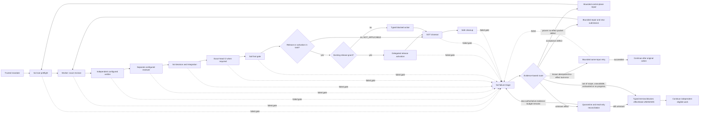

# Developer team responsibilities

Assign responsibilities per task under the active
[coding-delivery policy](../docs/architecture/delivery-control/WORKFLOW-POLICY.md)
and its machine-readable [model policy](../docs/architecture/delivery-control/contracts/model-policy.json).
The root agent derives bounded admissions from the trusted mandate. Sol owns
decisions, critical debugging, orchestration, audit, integration and final
disposition. Exploration, research, worker delivery, verification and review use
the contract-bound sessions. The caller must bind the configured model;
model failure blocks that role without fallback or substitution.

| Stable role | Responsibility | Policy assignment |
|---|---|---|
| `dev-lead` | Derive bounded scope, inspect dependencies and risks, prepare task packets | Sol root/orchestration |
| `dev-doc-writer` | Draft and reconcile documentation, diagrams and evidence | Doc Writer skill and native adapters; worker session when delegated |
| `dev-implementer` | Implement the admitted slice in its assigned worktree | Worker session |
| `dev-reviewer` | Independently review meaning, contracts, diff and evidence | Configured review session, separate from worker and verifier |
| `dev-verifier` | Execute relevant checks and return exact revision and results | Configured verifier session, separate from worker and reviewer |
| `dev-integrator` | Compose accepted sources, regenerate outputs and validate the combined result | Sol root integration; serialize shared-source generation |

Persona, domain expertise and role identity remain separate. Only Doc Writer has
a custom-agent role card, skill and native adapters in this package; the other
roles are selected and bound as distinct sessions by the orchestrator. The local
contract validator checks structure, but the actual dispatch also requires a
root-recorded mandate derived from a direct current user task or standing
delegation evidenced in trusted conversation/harness context, plus a verified
authority binding from that context. Root records the source message/reference,
repository, objective, effects and prohibitions once; packets reference it. The
user need not author or sign a packet, and no extra approval is required.

## Autonomous handoff

1. The root/Lead records the direct current task or standing delegation as the
   trusted mandate once, then derives a bounded packet that references it. The
   packet names source references, exact base and dependencies, distinct
   read/write scopes, forbidden effects, Given/When/Then acceptance checks,
   environment, receipt destination and remaining lineage budget.
2. G0 checks authority binding, input pins, read-set closure and packet
   completeness before the worker starts. No person approves this gate.
3. The Doc Writer or Implementer completes the admitted slice and records the
   exact revision, changed paths, commands, evidence and remaining gaps.
4. A separate Verifier checks the exact submission. A third, distinct Reviewer
   reviews the same verified revision. Neither can substitute for the other.
5. Sol resolves process and technical decisions within the mandate, integrates
   accepted work, and records the exact integrated revision. Out-of-scope effects
   become typed blockers; independent eligible work continues.
6. The delegated Integrator runs required generators and gates on the composed
   result. Authorized commit, push and PR creation may start CI; exact-head CI
   and the Sol final gate must pass before merge or release when applicable.
7. If release/activation is part of the task and the mandate grants its exact
   target and environment, execute its remaining gates without a human prompt.
   If it is part of the task but authority or credentials are missing, record a
   typed blocker. If release/activation is not part of the task, mark that gate
   `NOT_APPLICABLE` and proceed to closeout.
8. Reconcile through the owning source of truth, record remaining conditions,
   and clean up only after preserving evidence and confirming no active use.

The diagram describes an agent procedure, not a running orchestration service.
No mandatory human gate is part of the process. Existing external authority and
credential boundaries still apply. Shared source generation is serialized, and
branch dependencies are satisfied only by actual accepted artifacts.

## Version diff

0.1.0 → 0.2.0: replaces manual approval handoffs with autonomous v2 admission
and Sol-owned decisions, separates verifier/reviewer sessions, and makes release
activation conditional on an existing mandate grant. No runtime controller is
claimed.
