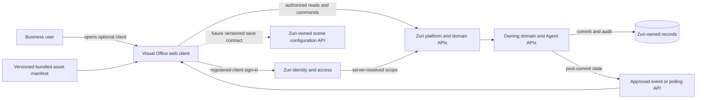
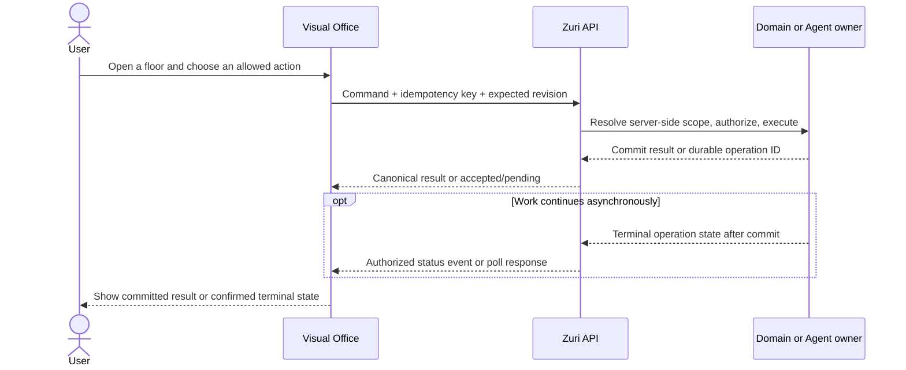

# Visual Office as an optional Zuri platform client

**Status: approved product-architecture direction; implementation remains contract-gated.** The owner approved Visual Office as a separately deployed, optional web client registered with Zuri on 2026-10-23. This approval fixes the product boundary and floor projection described here. It does not publish an API schema, select an authentication protocol, authorize a route or service, authorize a data migration, or claim that Visual Office is integrated. The Zuri sources cited below were rechecked against repository `main` at `e3474ef3c16b5cc5b6e797c63e69d6dc202c191f`.

## 1. Purpose and success criteria

Visual Office is an optional, separately deployed web client registered with Zuri. It lets an authorized user view and operate permitted Zuri Business capabilities through a simulation-like office. A user can use Zuri without opening Visual Office. Zuri remains the authority for identity, Business context, business domains, modules, agent records and roles, permissions, business data, and business writes; Visual Office owns only its client presentation and local editing experience.

The design succeeds when:

- the Office can be deployed and released as a frontend client without creating a second business-data authority;
- a signed-in user sees only the Business context and leaf domains returned by Zuri for that user;
- the building has a G/Lobby and one floor for every authorized, visible leaf business domain in that context;
- the number and roles of displayed agents come from Zuri records; a domain with no agent still has a truthful department view;
- CRUD, agent commands, scene saves, retries, and conflicts have explicit authoritative outcomes;
- Visual Office cannot create or modify canonical domain, agent, role, permission, or execution records through its scene editor.

## 2. Taxonomy and system placement

Use the accepted Zuri taxonomy without treating navigation, deployment, and business ownership as the same axis.

| Term | Meaning in this design | Visual Office consequence |
| --- | --- | --- |
| Business domain | Business ownership boundary for its rules and records, represented by Zuri's domain charter and APIs | Domain data and write authority stay with Zuri's domain owner |
| Module | A capability implemented within its owning domain; it is not an independent business owner by default | Modules do not create additional floors unless Zuri defines them as separate leaf domains |
| Domain group | A navigation/presentation grouping such as SCM or CRM | A group does not create a floor, model, module, or business grant by itself |
| Service | An execution, installation, and testing boundary; a service may contain several domains | A service name does not create an office floor or business permission |
| Client surface | A user-facing application that consumes platform identity and APIs | Visual Office is an optional cross-domain client surface |

[ADR-025 revision 4](../decisions/ADR-025-DOMAIN-DRIVEN-DOCS-ARCHITECTURE.md) establishes the distinction between domain ownership and service execution documentation and explicitly does not authorize a service/data migration. The [SCM service boundary](../services/scm/SERVICE.md) is a concrete example: a service can host leaf-domain modules while their model and permission ownership remains with the leaf domains. The candidate [domain taxonomy/navigation document](project-manager-system/13-DOMAIN-TAXONOMY-AND-NAVIGATION-BOUNDARIES.md) is useful analysis, not an accepted replacement for the adopted decisions.

### Placement decision

Visual Office is a separately deployed optional frontend client registered with Zuri's identity/platform owner. This is the approved placement. It is not a new Business domain, a domain module, or a new Visual Office backend service in the first integration slice. Its independent frontend deployment does not itself make it a business domain or grant it access. Zuri must authorize every request from its server-owned identity, membership, Business scope, and role/capability state.

This direction is reconciled into the [Visual Office 2.5D candidate plan](../plans/PLAN-VISUAL-OFFICE-2-5D.md) and its roadmap cross-reference in this change. The plan remains a candidate implementation elaboration; roadmap task status and acceptance evidence are unchanged.

## 3. Components and authority

1. **Zuri identity and access** authenticates the person and resolves the active session, Tenant/Business scope, memberships, role bindings, and permissions. The browser client never asserts its own authorization by sending a `tenantId`, `businessId`, role, or permission claim.
2. **Zuri domain APIs** own business reads and writes. Each domain owner validates authorization and commits its own records. Agent roster, role, status, command availability, and execution results come from Zuri-owned Agent/domain APIs.
3. **Visual Office client** renders the building and floors, displays authoritative records, submits permitted actions, and edits presentation-only scene configuration. It has no direct database or message-broker connection.
4. **Scene configuration storage** must be an explicitly designated Zuri-owned API/resource before shared saves are enabled. This proposal does not name an endpoint or assume an existing scene service. No Visual Office database/backend is introduced in the first slice.
5. **Initial asset delivery** uses curated, versioned GLB assets bundled with or served as immutable frontend assets and described by a manifest. A shared searchable asset catalog, upload workflow, or asset-storage service is a separate future decision.

### Authentication boundary

The independent client needs a Zuri-approved first-party client registration and sign-in/session contract, including allowed origins/redirects, scopes, expiry/revocation, and the route by which a user selects an authorized Business. That contract does not yet exist as an approved Visual Office integration contract. The browser must not contain a client secret, copy a privileged browser credential into local storage, or send passwords to Visual Office.

[ADR-045](../decisions/ADR-045-CANONICAL-IDENTITY-AND-ACCESS-MANAGEMENT.md) is the accepted identity/access boundary. [ADR-052](../decisions/ADR-052-PLUGIN-AUTHORIZATION-CODE-AND-TOKEN-BOUNDARY.md) is a candidate for a specific first-party plugin flow; Visual Office must not inherit that flow or its routes automatically. The platform identity owner must select and publish the client contract for this surface.

## 4. Context, reads, and floor projection

On launch, Visual Office obtains an authenticated Zuri context and requests a bounded snapshot for the selected Business. The platform derives the caller and scope from its session. Any Business identifier provided by the client is only a selection request and must be re-authorized server-side. A snapshot should include stable domain keys, display metadata, availability/visibility, supported module capabilities, actual agent identifiers and roles, action capabilities, source revision, and an observation time. This list is a contract requirement, not a published response schema.

The renderer creates:

- one G/Lobby, which is an Office navigation/presentation surface rather than a Business domain;
- one floor for each authorized, visible leaf business domain returned by Zuri;
- no extra floor for service names, technical modules, or navigation groups such as SCM/CRM.

A visible domain remains a floor when it has no assigned agent. It may show the domain's authorized work/status view with an honest empty-agent state. The client must not invent agents, pad role counts, infer a role from an illustration, or describe an avatar animation as proof of live work. Reserved, unsupported, unavailable, and inaccessible domains require distinct platform states; the Office must not treat missing data as an enabled empty domain.

No snapshot endpoint or response schema is approved. Zuri platform owners must publish the authorized context/domain/agent read contract, including its permissions, bounds, revision semantics, error model, and test fixtures, before the client connects.

## 5. Commands, writes, and events

All Business CRUD and agent commands go through the owning Zuri API. The Office may render available actions from a capability response, but Zuri rechecks authorization at execution time. A command request carries a client-generated idempotency key and the expected record/resource revision where applicable. The owner commits the change transactionally and returns the canonical result and new revision. A version conflict is surfaced to the user; the client does not silently overwrite with last-write-wins.

Long-running agent work is distinct from CRUD. Zuri may accept a command and return a durable operation ID; Visual Office shows `pending` until it receives an authoritative terminal state. Acceptance of a command is not proof of its business side effect.

Events may notify clients after the authoritative transaction commits, using the platform's approved reliable mechanism. Consumers handle duplicates and stale ordering. If an event stream is unavailable, Visual Office can poll an authorized status API. The browser never publishes directly to a broker, treats an event as a transaction, or claims that an unconfirmed write succeeded.

## 6. Scene state and asset handling

Scene state is presentation configuration, separate from Business records and Agent definitions. It is scoped independently by Business and domain/floor and contains versioned asset references, transforms/dimensions, finishes/material references, layer order, declarative interactions, and optional presentation bindings to real platform agent IDs. It cannot change the roster, role, permissions, agent command, or business state.

The target shared-save flow uses a Zuri-designated presentation-configuration API. Save requests include the base revision and an idempotency key; the server returns the committed revision and audit attribution or a conflict. Revisions allow a user to reload a known saved state. A scene save changes the visual floor configuration only.

Until that API and its ownership contract are approved, the Studio can keep a clearly labeled browser-local draft and explicit JSON export. It must not call this cross-device persistence or a platform save. The initial asset manifest should bind stable asset IDs to immutable file revisions/hashes, category, preview, units, and license/provenance. Only curated assets from the manifest load in the scene. Arbitrary executable assets or user-supplied remote URLs are outside this design. A shared catalog and object-storage lifecycle require a separate owner and decision.

## 7. Failure behavior and safety

| Condition | Required client behavior |
| --- | --- |
| No valid Zuri session | Start the approved sign-in flow; show no Business data before authorization |
| Business/domain permission denied | Deny access and avoid rendering cached private data |
| Snapshot unavailable, stale, or schema-incompatible | Show unavailable/stale state with source time; do not replace it with zero, idle, or success |
| Write timeout/retry | Reuse the same idempotency key and reconcile with the owner API before presenting success |
| Resource revision conflict | Preserve the user's draft and offer reload/reconcile; never silently apply last-write-wins |
| Agent operation accepted but incomplete | Show the operation ID and pending state; show completion only after Zuri confirms it |
| Event delivery delayed or lost | Mark status freshness and poll the authoritative operation/status endpoint |
| Asset is missing or hash/revision mismatches | Show a safe placeholder and report the asset failure; do not load an unverified replacement |

Client logs and audit payloads must not contain passwords, session tokens, private business payloads beyond the approved diagnostic need, or agent secrets. Zuri remains responsible for authorization and audit of business actions; the scene editor has no elevated grant.

## 8. Acceptance and integration gates

The platform integration is not ready until the relevant owners publish and test these contracts:

1. client registration, authentication, session expiry/revocation, allowed origins, and authorized Business selection;
2. a Business snapshot/domain registry that defines visible leaf domains, module capabilities, reserved/unavailable states, versions, and access behavior;
3. actual per-domain agent roster/role/status and action capability data, plus the command and long-running-operation lifecycle;
4. domain-owner write contracts for authorization, transactional result, idempotency, expected revisions, conflicts, and audit;
5. post-commit event or polling contracts for operation status, including duplicate and stale delivery behavior;
6. a designated owner and API for versioned scene saves if cross-device persistence is required;
7. immutable asset-manifest and delivery rules for the initial curated library; a shared catalog is not a prerequisite for the first bundled library.

Verification should include:

- schema/contract tests against the published API versions and representative authorization fixtures;
- authorization tests for cross-Tenant/Business and inaccessible-domain requests;
- floor-projection tests proving exactly one lobby plus one floor per returned visible leaf domain, including a domain with no agents and a reserved/unavailable domain;
- command tests for duplicate idempotency keys, successful transactional responses, stale revisions, explicit conflicts, and long-running operation transitions;
- event/poll tests for duplicate, delayed, missing, and out-of-order notifications;
- scene tests for per-Business/domain isolation, revision conflicts, retained drafts, no mutation of agent/domain records, and asset hash mismatch;
- sandbox end-to-end tests against a real Zuri test Business before making any live-read or agent-command integration claim.

The frontend deployment also needs an owned host/origin, registered redirect/callback configuration, production-safe CSP/CORS, error reporting without secrets, and an explicit release/rollback owner. A `docs/services/<name>/SERVICE.md` entry should be added only if Zuri adopts an actual operational service boundary with package/runtime, test, and owner evidence; client registration alone does not create one.

## 9. Open decisions and explicit non-goals

The platform owners still need to choose the registered-client auth protocol; publish stable Business/domain and Agent/command schemas; decide who owns shared scene revisions; and decide whether a shared asset catalog is ever needed. This design intentionally does not choose an event broker, invent a new Zuri Business domain, add a Visual Office backend/database, create agent roles, change canonical agent counts, or assert that any integration is currently live.

The client topology is approved and the candidate plan/roadmap cross-reference are reconciled. Platform-backed implementation remains gated on the written owner contracts above. Contract gaps can be tracked as dependencies; they are not permission to fabricate a contract in the Office client.

## 10. Source documents reviewed

- [ADR-024 — zuri-ai is a standalone product](../decisions/ADR-024-ZURI-AI-IS-A-STANDALONE-PRODUCT.md)
- [ADR-025 — domain-driven documentation architecture, revision 4](../decisions/ADR-025-DOMAIN-DRIVEN-DOCS-ARCHITECTURE.md)
- [ADR-045 — canonical identity and access management boundary](../decisions/ADR-045-CANONICAL-IDENTITY-AND-ACCESS-MANAGEMENT.md)
- [ADR-052 — candidate plugin authorization-code and token boundary](../decisions/ADR-052-PLUGIN-AUTHORIZATION-CODE-AND-TOKEN-BOUNDARY.md)
- [Service documentation index](../services/README.md) and [SCM service boundary](../services/scm/SERVICE.md)
- [Visual Office 2.5D candidate plan](../plans/PLAN-VISUAL-OFFICE-2-5D.md)
- [Candidate domain taxonomy and navigation analysis](project-manager-system/13-DOMAIN-TAXONOMY-AND-NAVIGATION-BOUNDARIES.md)
- `apps/server/src/config/domains.js` for current navigation-group semantics; the route/config source is not a substitute for a future Business-scoped domain registry API.

**Version diff 0.1.0 → 0.2.0 (2026-10-23):** Records the owner's approval of the optional registered-client placement, explicitly keeps authentication/API/resource contracts as prerequisites, and reconciles the candidate implementation plan without changing canonical roadmap statuses or claiming implementation.
