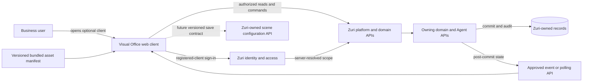
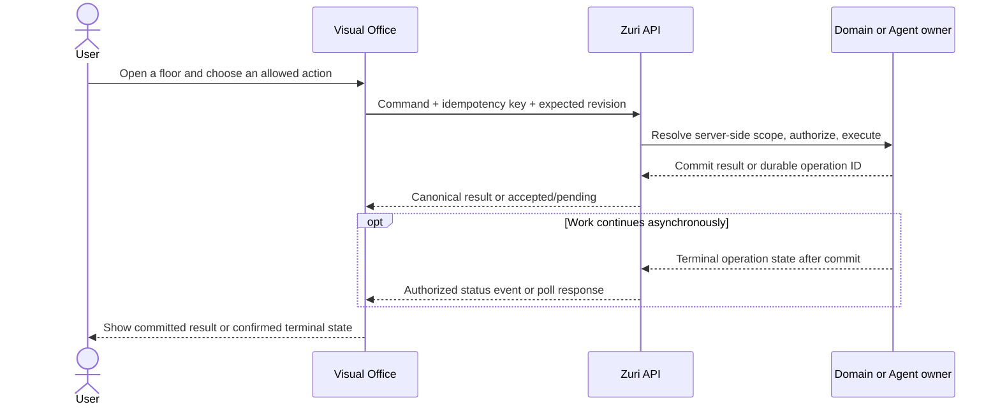

# Visual Office as an optional Zuri platform client

**Status: approved product-architecture direction; implementation remains contract-gated.** The owner approved Visual Office as a separately deployed, optional web client registered with Zuri on 2026-10-23. This approval fixes the product boundary and floor projection described here. It does not publish an API schema, select an authentication protocol, authorize a route or service, authorize a data migration, or claim that Visual Office is integrated. The Zuri sources cited below were rechecked against repository `main` at `e3474ef3c16b5cc5b6e797c63e69d6dc202c191f`; §11 records the 2026-11-06 reconciliation with `main` at `46787958`. [ADR-116](../decisions/ADR-116-VISUAL-OFFICE-INTEGRATION-BOUNDARY.md), accepted by the owner on 2026-11-07, decides the repository, data-access and deployment-origin questions this design left open.

## 1. Purpose and success criteria

Visual Office is an optional, separately deployed web client registered with Zuri. It lets an authorized user view and operate permitted Zuri Business capabilities through a simulation-like office. A user can use Zuri without opening Visual Office. Zuri remains the authority for identity, Business context, business domains, modules, agent records and roles, permissions, business data, and business writes; Visual Office owns only its client presentation and local editing experience.

The design succeeds when:

- the Office can be deployed and released as a frontend client without creating a second business-data authority;
- a signed-in user sees only the Business context and leaf domains returned by Zuri for that user;
- the building has a G/Lobby and one floor for every authorized, visible leaf business domain in that context;
- the number and roles of displayed agents come from Zuri records; a domain with no agent still has a truthful department view;
- CRUD, agent commands, scene saves, retries, and conflicts have explicit authoritative outcomes;
- Visual Office cannot create or modify canonical domain, agent, role, permission, or execution records through its scene editor.

## 2. Taxonomy and system placement

Use the accepted Zuri taxonomy without treating navigation, deployment, and business ownership as the same axis.

| Term | Meaning in this design | Visual Office consequence |
| --- | --- | --- |
| Business domain | Business ownership boundary for its rules and records, represented by Zuri's domain charter and APIs | Domain data and write authority stay with Zuri's domain owner |
| Module | A capability implemented within its owning domain; it is not an independent business owner by default | Modules do not create additional floors unless Zuri defines them as separate leaf domains |
| Domain group | A navigation/presentation grouping such as SCM or CRM | A group does not create a floor, model, module, or business grant by itself |
| Service | An execution, installation, and testing boundary; a service may contain several domains | A service name does not create an office floor or business permission |
| Client surface | A user-facing application that consumes platform identity and APIs | Visual Office is an optional cross-domain client surface |

[ADR-025 revision 4](../decisions/ADR-025-DOMAIN-DRIVEN-DOCS-ARCHITECTURE.md) establishes the distinction between domain ownership and service execution documentation and explicitly does not authorize a service/data migration. The [SCM service boundary](../services/scm/SERVICE.md) is a concrete example: a service can host leaf-domain modules while their model and permission ownership remains with the leaf domains. The candidate [domain taxonomy/navigation document](project-manager-system/13-DOMAIN-TAXONOMY-AND-NAVIGATION-BOUNDARIES.md) is useful analysis, not an accepted replacement for the adopted decisions.

### Placement decision

Visual Office is a separately deployed optional frontend client registered with Zuri's identity/platform owner. This is the approved placement. It is not a new Business domain, a domain module, or a new Visual Office backend service in the first integration slice. Its independent frontend deployment does not itself make it a business domain or grant it access. Zuri must authorize every request from its server-owned identity, membership, Business scope, and role/capability state.

This direction was written against the [Visual Office 2.5D candidate plan](https://github.com/Freshair129/zuri.ai/blob/e3474ef3c16b5cc5b6e797c63e69d6dc202c191f/docs/plans/PLAN-VISUAL-OFFICE-2-5D.md), pinned here at its last revision. That plan was removed from `main` on 2026-10-23 (`d1a3acb4`) with other obsolete plans; it is historical context, not a current source. TASK-ZAI-019..023 roadmap status and acceptance evidence are unchanged.

## 3. Components and authority

1. **Zuri identity and access** authenticates the person and resolves the active session, Tenant/Business scope, memberships, role bindings, and permissions. The browser client never asserts its own authorization by sending a `tenantId`, `businessId`, role, or permission claim.
2. **Zuri domain APIs** own business reads and writes. Each domain owner validates authorization and commits its own records. Agent roster, role, status, command availability, and execution results come from Zuri-owned Agent/domain APIs.
3. **Visual Office client** renders the building and floors, displays authoritative records, submits permitted actions, and edits presentation-only scene configuration. It has no direct database or message-broker connection.
4. **Scene configuration storage** must be an explicitly designated Zuri-owned API/resource before shared saves are enabled. This proposal does not name an endpoint or assume an existing scene service. No Visual Office database/backend is introduced in the first slice.
5. **Initial asset delivery** uses curated, versioned GLB assets bundled with or served as immutable frontend assets and described by a manifest. A shared searchable asset catalog, upload workflow, or asset-storage service is a separate future decision.



### Authentication boundary

The independent client needs a Zuri-approved first-party client registration and sign-in/session contract, including allowed origins/redirects, scopes, expiry/revocation, and the route by which a user selects an authorized Business. That contract does not yet exist as an approved Visual Office integration contract. The browser must not contain a client secret, copy a privileged browser credential into local storage, or send passwords to Visual Office.

[ADR-045](../decisions/ADR-045-CANONICAL-IDENTITY-AND-ACCESS-MANAGEMENT.md) is the accepted identity/access boundary. [ADR-052](../decisions/ADR-052-PLUGIN-AUTHORIZATION-CODE-AND-TOKEN-BOUNDARY.md) is a candidate for a specific first-party plugin flow; Visual Office must not inherit that flow or its routes automatically. The platform identity owner must select and publish the client contract for this surface.

## 4. Context, reads, and floor projection

On launch, Visual Office obtains an authenticated Zuri context and requests a bounded snapshot for the selected Business. The platform derives the caller and scope from its session. Any Business identifier provided by the client is only a selection request and must be re-authorized server-side. A snapshot should include stable domain keys, display metadata, availability/visibility, supported module capabilities, actual agent identifiers and roles, action capabilities, source revision, and an observation time. This list is a contract requirement, not a published response schema.

The renderer creates:

- one G/Lobby, which is an Office navigation/presentation surface rather than a Business domain;
- one floor for each authorized, visible leaf business domain returned by Zuri;
- no extra floor for service names, technical modules, or navigation groups such as SCM/CRM.

A visible domain remains a floor when it has no assigned agent. It may show the domain's authorized work/status view with an honest empty-agent state. The client must not invent agents, pad role counts, infer a role from an illustration, or describe an avatar animation as proof of live work. Reserved, unsupported, unavailable, and inaccessible domains require distinct platform states; the Office must not treat missing data as an enabled empty domain.

No snapshot endpoint or response schema is approved. Zuri platform owners must publish the authorized context/domain/agent read contract, including its permissions, bounds, revision semantics, error model, and test fixtures, before the client connects.

## 5. Commands, writes, and events

All Business CRUD and agent commands go through the owning Zuri API. The Office may render available actions from a capability response, but Zuri rechecks authorization at execution time. A command request carries a client-generated idempotency key and the expected record/resource revision where applicable. The owner commits the change transactionally and returns the canonical result and new revision. A version conflict is surfaced to the user; the client does not silently overwrite with last-write-wins.

Long-running agent work is distinct from CRUD. Zuri may accept a command and return a durable operation ID; Visual Office shows `pending` until it receives an authoritative terminal state. Acceptance of a command is not proof of its business side effect.



Events may notify clients after the authoritative transaction commits, using the platform's approved reliable mechanism. Consumers handle duplicates and stale ordering. If an event stream is unavailable, Visual Office can poll an authorized status API. The browser never publishes directly to a broker, treats an event as a transaction, or claims that an unconfirmed write succeeded.

## 6. Scene state and asset handling

Scene state is presentation configuration, separate from Business records and Agent definitions. It is scoped independently by Business and domain/floor and contains versioned asset references, transforms/dimensions, finishes/material references, layer order, declarative interactions, and optional presentation bindings to real platform agent IDs. It cannot change the roster, role, permissions, agent command, or business state.

The target shared-save flow uses a Zuri-designated presentation-configuration API. Save requests include the base revision and an idempotency key; the server returns the committed revision and audit attribution or a conflict. Revisions allow a user to reload a known saved state. A scene save changes the visual floor configuration only.

Until that API and its ownership contract are approved, the Studio can keep a clearly labeled browser-local draft and explicit JSON export. It must not call this cross-device persistence or a platform save. The initial asset manifest should bind stable asset IDs to immutable file revisions/hashes, category, preview, units, and license/provenance. Only curated assets from the manifest load in the scene. Arbitrary executable assets or user-supplied remote URLs are outside this design. A shared catalog and object-storage lifecycle require a separate owner and decision.

## 7. Failure behavior and safety

| Condition | Required client behavior |
| --- | --- |
| No valid Zuri session | Start the approved sign-in flow; show no Business data before authorization |
| Business/domain permission denied | Deny access and avoid rendering cached private data |
| Snapshot unavailable, stale, or schema-incompatible | Show unavailable/stale state with source time; do not replace it with zero, idle, or success |
| Write timeout/retry | Reuse the same idempotency key and reconcile with the owner API before presenting success |
| Resource revision conflict | Preserve the user's draft and offer reload/reconcile; never silently apply last-write-wins |
| Agent operation accepted but incomplete | Show the operation ID and pending state; show completion only after Zuri confirms it |
| Event delivery delayed or lost | Mark status freshness and poll the authoritative operation/status endpoint |
| Asset is missing or hash/revision mismatches | Show a safe placeholder and report the asset failure; do not load an unverified replacement |

Client logs and audit payloads must not contain passwords, session tokens, private business payloads beyond the approved diagnostic need, or agent secrets. Zuri remains responsible for authorization and audit of business actions; the scene editor has no elevated grant.

## 8. Acceptance and integration gates

The platform integration is not ready until the relevant owners publish and test these contracts:

1. client registration, authentication, session expiry/revocation, allowed origins, and authorized Business selection;
2. a Business snapshot/domain registry that defines visible leaf domains, module capabilities, reserved/unavailable states, versions, and access behavior;
3. actual per-domain agent roster/role/status and action capability data, plus the command and long-running-operation lifecycle;
4. domain-owner write contracts for authorization, transactional result, idempotency, expected revisions, conflicts, and audit;
5. post-commit event or polling contracts for operation status, including duplicate and stale delivery behavior;
6. a designated owner and API for versioned scene saves if cross-device persistence is required;
7. immutable asset-manifest and delivery rules for the initial curated library; a shared catalog is not a prerequisite for the first bundled library.

Verification should include:

- schema/contract tests against the published API versions and representative authorization fixtures;
- authorization tests for cross-Tenant/Business and inaccessible-domain requests;
- floor-projection tests proving exactly one lobby plus one floor per returned visible leaf domain, including a domain with no agents and a reserved/unavailable domain;
- command tests for duplicate idempotency keys, successful transactional responses, stale revisions, explicit conflicts, and long-running operation transitions;
- event/poll tests for duplicate, delayed, missing, and out-of-order notifications;
- scene tests for per-Business/domain isolation, revision conflicts, retained drafts, no mutation of agent/domain records, and asset hash mismatch;
- sandbox end-to-end tests against a real Zuri test Business before making any live-read or agent-command integration claim.

The frontend deployment also needs an owned host/origin, registered redirect/callback configuration, production-safe CSP/CORS, error reporting without secrets, and an explicit release/rollback owner. A `docs/services/<name>/SERVICE.md` entry should be added only if Zuri adopts an actual operational service boundary with package/runtime, test, and owner evidence; client registration alone does not create one.

## 9. Open decisions and explicit non-goals

The platform owners still need to choose the registered-client auth protocol; publish stable Business/domain and Agent/command schemas; decide who owns shared scene revisions; and decide whether a shared asset catalog is ever needed. This design intentionally does not choose an event broker, invent a new Zuri Business domain, add a Visual Office backend/database, create agent roles, change canonical agent counts, or assert that any integration is currently live.

The client topology is approved. Platform-backed implementation remains gated on the written owner contracts above. Contract gaps can be tracked as dependencies; they are not permission to fabricate a contract in the Office client.

## 10. Source documents reviewed

- [ADR-024 — zuri-ai is a standalone product](../decisions/ADR-024-ZURI-AI-IS-A-STANDALONE-PRODUCT.md)
- [ADR-025 — domain-driven documentation architecture, revision 4](../decisions/ADR-025-DOMAIN-DRIVEN-DOCS-ARCHITECTURE.md)
- [ADR-045 — canonical identity and access management boundary](../decisions/ADR-045-CANONICAL-IDENTITY-AND-ACCESS-MANAGEMENT.md)
- [ADR-052 — candidate plugin authorization-code and token boundary](../decisions/ADR-052-PLUGIN-AUTHORIZATION-CODE-AND-TOKEN-BOUNDARY.md)
- [Service documentation index](../services/README.md) and [SCM service boundary](../services/scm/SERVICE.md)
- [Visual Office 2.5D candidate plan (removed; pinned at `e3474ef3`)](https://github.com/Freshair129/zuri.ai/blob/e3474ef3c16b5cc5b6e797c63e69d6dc202c191f/docs/plans/PLAN-VISUAL-OFFICE-2-5D.md)
- [Candidate domain taxonomy and navigation analysis](project-manager-system/13-DOMAIN-TAXONOMY-AND-NAVIGATION-BOUNDARIES.md)
- `apps/server/src/config/domains.js` for current navigation-group semantics; the route/config source is not a substitute for a future Business-scoped domain registry API.

**Version diff 0.1.0 → 0.2.0 (2026-10-23):** Records the owner's approval of the optional registered-client placement, explicitly keeps authentication/API/resource contracts as prerequisites, and reconciles the candidate implementation plan without changing canonical roadmap statuses or claiming implementation.

## 11. Reconciliation with main (2026-11-06)

This design was first recorded on an unmerged checkpoint branch (`f4aec274`) and is landed here against `main` at `46787958`. Since the first draft, `main` added two bounded Office integrations that are consistent with this boundary and do not satisfy the §8 gates:

- [ZAI:FR-294](../requirements/FR-294.md) — the Office design receiver: Business-scoped design and asset custody under `/api/businesses/[id]/office-designs` for a session that holds current Business ownership, with cross-site refusal, CSRF, `If-Match` and `Idempotency-Key` checks. It creates no runtime agents, approvals or roster; Office-client enrollment, CORS and client credentials remain out of scope.
- [ZAI:FR-295](../requirements/FR-295.md) — the Office handoff client: a Zuri-origin `/office-handoff` popup receives an Office design package by `postMessage` from an allow-listed origin and submits it same-origin with the user's session. This avoids cross-origin API access rather than providing a registered-client contract.

No snapshot/domain registry, roster, command, event or scene-save contract from §8 exists yet. Zuri has no CORS configuration and its session cookie is `SameSite=Lax`. [ADR-116](../decisions/ADR-116-VISUAL-OFFICE-INTEGRATION-BOUNDARY.md) (accepted 2026-11-07) decides how the first platform-backed slice is placed and served. Its decision 4 amends §8 gate 1 for that slice only: same-origin serving under its stated conditions, with the registered client as the fallback.

The 2026-10-23 owner approval stated in the status line is recorded in this design itself (checkpoint `f4aec274`, committed from the owner's account). No separate approval artifact exists, and that checkpoint noted that governance and semantic re-review were still pending. The frontmatter therefore stays `candidate`. The approval covers the client placement and floor projection only.

**Version diff 0.2.0 → 0.3.0 (2026-11-06):** Lands the checkpoint on current `main`; adopts current metadata; replaces links to the removed plan with a commit-pinned historical link; adds §11 reconciliation with FR-294/FR-295 and the ADR-116 proposal. The 2026-10-23 owner approval of the client placement is unchanged; no contract, route or implementation claim is added.

## 12. The handoff as built (FR-294, FR-295)

Sections 1 to 10 describe a target. This section describes the one integration
that exists in code, on both sides, read from `apps/server/` at `49b10eb3` and
the Visual Office repository (`Freshair129/visual-office`) at `1dff013d`. It
adopts nothing new and does not satisfy the §8 gates.

### 12.1 What each side holds

| | Visual Office | zuri.ai |
|---|---|---|
| Runs as | A static browser application (Three.js) | The Core server (`apps/server`) |
| Stores | Editor state and drafts in `localStorage`; custom GLB files in IndexedDB. No shared scene database | `OfficeDesignRegistry`, `OfficeDesignIdentity`, `OfficeDesignRevision`, `OfficeDesignBlob` (GLB bytes in the database), `OfficeDesignImportReceipt` |
| Identity | Stable UUIDv5 design ids derived from entity kind and semantic key | Its own UUID per design entity, with the crosswalk `(registryId, externalId)` |
| Authenticates | It does not. It holds no Zuri credential | The signed-in person's `zuri_session` in the popup |
| Authority | None over Zuri data | Current Business ownership, rechecked at commit |

The package is `zuri-office-design-handoff/v1`: a ZIP with a manifest of typed
entities and optional GLB assets. Its Tenant, Business and Workspace context is
null — the person chooses the target inside Zuri, never inside the package.

### 12.2 The flow

```text
Visual Office (its own origin)                 Zuri (its own origin)
  person clicks "send to Zuri"
  ── open popup /office-handoff#origin&nonce ─▶  page checks the opener's origin
                                                 against OFFICE_HANDOFF_ALLOWED_ORIGINS
  ◀──────────── office-ready (nonce) ─────────  
  build ZIP from the saved scene
  ── office-package (ZIP bytes, nonce) ───────▶  GET /api/office-design-targets
                                                 person picks a Business Workspace
                                                 GET /api/auth/csrf
                                                 POST /api/businesses/[id]/office-designs
                                                   If-Match · Idempotency-Key · x-csrf-token
                                                 verify → one transaction → audit
                                                 GET the committed revision and mappings
  ◀──────────── office-complete (version, count)
```

Both sides check `event.origin`, the window that sent the message, and the
nonce. Visual Office refuses a Zuri origin that shares its hostname on a
different port, and anything that is not HTTPS or loopback; Zuri accepts only exact origins from its
allow-list, HTTPS or loopback. The API call is same-origin from the popup, so
no CORS configuration exists or is needed.

### 12.3 What the receiver does with an untrusted archive

1. **Request gate** (`office-design/http.js`): a `cross-site` fetch is refused;
   the session-bound API write CSRF token is required; `If-Match` carries the
   expected registry version; `Idempotency-Key` is required; the body must be a
   ZIP of at most 100 MB, enforced while streaming.
2. **Admission**: at most two uploads are in flight per process; a third gets
   `503 OFFICE_VERIFIER_BUSY`.
3. **Verification** (`verify.js`, `validation-worker.mjs`): a Node worker thread
   with V8 heap limits and a 30-second timeout runs the **pinned** archive
   reader and semantic verifier from `apps/server/vendor/office-design/`. It
   never runs code from the package. Paths and compression are allow-listed,
   sizes and CRCs are checked without extracting, GLB containers are inspected
   and external `uri` references are refused, and the graph is capped at 20,000
   entities, 15 workflows and 63 steps.
4. **Commit** (`service.js`): one transaction re-authorizes the target
   (current Business owner; active Workspace, Business and Tenant), replays an
   identical earlier request from its receipt, compares and increments the
   registry version, adds identities for entities not seen before, stores
   blobs not already held, writes the revision and an `OFFICE_DESIGN` /
   `REGISTER_DESIGN_REVISION` audit event scoped to the Tenant and Business,
   then writes the receipt. A same-key request with different content is a
   `409`. `?dryRun=1` validates and reports counts without writing.
5. **Refusals are 404-shaped** for anything about the target the caller may not
   see.

The result states `runtimeAgentsCreated: 0` and `permissionsGranted: 0`. The
receiver creates design custody only: no Agent runtime, no physical Asset, no
Membership and no approval.

### 12.4 The verifier pin

`apps/server/vendor/office-design/provenance.json` pins the producer at
revision `b4e2d8ed…` of `Freshair129/zuri-visual-office`, and every stored
revision records that value as `producerRevision` (`OFFICE_PRODUCER_REVISION`
in `office-design/service.js`).

- That repository is the archived predecessor. The pinned commit
  (`b4e2d8edec9d8dbad32573d860cff3a6a27efbbd`, "Merge pull request #12:
  accepted low-rate Office MVP") is reachable from `archive/main` of
  `https://github.com/Freshair129/zuri-visual-office.git`, and from no branch of
  the current repository, `Freshair129/visual-office` (`origin`). The two
  histories have no common ancestor, so "unchanged" below means identical git
  blob content, not an ancestor relationship.
- Of the 31 pinned producer source files, 28 are identical at `1dff013d` and
  three have changed since the pin: `web/office-characters.js`,
  `web/tycoon-models.js` and `web/tycoon-state.js`. The Three.js version is the
  same (`0.180.0`, declared in the producer's `package.json` and installed; checked
  by hand, not asserted by a test). `tycoon-models.js` changes `bakeActorClips` to bake bone nodes as well as
  groups, and `tycoon-state.js` rewrites the browser `localStorage` store.
  `office-characters.js` (about 170 changed lines) was not reviewed line by
  line.
- Observed on 2026-11-13, generating in memory from a read-only checkout at
  `1dff013d` and writing nothing to it: the current producer's default stock
  export is byte-identical to the committed `stock.zip.gz` fixture (archive
  sha256 `9c21ab58…`, content hash `97599a01…`), and rebuilding the custom
  fixture's scenes with the current `buildOfficeHandoff` and `handoffZip`
  reproduces `custom.zip.gz` byte for byte (`8394bbab…`). So the three changed
  files do not alter the default export or the actor GLB digest the receiver
  pins. They are not shown to be irrelevant for edited scenes: a Visual Office
  scene that exercises the changed actor or animation code has not been
  exported or tested.
- `tests/unit/office-design-current-producer.test.js` and its ledger
  `tests/fixtures/office-design/current-producer.json` keep this finding
  checkable. The always-on part pins the ledger to the committed fixtures and
  runs raw tamper cases against the pinned verifier. The opt-in part, enabled
  with `VISUAL_OFFICE_CHECKOUT=<path to a local read-only checkout>`, regenerates
  both exports from that checkout, requires the pinned verifier to accept them
  and, when the checkout is at the ledger's revision, requires the drift list to
  equal the ledger. CI does not have the checkout, so the opt-in part is a local
  pre-bump check and not a merge gate.

#### Re-obtaining the pinned revision

The vendored `verifier.mjs`, `archive.mjs` and `schema.json` are the runtime
artifacts and are self-contained. The producer source is needed only to audit
or rebuild them. To get the exact source:

```bash
git clone https://github.com/Freshair129/zuri-visual-office.git <empty-dir>
git -C <empty-dir> cat-file -t b4e2d8edec9d8dbad32573d860cff3a6a27efbbd   # must print: commit
git -C <empty-dir> merge-base --is-ancestor b4e2d8edec9d8dbad32573d860cff3a6a27efbbd origin/main
git -C <empty-dir> checkout --detach b4e2d8edec9d8dbad32573d860cff3a6a27efbbd
```

In an existing Visual Office checkout, the same revision is fetched through
the `archive` remote (`git fetch archive`). Install the producer's own
dependencies in that clean checkout (Three.js `0.180.0`, esbuild `0.28.2`), then
run `node scripts/vendor-office-design.mjs <that-checkout>` from `apps/server`.
The script overwrites the files in `apps/server/vendor/office-design/` in place,
so it is a rebuild, not a read-only check: run it in a scratch worktree of
zuri.ai, then `git diff --stat -- apps/server/vendor/office-design` must be
empty (the committed bytes are the reference); restore any difference with
`git checkout -- apps/server/vendor/office-design`. Hashes in
`provenance.json` were computed on a Windows checkout and match the repository
blobs either as stored (LF) or with CRLF line endings; all 31 producer inputs
were matched against the pinned commit on 2026-11-13 (the Three.js files were
not re-checked).
That a clean rebuild reproduces `bundleSha256` byte for byte was not re-run in
the change that wrote this section. The archive repository's availability is an
external dependency: if it is deleted, runtime verification still works, but
the source audit and rebuild do not.

#### Reviewing a verifier bump

Changing the pin is a contract review, never a dependency upgrade, and needs
the owner's approval before the pin file changes. In order:

1. Name the new revision, which must be reachable from `origin` of the current
   producer repository, and the reason for the bump.
2. Diff the new revision against the pinned one at blob level for all producer
   inputs the build lists, the Three.js version, the handoff schema
   (`contracts/office-design-handoff-v1.schema.json`) and
   `scripts/office-handoff-archive.mjs`. A schema or archive-format change is a
   new contract version for FR-294, not a bump.
3. Rebuild with `scripts/vendor-office-design.mjs` from a clean checkout and
   update together: `provenance.json`, the revision constant in that script,
   `OFFICE_PRODUCER_REVISION` in `office-design/service.js`, the vendor README
   and the tests that assert the revision.
4. Re-review the receiver's own pins that the new producer could invalidate: the
   actor GLB digest and the fixed workflow catalog preflight in
   `validation-worker.mjs`.
5. Regenerate the fixtures from the new producer, update the ledger, and run
   `office-design-package`, `office-design-provenance` and
   `office-design-current-producer` with `VISUAL_OFFICE_CHECKOUT` set.
6. Stored revisions keep the `producerRevision` they were verified under; a bump
   neither re-verifies nor rewrites them.
7. Independent review of the same patch, exact-head CI, then the owner's
   approval recorded in the change request that authorizes the bump.

### 12.5 Not built

| Gap | State |
|---|---|
| Portable recovery | Generic JSON backup and restore refuse while any Office Design registry exists (`backup-boundary.js`, `OFFICE_DESIGN_RECOVERY_UNAVAILABLE`). Whole-database recovery is the only path. §13 is a candidate proposal |
| Same-origin `/office/` serving | Accepted in ADR-116 decision 4 with its CSP and artifact-hash conditions; not implemented |
| Separately hosted client enrollment | The fallback if same-origin serving cannot meet its conditions; no registration or token contract exists |
| Identities dropped from a later design | A later revision adds missing identities and never retires one. Whether an omitted entity stays as history, is retired or may be deleted is undecided |
| Process-level containment of the verifier | The worker has heap limits and a timeout; total process memory is not bounded by them |
| Snapshot, roster, command and event contracts | Named by ADR-116 for separate requirements; none issued |

## 13. Portable recovery of Office design custody — candidate proposal

**Status: candidate proposal. Not approved, not scheduled.** It adds no requirement, route, contract or permission and does not change FR-294. Approving any option below is the owner's decision and needs its own change request.

### 13.1 The gap

`assertOfficeDesignBackupSafe` (`office-design/backup-boundary.js`) makes generic JSON export and restore refuse with `409 OFFICE_DESIGN_RECOVERY_UNAVAILABLE` as soon as one `OfficeDesignRegistry` row exists. The refusal is installation-wide: one Business registering one design stops the generic backup for every tenant on that installation, and there is no Office-specific export to use instead. The only recovery that preserves Office custody is whole-database recovery (a consistent database and volume copy), which cannot restore one Business, cannot move a Business to another installation and cannot be exercised by the application.

Other domains handled the same problem with a versioned recovery manifest. `phase-b-recovery.v1` (`phase-b-backup.js`, `docs/architecture/project-manager-system/26-PHASE-B-RECOVERY-AND-ERASURE-DECISION.md`) has a protected offline export and a clean-target restore guard, and is the closest precedent. Others (`knowledge-artifact-storage-recovery.v1`, `commerce-billing-recovery.v1` and more in `backup-service.js`) are manifests carried inside the generic snapshot object with their own validation. A new Office format would follow the first pattern, because Office data does not fit the generic replace-everything restore.

### 13.2 What recovery has to preserve

| Custody item | Why it cannot be regenerated |
|---|---|
| `OfficeDesignRegistry` (`id`, `code` `ODR-…`, scope ids, `version`) | `version` is the compare-and-swap counter that `If-Match` is checked against; a restored value that is lower or higher breaks replay and conflict behavior |
| `OfficeDesignIdentity` (`id`, `code` `ODI-…`, `externalId`, `kind`, `semanticKey`) | The server UUIDs were already returned to callers as `mapping[].zuriId`; minting new ones silently breaks every reference held outside the database |
| `OfficeDesignRevision` (`version` 1…N, `contentHash`, `archiveSha256`, `manifestJson`, `producerRevision`, `createdByPersonId`) | Immutable design history and attribution; `manifestJson` must come back byte for byte |
| `OfficeDesignBlob` (`sha256`, `byteLength`, `bytes`) | The GLB bytes are held only here; sha256 is recomputable |
| `OfficeDesignImportReceipt` (`requestKey`, `commandHash`, `resultJson`) | Idempotent replay returns the stored result, which embeds `registryId`, `revisionId`, identity codes and `auditEventId` |
| `AuditEvent` rows `OFFICE_DESIGN` / `REGISTER_DESIGN_REVISION` | Referenced by `auditEventId` in receipts and by `revisionId` in the payload; lives in a generic table owned by another recovery path |
| Rows the above point to: Tenant, Business, Workspace | Foreign keys are `Restrict`; the targets must already exist. `createdByPersonId` on a revision is a plain string with no foreign key, so it restores without a Person row but may then name a Person the target does not hold |

Hash and chain integrity as it exists today: the Office tables carry no row-level hash chain, and `AuditEvent` in `schema.prisma` has no chained-hash column. The integrity anchors are `contentHash` (recomputable from `manifestJson` by the pinned canonicalization), blob `sha256` (recomputable from `bytes`), `archiveSha256` and the receipt `commandHash`. `archiveSha256` is the hash of the uploaded ZIP, and the ZIP is not stored (only its manifest and blobs are), so after a restore it can be carried and compared but not recomputed. `commandHash` is a hash over `workspaceId`, `expectedVersion`, `contentHash` and `archiveSha256`; it can be recomputed only from the carried values.

### 13.3 Options

| | Option | For | Against |
|---|---|---|---|
| A | **Keep the refusal; declare whole-database recovery the supported path** and rehearse it | No code; custody and identities are preserved by construction | No per-Business or cross-installation recovery; generic JSON backup stays blocked everywhere while any registry exists; not exercised by tests |
| B | **Add the five Office models to the generic JSON snapshot** | Smallest change to the backup surface | Generic restore replaces every tenant and deletes graphs before insert; GLB `bytes` in one JSON document (up to the 100 MB package bound per upload, many uploads); `Restrict` foreign keys and audit linkage are not handled; the refusal in `SNAPSHOT_EXCLUDED_MODELS` was written to prevent exactly this |
| C | **A dedicated `office-design-recovery.v1` manifest**, protected offline export first, clean-target restore second | Follows the existing precedent; export is non-destructive; blobs as separate content-addressed files; completeness is checkable (counts, recomputed hashes, revision continuity `1…version`, receipt-to-revision linkage) | New contract to specify and qualify on SQLite and PostgreSQL; has to decide how audit events travel |
| D | **Re-import the stored manifests through the receiver** | Reuses the receiver | Mints new server UUIDs and receipts, so the crosswalk, replay and audit linkage change; `SNAPSHOT_EXCLUDED_MODELS` refuses this for that reason |

### 13.4 Risks to custody and integrity

- **Identity continuity.** Any path that regenerates `id`, `code` or receipts (option D, or a careless option C) breaks references that already left the database.
- **Immutability.** A restore that writes into an existing registry could overwrite or reorder revisions. Restore must refuse a target that already has a registry for the same scope instead of merging.
- **Split brain on `version`.** Restoring an older export over a newer registry reopens the compare-and-swap window and lets a stale client's `If-Match` succeed.
- **Audit linkage.** Restoring Office rows without their audit events leaves dangling `auditEventId` values; restoring audit events needs the generic audit recovery to agree. Fabricating audit events at restore would be false custody.
- **Hash verification limits.** `archiveSha256` cannot be re-derived, and a later verifier bump (§12.4) must not re-verify or rewrite restored historical revisions, which stay labelled with the `producerRevision` they were accepted under.
- **Scope and disclosure.** An export contains design data and GLB bytes for a Business; it must be produced only under operator authority and keep per-scope boundaries, as the existing protected exports do.
- **Retention.** Whether an identity omitted by a later design is history, retired or deletable is undecided (§12.5); recovery completeness is defined against that rule.

### 13.5 Recommended minimal first step

Option C, in two slices, with the first one not restoring anything:

1. **Owner decisions first:** the supported interim position (option A is already true in practice and should be stated and rehearsed), whether recovery must be per Business or may be installation-wide, and how audit events are carried.
2. **Slice 1, export and offline verifier only.** A protected offline export of every registry and its identities, revisions, blobs and receipts, with a manifest of counts and digests, and a command that verifies a package (recomputes `contentHash` and blob `sha256`, checks revision continuity and receipt linkage) without touching a database. It cannot lose data, gives backup evidence, and settles the format before any restore code exists.
3. **Slice 2, clean-target restore** after the format is qualified: refuse any target that already holds a registry for the scope or lacks a referenced Tenant, Business or Workspace, preserve every id and code, and write no synthesized receipts or audit rows.

Until slice 1 exists the refusal in `backup-boundary.js` stays unchanged.

**Version diff 0.4.0 → 0.5.0 (2026-11-13):** Expands §12.4 with the observed comparison of the current producer against the pinned verifier, how to re-obtain the pinned revision and how a verifier bump is reviewed; points §12.5 at the new candidate §13 on portable recovery. No contract, route, permission or approval is added, and the pin is unchanged.

**Version diff 0.3.1 → 0.4.0 (2026-11-12):** Adds §12, an as-built description
of the FR-294/FR-295 handoff on both sides, the state of the verifier pin and
the list of what is not built. No contract, route, permission or approval is
added, and the §8 gates are unchanged.

**Version diff 0.3.0 → 0.3.1 (2026-11-07):** Records that the owner accepted ADR-116, including its decision 4 amendment of §8 gate 1 for the first slice. No contract, route or implementation claim is added.
