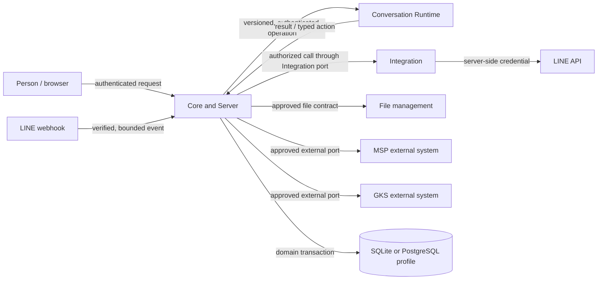

# Architecture

This is the normative ownership and trust-boundary baseline. It specifies which
component may authorize, persist, execute and call external systems. It does
not require the current implementation to be complete. The accepted decisions
and service documents linked here govern any more detailed protocol choice.

## Component boundaries

| Component | Owns | Must not own |
|---|---|---|
| Core and Server | Viewer resolution; identity and resource scope; durable admission, authorization, domain transactions, work ownership/fencing, audit and recovery | Hidden authority delegated to a client, Runtime or external service; speculative cross-domain writes |
| Business domains | Their declared business state, transitions and contract behavior, as listed by the current charters and schema | Another domain's tables or an undeclared universal registry |
| LINE OA Studio | Account, design, dispatch and other Studio state that its accepted contracts assign to it | LINE channel secret, direct provider transport, webhook ownership, Core admission, Edge device authorization |
| Integration | LINE connection/credential metadata, secret resolution, provider transport and external integration receipts | Product scope, Core viewer authorization, an alternate conversation owner |
| Conversation Runtime | The versioned conversation-computation contract selected by ADR-106 | Core identity, authorization, admission, direct Prisma/table access, durable domain state, reusable LINE credentials, ownership fencing |
| File management | File identity and bytes through its accepted file contract | Caller-provided arbitrary path or storage authority |
| MSP and GKS | Their own external system data and behavior behind their approved ports | A hidden Zuri-owned persistence dependency or a new in-product substitute |

Domain ownership is logical ownership. A single server database does not mean
one domain may write another's models. Separate service deployment does not
create a second source of truth.

## Trust and execution flow

1. A browser request is authenticated and its viewer and resource scope are
   resolved by Core. The client cannot widen Tenant, Business, account or
   Project scope by supplying another identifier or role.
2. LINE ingress is handled on the Server. Core applies the accepted webhook,
   identity, consent and admission contracts before any answer work is accepted.
   An HTTP success acknowledgement follows the durable capture/handoff required
   by ADR-106; process memory is not accepted-event state.
3. Core owns the durable LINE admission and job state, dispatching eligible
   conversation work through the authenticated, versioned Runtime contract.
   Core retains ownership fencing and recovery authority. Runtime health alone
   never grants ownership or permission to send.
4. Runtime returns results to Core. Any proposed domain mutation or external
   side effect is authorized and persisted by the owning Core/domain contract.
   Runtime does not update tables or send directly to LINE.
5. When a current contract calls LINE, Integration resolves the configured
   opaque secret reference and invokes the provider port server-side. Studio,
   Runtime and the browser receive neither a reusable channel credential nor
   authority to choose an arbitrary provider URL.
6. Core and the owning domain record the durable outcome and appropriate audit,
   job, trace or provider receipt under their respective contracts. A timeout
   with unknown external effect remains unknown until reconciled; no blind retry
   may turn an uncertain send into a duplicate.

The exact operation versions, statuses and idempotency keys come from accepted
canonical and machine-readable source contracts. This chapter does not invent
a replacement queue protocol or imply that all generated API inventory entries
have complete request/response schemas.

## Transactions and durable state

Every accepted user or external action is scoped and validated before its
mutation. Multi-record operations that are required to succeed as one business
outcome, including accepted plan import and durable LINE admission, commit through
the owning server transaction contract. Rejection leaves no partial business
mutation. Audit and idempotency behavior follow the source contract for that
operation; an audit record is not replaced by a task log or runtime trace.

Studio API and worker instances are disposable. Durable business and work state
lives in Core-owned persistence; process memory may cache data only where losing
the cache cannot change authorization, selection, ownership, delivery or
recovery. Restart, timeout, and replacement preserve accepted work and truthful
outcomes. An `UNKNOWN` external result is surfaced for reconciliation, not
reported as successful or retried without the owning idempotency/recovery rule.

For schedules that an accepted behavior selects, Studio owns the declared
schedule state; it is durable, uses the owning lease/idempotency discipline and
survives worker replacement. A process-local timer can only be a wake-up hint
(ADR-105 D2/D3). This invariant does not select the concrete proposed
`LineOaSchedule` model, scheduled-dispatch behavior or timed flow-WAIT design in
proposed ADR-060 and the historical LINE SRS clauses. No replacement timer or
generic transport-job contract is implied.

The persistence profiles are:

| Profile | Persistence | Contract |
|---|---|---|
| Local/offline | SQLite through the Server repository boundary | Local operation does not imply network sync, an outbox, or later automatic reconciliation with hosted data. |
| Hosted | PostgreSQL for the Server/Core deployment | Production persistence uses the accepted Server boundary and authorization; it is not a per-domain database split. |

The same logical domain contract should be preserved across profiles where the
accepted schema and application behavior require it. A conversion, network sync,
dual-write or automatic cutover is a separate behavior and is not authorized by
the existence of both profiles.

ADR-025 D8 adopted domain taxonomy and ownership principles only. The candidate
modular-monolith target does not authorize `crm.*`/`sales.*` PostgreSQL schemas,
a generic per-domain outbox, a new database/service split, or code-level module
contracts. The exact current physical schema is in
[`apps/server/prisma/schema.prisma`](../../../apps/server/prisma/schema.prisma).

## External ports

| Port | Boundary behavior |
|---|---|
| LINE Messaging API | Integration is the server-side provider owner. Use the selected configured connection, accepted rate/receipt/consent controls and redaction contract. No Edge relay or client-provided transport URL. |
| File management | Use the approved file-service contract for metadata, authorization and bytes. A local absolute path, object URL or signed URL does not become a portable product identity. |
| MSP | Treat MSP as an external memory-system authority. Use only the accepted port and its declared data/consent behavior; do not implement its persistence inside Runtime or silently mirror its records. |
| GKS | Treat GKS as an external governed-knowledge authority. Use only the accepted port, source/lineage and promotion contract; do not create a substitute graph or imply local data is canonical GKS state. |
| Model provider | Server/Core selects the configured provider according to the applicable accepted contract. Secrets are resolved server-side. The browser and Runtime cannot widen scope or set an arbitrary provider endpoint. |

An external port is an explicit dependency boundary. It does not authorize a new
product feature, credential family, service, copy of external data, activation,
or production claim.

## Current source references

- [ADR-018](../../decisions/ADR-018-SUPABASE-PRODUCTION-TENANT-ISOLATION.md): persistence
  profiles and repository boundary.
- [ADR-025](../../decisions/ADR-025-DOMAIN-DRIVEN-DOCS-ARCHITECTURE.md): domain
  taxonomy and logical ownership; D8 explicitly withholds runtime/database
  decisions.
- [ADR-045](../../decisions/ADR-045-CANONICAL-IDENTITY-AND-ACCESS-MANAGEMENT.md): domain
  ownership contracts.
- [ADR-100](../../decisions/ADR-100-LINE-OA-RUNS-SERVER-EXECUTED-ON-BROWSER-PROVISIONED-API-KEYS.md):
  server-side LINE execution and provider selection.
- [ADR-105](../../decisions/ADR-105-LINE-OA-STUDIO-STATELESS-APPLICATION-TIER.md):
  disposable Studio processes over durable domain state.
- [ADR-106](../../decisions/ADR-106-CONVERSATION-RUNTIME-SERVICE-EXTRACTION.md):
  Core/Runtime ownership and versioned service boundary.
- [ADR-110](../../decisions/ADR-110-RETIRE-EDGE-DEVICE-AND-HARNESS-SURFACES.md):
  Edge and harness product-surface retirement; stored data/schema preservation.
- [Service index](../../services/README.md): service execution and contract
  documents.
