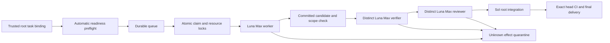

# Repository-local delivery controller

The local controller implements the active v4 procedure as repository tooling.
It is separate from Business execution, product approval tiers and the read-only
Mission Control/PORL projection. It does not activate a provider or create a
production deployment. Its dashboard is a separate loopback-only local tool.

## Execution DAG



Independent tasks can run concurrently when their accepted dependencies and
write sets permit it. The controller never infers independence from a roadmap
wave alone. Locks remain held until integration or an explicit safe disposition.
Local claims fence ledger transitions; they cannot revoke filesystem access
from an already running process. An expired or uncertain dispatch must remain
quarantined until its process is stopped and its effects are reconciled. Never
start a successor in the same checkout merely because a lease expired.

## Storage and restart boundary

Use one designated host and local filesystem. State belongs under the Git
common directory's `zuri-delivery-control/` tree, shared by this repository's
linked worktrees. It is private, outside source control and separate from the
application database. SQLite is not multi-host consensus; do not put its WAL on
a network filesystem or copy it into ephemeral Next containers.

Stop the controller before taking a consistent backup of its complete state
directory. Preserve database, WAL/SHM if present, event history, dispatch logs,
process receipts and trusted task configuration together. A recorded PID is a
diagnostic hint, not proof of process identity or permission to kill a process;
reconciliation must check the actual process start identity and command before
acting. Restore only with all
prior processes stopped. Never restore an older snapshot while old workers can
still write. Restart reconciles unfinished dispatches rather than replaying
them blindly. A lost CLI response is not proof of no effect.

## Local backend

The supported backend invokes installed Codex CLI using argument arrays and
stdin, with no shell interpolation. Each role gets a fresh session, the explicit
`gpt-6-luna` model and `max` effort. Worker uses `workspace-write`; verification
and review use `read-only`. The worker edits source and runs checks; after it
exits the trusted local root runner checks scope, stages exact changed paths and
creates the candidate commit. Its private receipt binds the worker result digest
to that new commit. No Git-metadata sandbox exception is given to the worker.
The CLI's normal rules remain in force. Automatic
model fallback, bypassing sandbox/approval review, pushing, merging, deployment
and credential changes are not delegated to a worker.

The child environment retains only OS/runtime paths and Codex auth-location
settings. Database, provider and deployment environment secrets are stripped.
This does not make the local account or checkout a secret-free security sandbox:
use a development host and never place production credentials in task worktrees.
Codex reuses its existing local sign-in; the controller does not copy auth files.

Structured results alone are not proof. The controller binds actual session
identity and checks Git candidate state, scope and exact head. Private stdout,
stderr, result and process identity receipts support diagnosis. Output and time
are bounded; timeout or uncertain transport cannot count as a pass. No automatic
retry occurs while effects are unknown. v4 repair and cumulative no-progress
limits remain authoritative and a metadata repair never resets implementation
history.

Pre-claim failures are suppressed until task, Git state or declared executable
capability changes. A trusted local runner also exposes an explicit `wake(taskId)`
for new external evidence. Restarting the daemon reevaluates readiness, but never
clears the durable implementation/no-progress history or quarantined effects.

## Commands

Run with Node 24 on the designated host. The private JSON configuration names
`repoRoot`, absolute `codexExecutable`, `maxConcurrent` (1 or 2), optional
`dashboardPort` (default 4190), and `tasks`. Each task binding names `taskId`,
absolute `worktree`, absolute `taskFile`, optional `base`, and the root's
`trustedMandateBinding`:

```json
{
  "resolvedBy": "root",
  "taskId": "EXAMPLE-TASK",
  "repositoryRoot": "absolute repository root",
  "objective": "same objective as task-readiness record",
  "writeScope": ["exact authorized paths"],
  "sourceRef": "trusted current user instruction",
  "authorizedEffects": ["local repository implementation and checks"],
  "prohibitions": ["production", "Supabase", "grants", "credentials"]
}
```

The trusted root creates this binding from the real instruction. A self-authored
JSON object or a copied mandate pointer cannot create authority. Private config
intake is CLI-only; web pages and repository documents cannot enqueue commands.

```text
node tools/delivery-control/controller-cli.mjs admit <private-config.json>
node tools/delivery-control/controller-cli.mjs status <private-config.json>
node tools/delivery-control/controller-cli.mjs run <private-config.json>
node tools/delivery-control/controller-cli.mjs serve <private-config.json>
```

`admit` validates and durably queues the explicit trusted bindings. `run` drains
currently eligible bound tasks. `serve` keeps polling and exposes the read-only
dashboard at `http://127.0.0.1:4190/`. On Windows launch a background instance with
`Start-Process -WindowStyle Hidden`, private stdout/stderr receipts and an
explicit working directory. Keep its PID so only that instance is stopped.

The dashboard exposes task/stage codes and attempts only. It rejects cross-site
requests and DNS rebinding Hosts, has no mutation endpoint and cannot authorize
merge or deployment. It is not `/control/roadmap` and does not expand product
Operator or Business permissions. Root delivery still requires independent
acceptance, review and applicable exact-head CI; a green local stage is not
`MERGED` or production readiness.
