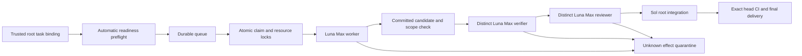

# Repository-local delivery controller

The local controller implements the active v4 procedure as repository tooling.
It is separate from Business execution, product approval tiers and the read-only
Mission Control/PORL projection. It does not activate a provider or create a
production deployment. Its dashboard is a separate loopback-only local tool.

## Execution DAG



Independent tasks can run concurrently when their accepted dependencies and
write sets permit it. The controller never infers independence from a roadmap
wave alone. Locks remain held until integration or an explicit safe disposition.
Each task uses a distinct canonical checkout. The runner rejects duplicate
worktree bindings and the durable store holds checkout locks alongside path
locks. Root disposition cannot release these while a lease is active or any
effect remains unresolved, even when the execution cycle has expired.
Local claims fence ledger transitions; they cannot revoke filesystem access
from an already running process. An expired or uncertain dispatch must remain
quarantined until its process is stopped and its effects are reconciled. Never
start a successor in the same checkout merely because a lease expired.

## Storage and restart boundary

Use one designated host and local filesystem. State belongs under the Git
common directory's `zuri-delivery-control/` tree, shared by this repository's
linked worktrees. It is private, outside source control and separate from the
application database. SQLite is not multi-host consensus; do not put its WAL on
a network filesystem or copy it into ephemeral Next containers.

Stop the controller before taking a consistent backup of its complete state
directory. Preserve database, WAL/SHM if present, event history, dispatch logs,
process receipts and trusted task configuration together. A recorded PID is a
diagnostic hint, not proof of process identity or permission to kill a process;
reconciliation must check the actual process start identity and command before
acting. Restore only with all
prior processes stopped. Never restore an older snapshot while old workers can
still write. Restart reconciles unfinished dispatches rather than replaying
them blindly. A lost CLI response is not proof of no effect.

Reconciliation is a trusted-root operation. Its evidence must include
`sourceRef`, `finding`, `observedAt` and
`process: {operationId, status, identityRef, checkedAt}`. Process status must be
`STOPPED` or `NOT_STARTED`; identityRef points to read-only evidence checking
actual process start identity/command and relevant descendants. The API checks
the attestation shape and operation binding; root is accountable for its truth.
A clean Git tree alone does not prove an orphaned process is stopped. Resolving
effects never resets a deadline or authorizes retry in an inactive cycle.

## Local backend

The supported backend invokes installed Codex CLI using argument arrays and
stdin, with no shell interpolation. Each role gets a fresh session, the explicit
`gpt-6-luna` model and `max` effort. Worker uses `workspace-write`; verification
and review use `read-only`. The worker edits source and runs checks; after it
exits the trusted local root runner checks scope, stages exact changed paths and
creates the candidate commit. Its private receipt binds the worker result digest
to that new commit. No Git-metadata sandbox exception is given to the worker.
The CLI's normal rules remain in force. Automatic
model fallback, bypassing sandbox/approval review, pushing, merging, deployment
and credential changes are not delegated to a worker.

The child environment retains only OS/runtime paths and Codex auth-location
settings. Database, provider and deployment environment secrets are stripped.
This does not make the local account or checkout a secret-free security sandbox:
use a development host and never place production credentials in task worktrees.
Codex reuses its existing local sign-in; the controller does not copy auth files.

Structured results alone are not proof. The controller binds actual session
identity and checks Git candidate state, scope and exact head. Private stdout,
stderr, result and process identity receipts support diagnosis. Output and time
are bounded; timeout or uncertain transport cannot count as a pass. No automatic
retry occurs while effects are unknown. v4 repair and cumulative no-progress
limits remain authoritative and a metadata repair never resets implementation
history.

Pre-claim failures are suppressed until task, Git state or declared executable
capability changes. A trusted local runner also exposes an explicit `wake(taskId)`
for new external evidence. Restarting the daemon reevaluates readiness, but never
clears the durable implementation/no-progress history or quarantined effects.

## Commands

Run with Node 24 on the designated host. The private JSON configuration names
`repoRoot`, absolute `codexExecutable`, `maxConcurrent` (1 or 2), optional
`dashboardPort` (default 4190), and `tasks`. Each task binding names `taskId`,
absolute `worktree`, absolute `taskFile`, optional `base`, and the root's
`trustedMandateBinding`:

```json
{
  "resolvedBy": "root",
  "taskId": "EXAMPLE-TASK",
  "repositoryRoot": "absolute repository root",
  "objective": "same objective as task-readiness record",
  "writeScope": ["exact authorized paths"],
  "sourceRef": "trusted current user instruction",
  "authorizedEffects": ["local repository implementation and checks"],
  "prohibitions": ["production", "Supabase", "grants", "credentials"]
}
```

The trusted root creates this binding from the real instruction. A self-authored
JSON object or a copied mandate pointer cannot create authority. Private config
intake is CLI-only; web pages and repository documents cannot enqueue commands.

```text
node tools/delivery-control/controller-cli.mjs admit <private-config.json>
node tools/delivery-control/controller-cli.mjs status <private-config.json>
node tools/delivery-control/controller-cli.mjs run <private-config.json>
node tools/delivery-control/controller-cli.mjs serve <private-config.json>
```

`admit` validates and durably queues the explicit trusted bindings. `run` drains
currently eligible bound tasks. `serve` keeps polling and exposes the read-only
dashboard at `http://127.0.0.1:4190/`. On Windows launch a background instance with
`Start-Process -WindowStyle Hidden`, private stdout/stderr receipts and an
explicit working directory. Keep its PID so only that instance is stopped.

Dependency-blocked tasks are persisted without starting an execution cycle.
The runner reevaluates bound intake when accepted base/dependency evidence
changes; no repeated manual admission is needed. It does not fetch, merge or
rebase implicitly. Root first integrates the accepted dependency and updates
the task checkout to a compatible baseline. Intake errors affect their task;
repeated unchanged observations are suppressed.

The dashboard exposes task/stage codes and attempts only. It rejects cross-site
requests and DNS rebinding Hosts, has no mutation endpoint and cannot authorize
merge or deployment. It is not `/control/roadmap` and does not expand product
Operator or Business permissions. Root delivery still requires independent
acceptance, review and applicable exact-head CI; a green local stage is not
`MERGED` or production readiness.

### Local Workers projection for `/control/roadmap`

In `serve` mode, the host controller also publishes the sanitized
`worker-observability/v1` projection to
`apps/server/.worker-observability.local/worker-observability.json` by default.
The file is replaced atomically every two seconds (the configured interval is
capped at five seconds). If the controller, ledger, receipts, or verified source
is unavailable, the export contains an `UNKNOWN` projection. The publisher stops
when the controller exits.

The web process reads only `ZURI_WORKER_OBSERVABILITY_FILE`, which the local-only
overlay sets to `/run/zuri/worker-observability/worker-observability.json`. It
validates the projection and its timestamp, returns `UNKNOWN` when the file is
absent, invalid, future-dated, or older than 15 seconds, and applies the API's
`since` filter to events after authentication and operator authorization. The
source is never opened by the container.

Use the local overlay with the app's existing Compose project directory:

```text
docker compose --project-directory apps/server -f apps/server/docker-compose.yml -f apps/server/docker-compose.worker-observability.yml config
```

The overlay mounts only `apps/server/.worker-observability.local` into `web`,
read-only. That directory is ignored by Git and excluded from the app build
context. The base Compose file remains unchanged and does not mount `.git`, the
controller database, or private supervisor state.

## Autonomous root supervisor

`npm run delivery:autonomous -- serve <private-campaign.json>` joins trusted
roadmap intake, parallel role execution, root integration and GitHub delivery.
`run` uses the same loop and exits when every allowed task has a verified merged
receipt, or yields a resumable no-ready/reassessment result instead of polling
forever before any worker starts. This is repository delivery automation, not Business-runtime approval
or production deployment. Sol root owns the campaign and exception decisions;
the private supervisor implements its preauthorized mechanical transitions.
Workers cannot create campaigns, grant themselves scope, or invoke GitHub tools.

The root installs two JSON files inside the Git common directory's
`zuri-delivery-control/campaigns/` directory. File provenance is a local trust
boundary, not a cryptographic signature. The supervisor pins both files' content
digests, requires the canonical repository and matching prohibitions, and pauses
for reassessment if the campaign changes. Model worktrees cannot write Git
metadata; do not place these files in tracked source or expose a web enqueue API.

The intake campaign uses `roadmap-intake-campaign/v1`, `campaignId`,
`repositoryRoot`, `baseRef`, `objective`, `sourceRef`, `authorizedEffects`,
`prohibitions`, `allowedTaskIds` and `taskPlans`. Each task plan supplies explicit
`objective`, `acceptance`, `writeScope`, structured `checks` and
`mandateReference`. Canonical task criteria must be included. Roadmap prose
cannot supply commands, expand scope or grant authority. Intake reads the
canonical ledger and programme at the resolved Git base, selects ready tasks by
priority then ID, creates a deterministic worktree once, and persists the binding.
The supervisor excludes already bound tasks so another independent task can start.
Missing plans, ambiguous criteria, dependency evidence, path conflicts and
interrupted worktree creation produce typed holds, without resetting old history.

The supervisor campaign has this shape (paths are examples, not authority):

```json
{
  "schemaVersion": "autonomous-delivery-campaign/v1",
  "campaignId": "roadmap-batch-01",
  "repositoryRoot": "absolute canonical checkout",
  "sourceRef": "actual trusted user delegation",
  "authorizedEffects": ["intake", "dispatch", "rootIntegration", "push", "pullRequest", "merge"],
  "prohibitions": ["production", "Supabase", "providers", "grants", "credentials"],
  "intakeCampaignFile": "absolute private intake campaign JSON",
  "codexExecutable": "absolute installed Codex executable",
  "windowsSandbox": "unelevated",
  "maxConcurrent": 2,
  "maxCampaignMinutes": 120,
  "pollIntervalMs": 30000,
  "dashboardPort": 4190,
  "delivery": {
    "remoteName": "origin",
    "expectedOwnerRepo": "github.com/OWNER/REPO",
    "base": "main",
    "requiredChecks": ["actual required check names"],
    "notApplicableChecks": ["explicitly inapplicable optional check names"]
  }
}
```

Select the host's authorized Windows implementation explicitly (`mxc`, `elevated`
or `unelevated`); there is no automatic downgrade. The backend intentionally
ignores user config to avoid inheriting unrelated providers and full-access
settings. On Windows that also drops the implementation selection: a requested
`workspace-write` can resolve to read-only without it. Missing selection now fails
before dispatch. The local development host already used `unelevated`; explicitly
passing that value restores its existing restricted-token implementation while
preserving `workspace-write` for workers, `read-only` for gates, `never` approvals,
and normal rules. It does not change system/user settings, trust, network grants,
or bypass protections. Other hosts must select their own permitted implementation.

The supervisor stores bindings, deadlines, delivery checkpoints and events under
`zuri-delivery-control/supervisors/<campaignId>/`. One root process owns a campaign;
a live owner blocks another process. Reclaiming a dead root service lock never
releases controller task locks or reconciles an orphaned worker. The campaign's
maximum 120-minute deadline is anchored once to the earliest actual worker
dispatch among bound tasks. Its original `deadlineAt` remains immutable through
successor cycles and service restarts; an exhausted predecessor is still part of
the campaign's deadline history. An expired campaign cannot admit or dispatch a
successor cycle. Separately, the controller's 120-minute execution deadline
starts at each cycle's first worker dispatch, so a successor has its own
per-cycle controller cap within the immutable campaign-wide upper bound.
On every tick and restart the supervisor reconciles the checkpoint against the
earliest `occurredAt` of a verified `BACKEND_DISPATCH_INTENT` event whose role
is `worker`, plus the pinned campaign duration. The controller verifies the
complete event hash chain and exposes a read-only inspection for every bound
task and configured successor admission. Each cycle's safe nonnegative
submission count must equal its worker-intent event count. A positive count
requires `startedAt`, and a start time requires a positive count; the timestamp
must be canonical and no later than the first worker intent, allowing the
small skew from the controller's separate clock reads. Reset or inconsistent
projections fail closed even while dispatch events remain. A stored non-null
deadline without a verified worker-intent anchor also fails closed. A valid
earlier checkpoint deadline remains an additional bound; a malformed or later
checkpoint value can never extend the source-derived bound.
The controller durably pins that effective value in the append-only, hash-chained
`CAMPAIGN_DEADLINE_BOUND_PINNED` event, keyed by the stable campaign ID. Each pin
also records the pinned duration and cumulative task IDs. Reconciliation unions
newly configured tasks with IDs from prior pins, rejects a duration change, and
only keeps or tightens the effective deadline as earlier verified dispatch
evidence is discovered. Once pinned, editing a checkpoint to a later timestamp
that is still before the source deadline cannot extend the campaign bound,
including after a supervisor restart. Successor admission repeats this pin and
source reconciliation inside its transaction before repairing locks or writing
cycle state. A task ID pinned under one campaign ID cannot be reassigned to a
different campaign ID; overlapping campaign pins fail closed before writes.
Every bound run must also exist and expose a safe positive current cycle number
with a complete, contiguous cycle history from 1 through that number. Missing,
duplicate, or gapped cycle rows fail closed before the supervisor derives a
deadline, so a later surviving cycle cannot conceal the earliest dispatch
anchor.
Unchanged intake exceptions are held while independent bound tasks continue.
Controller caps and cumulative no-progress history remain intact.

The supervisor passes the campaign deadline guard into the local runner. The
runner rechecks it after preflight and immediately before claiming, then again
after claiming (releasing the unused lease if the campaign has expired). It
checks once more after recording dispatch intent and directly before calling
the backend. If expiry occurs in that final gap, the controller appends a
`BACKEND_DISPATCH_CANCELLED_BEFORE_LAUNCH` event, marks the effect `NONE`, and
pauses the run and cycle. The dispatch-attempt and submission counters already
recorded with the intent remain intact, and no backend handle or unknown-effect
record is created. Cancellation may proceed after lease expiry only while the
same owner and fencing epoch still hold the `RUNNING` row, the exact dispatch
intent matches, and no backend session, reference, or effect evidence exists.
If recovery or reclaim changes the row first, the stale owner cannot cancel it.

### Root-admitted successor cycles

The supervisor accepts a continuation only through a root-owned, digest-pinned
record referenced by the private campaign's optional `cycleAdmissions` array:

```json
{
  "taskId": "TASK-ID",
  "recordFile": "absolute private cycle-admission JSON path",
  "admissionRecordDigest": "sha256 of exact record bytes"
}
```

The file uses schema `root-execution-cycle-admission/v1` and binds a unique
`admissionId`, stable `taskId`, `priorCycleNo` and `priorCycleState`, exact
`taskRecordDigest` and private `taskFile`, nonempty `reason` and `evidenceRef`,
`materialChange: true`, and a supported `basis` (`MATERIAL_NEW_EVIDENCE` or
`CORRECTED_IMPLEMENTATION_PLAN`). The campaign reference must name an allowed
task and the record and task file must resolve under the repository's private
`zuri-delivery-control` directory. Raw-byte digests pin both records. The
supervisor requires each configured admission to resolve to its matching
controller run before it starts intake or dispatch. A missing or unreadable run
produces `HOLD_CYCLE_ADMISSION` and keeps the task held; once the matching run
exists, a later tick can reassess the admission. The controller also requires a
fresh matching READY read-only preflight, exact
current worktree/base evidence, complete prior cycle history, a matching
paused or exhausted cycle and resumable controller run state, no active leases
or unknown effects, and the original semantic-domain and write-scope locks.
Inside the admission transaction it re-verifies the complete event chain and
the same worker-intent/projection evidence for the supplied campaign task set
before repairing locks or writing a successor cycle. The supplied deadline
source must equal the earliest verified worker intent plus the pinned campaign
duration. The checkpoint's effective deadline is supplied separately as an
additional bound; it must match the durable pin, and the transaction enforces
the immutable minimum. A configured task omission cannot discard anchors from
prior pins, and a later checkpoint value cannot replace an earlier pin.
After the awaited preflight, the supervisor re-resolves the private task path and
reads the bytes again. Both the resolved path and exact-byte digest must still
match the immutable admission record before the controller can create a cycle.
The preflight itself uses the controller-pinned, resolved worktree root. After
it returns, the supervisor resolves the binding and controller worktree again
and requires the worktree root, canonical repository root, and Git common
directory to match the captured identity. A path retarget during preflight
leaves the predecessor unchanged and held.
An unchanged admission hold is suppressed using a signature that includes the
current task-file digest and PATH/PATHEXT executable candidates with their
missing/present metadata. The read-only controller lock snapshot also includes
all current conflicting worktree, overlapping write-scope, and semantic-domain
locks. Durable SQLite triggers advance a monotonic resource-lock epoch on every
insert, update, or delete in either lock table. A known conflict prevents
preflight and remains suppressed while its snapshot is unchanged; release
changes the signature. The epoch also detects a conflict acquired and released
while preflight was awaited, and the controller checks the captured epoch again
inside the admission transaction. A changed task file or executable capability
permits a fresh preflight; it never clears prior counters or cumulative
no-progress.
The controller transaction also receives the supervisor's immutable campaign
`deadlineAt` and rechecks it after Git/base validation, immediately before cycle
writes. Missing deadline evidence is refused once worker-dispatch history has
anchored the campaign. The controller validates complete, contiguous cycle
history and every cycle's safe submission count against its `startedAt` before
admission or lock repair; incomplete, inconsistent, or malformed dispatch
history rejects admission without ledger writes. `null`
remains valid before any bound task has dispatched.
Expiry leaves the run, cycle ledger, and event history unchanged.

Admission is recorded on the new cycle and in the controller event history.
Replaying the same admission after supervisor checkpoint loss returns that
already-admitted cycle only when the complete lineage and evidence match; an
identifier reused for different evidence or a superseded cycle is rejected.
The supervisor wakes the matching admitted cycle once per process instance, so
later checkpoint ticks do not clear the runner's repeated-failure suppression;
a restarted process performs one fresh wake for that same cycle.
Previous cycle counters, delivery history, and cumulative no-progress history
remain available. Earlier delivery receipts are retained as invalidated history;
they do not authorize delivery of the successor. Invalid or stale admission
records leave the task held without dispatch.

Only exact `ROOT_DELIVERY_READY` candidates can be root-integrated. The GitHub
adapter verifies durable role history and the unchanged clean snapshot, validates
the repository/remote/ref, then publishes using argument-array Git/gh calls. Each
mutation has a durable intent and bounded reconciliation; lost responses do not
trigger blind repeats. It discovers an existing PR, checks GitHub's exact head and
required checks plus all applicable checks, and uses a matching-head merge guard.
Skipped checks count only as explicitly inapplicable optional checks. Direct
merge also requires authenticated proof of strict up-to-date required checks
and administrator enforcement on the target branch; a local head check alone
does not eliminate a concurrent base-update race. A moving base yields
`BASE_ADVANCED` with the actual SHA and pauses that revision for autonomous root
replanning; unchanged revisions are not hot-polled. It never silently reuses
old evidence or force-pushes a rebase. A known merged PR is
reconciled before recording `MERGED`. No model session receives these credentials.

`ROOT_REPLAN_PAUSED` is a supervisor delivery checkpoint stored with the
supervisor's delivery state; it is not itself a `delivery_runs.state`. The
bounded bridge below records the exact checkpoint as a material-evidence
`YIELD_REASSESS` and moves the matching integrated cycle to
`BLOCKED_STALE_CANDIDATE`. Other stale checkout cases remain
`BLOCKED_STALE_CANDIDATE` or `BLOCKED_STALE_BASELINE` as appropriate.

## Autonomous Sol root continuation

Run a root continuation through the Codex app's thread heartbeat when work must
continue after the interactive turn. Root is an AI role, not a human approval
step. Its trusted prompt includes the repository, existing mandate, task
lineage/caps, independent gates and prohibitions. It checks only on its bounded
schedule, stays quiet on unchanged/non-actionable state, and notifies on real
progress, completion or an external blocker. Do not replace this with a web
endpoint that executes roadmap text. A paused service revision is visible work
for this autonomous root; it is not a request to repeat a human G0 approval.

Root reconciles each accepted merge into the canonical roadmap and generated
projections through a separately checked branch/PR. Partial runtime goals remain
explicit; a merged implementation alone cannot check a broader DoD. After
accepted canonical closeout, root fetches the verified remote tracking base.
An intake `baseRef` such as `origin/main` then resolves the newer canonical commit
without changing the campaign's task allowlist, scope, criteria or permissions.
Already bound tasks keep their exact base and history until root revalidation.

For a later parallel candidate whose base advanced, the supervisor keeps the
task held and binds the work to the exact `ROOT_REPLAN_PAUSED` checkpoint:
`taskId`, old base, candidate head, and observed remote SHA must match the
controller's `ROOT_INTEGRATED_PENDING_CI` run and current `INTEGRATED` cycle.
The root verifies the same repository, branch, clean exact candidate, three
passed role records, no active leases, no unknown effect rows or nodes, and no
active runner process. It fetches the configured delivery base, then requires a
fresh `git ls-remote` SHA to equal the fetched SHA. The old base and checkpoint
base must both be ancestors of that fetched commit.

Before any merge, a narrow controller transaction records
`YIELD_REASSESS` with basis `MATERIAL_NEW_EVIDENCE`, preserves the task and
cycle, and reacquires its write-scope locks. It accepts only the exact
`ROOT_REPLAN_PAUSED` checkpoint on the `ROOT_INTEGRATED_PENDING_CI` run and
current cycle. The runner remains held throughout, so no worker-ready node is
exposed. The root then records a private durable merge intent and performs only
an ordinary `git merge --no-edit --no-ff` of the confirmed base. It aborts only
when that invocation returns a proven conflict, `MERGE_HEAD` names the intended
base, unmerged paths exist, and abort restores the exact old clean head. It
never resets, rebases, or force-pushes this candidate.

Fetch intent/results, the material-evidence disposition, merge intent, and
reconciliation are immutable files under the private supervisor state. A
restart may finish receipt creation only when the journal, paused controller
run, exact task/cycle/checkpoint, clean merge result, two exact merge parents,
and fresh remote SHA all agree. An intent without a conclusive result, an
uncertain merge, a moved remote, or any unknown effect stays held; the recorded
step prevents a retrying merge. A conflict with unchanged evidence is also
held across ticks and restarts. A root reassessment may revisit a proven
no-effect outcome, but it cannot override an unknown intent.

The immutable `root-base-prepared-candidate/v1` receipt binds the same task and
cycle, old/new base, old candidate, resulting merge head, reason, and private
reconciliation reference. The supervisor performs a fresh read-only preflight,
fetches and compares the configured base again, and repeats the remote SHA check
immediately before `resumeTask`. If those checks fail, the controller remains
paused and the runner remains held. `resumeTask` repeats receipt checks inside
its SQLite transaction: the real path must remain under the private control
root, task and cycle and retained old commits must match, preflight must bind
the receipt's new base and actual resulting HEAD, and candidate/base ancestry,
branch, and write scope must pass. The receipt digest and commit bindings become
durable `TASK_RESUMED` evidence before the run is made `WORKER_READY`. The
runner rechecks that exact digest before authorizing the prepared candidate.

The supervisor invalidates prior delivery, role, and CI evidence, then restarts
Worker, Verify, and Review under the same task and cycle. Counters and the
original cycle deadline remain intact; old CI and role passes do not carry
forward. Unchanged blocked evidence is suppressed across ticks and restarts.
Root may request a specific recheck through
`reassessBaseAdvancedResume({ taskId, evidenceRef, reason })`; this does not
clear an unknown fetch or merge intent.

### Newly admitted cycle with no controller run

The controller-backed continuation above requires a live task-bound controller
run and checkpoint. If a paused cycle has no such run, root cannot manufacture
one or route that old cycle through `resumeTask`. A separately admitted new
cycle may instead use the root-only base preparation path, and only when its
immutable admission record documents the prior pause and exhausted repair cap,
zero controller runs and cycles, no publication or submission, and no unknown effects. The
record and readiness task are read from their canonical private paths and must
match the admitted task, dynamically bound cycle, revision, and SHA-256
bindings. The prior cycle's exhausted repair cap, deadline, and cumulative
no-progress count remain as recorded; the new cycle uses only its separately
admitted caps.

Before fetch, the root-only path records immutable operation intent under the
private task state. It confirms the current branch, worktree, clean exact
candidate head, absence of an in-progress Git operation, and absence of active
workers or unknown effects. It fetches the configured `origin/main`, then
independently reads the live remote ref and requires that SHA to match the
freshly fetched commit. The admitted old base and candidate must still match,
and the admitted material movement must be an ancestor of the fetched commit.
The path performs only an ordinary `git merge --no-edit --no-ff`; it then
checks the exact first and second parents, clean resulting tree, and that the
live remote SHA still equals the merged base.

The root-only receipt binds the new task and cycle, admission and readiness
hashes, prior-cycle history, cycle caps, and resulting commit. It explicitly
records that no controller run was created, no prior cycle was resumed, and no
Worker, Verify, or Review role was dispatched. The receipt prepares the
candidate for a fresh admitted cycle's normal Worker/Verify/Review flow; it is
not proof that a controller or any role has run. Missing or changed admission,
worktree or remote movement, dirty/diverged candidate, conflict, unknown
operation result, or corrupt receipt produces a typed hold. An uncertain or
conflicted operation cannot be retried against unchanged evidence. Hold files
are content-addressed: replay with the same evidence returns the original typed
hold without rewriting it or repeating merge. Changed evidence creates its own
content-bound hold and remains held until trusted reassessment; it cannot clear
an unknown effect or authorize a retry by itself. This path does not alter or
reset the controller-backed `ROOT_REPLAN_PAUSED` flow above.

When the worker needs no source repair on the updated base, root may install
`supervisors/<campaignId>/prepared/<taskId>.json` in the private control directory:
`schemaVersion: root-base-prepared-candidate/v1`, `taskId`, `oldHeadCommit`,
`headCommit`, `oldBaseCommit`, `newBaseCommit`, `reason`, and `evidenceRef`.
The runner validates the private path, actual current head, changed base and
ancestry preserving both old candidate and new base. Only this root preparation
allows a validation-only empty commit after a fresh worker PASS. Normal no-change
worker output remains refused. The commit receipt binds the preparation digest;
it consumes a normal worker submission and still requires new independent gates
and hosted CI. A newer verified revision may update its private branch only by
ordinary fast-forward push; old receipts remain available for reconciliation.

Unattended execution is bounded to the trusted campaign's adopted task contracts.
It does not invent business policy, equate a partial feature with its broader DoD,
apply production migrations, deploy, or self-authorize a successor cycle. A real
scope/authority/unknown-effect block remains visible for autonomous root
reassessment; routine transitions do not require another human G0 approval.
