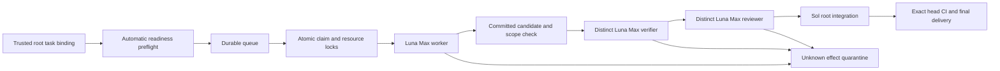

# Repository-local delivery controller

The local controller implements the active v4 procedure as repository tooling.
It is separate from Business execution, product approval tiers and the read-only
Mission Control/PORL projection. It does not activate a provider or create a
production deployment. Its dashboard is a separate loopback-only local tool.

## Execution DAG



Independent tasks can run concurrently when their accepted dependencies and
write sets permit it. The controller never infers independence from a roadmap
wave alone. Locks remain held until integration or an explicit safe disposition.
Each task uses a distinct canonical checkout. The runner rejects duplicate
worktree bindings and the durable store holds checkout locks alongside path
locks. Root disposition cannot release these while a lease is active or any
effect remains unresolved, even when the execution cycle has expired.
Local claims fence ledger transitions; they cannot revoke filesystem access
from an already running process. An expired or uncertain dispatch must remain
quarantined until its process is stopped and its effects are reconciled. Never
start a successor in the same checkout merely because a lease expired.

## Storage and restart boundary

Use one designated host and local filesystem. State belongs under the Git
common directory's `zuri-delivery-control/` tree, shared by this repository's
linked worktrees. It is private, outside source control and separate from the
application database. SQLite is not multi-host consensus; do not put its WAL on
a network filesystem or copy it into ephemeral Next containers.

Stop the controller before taking a consistent backup of its complete state
directory. Preserve database, WAL/SHM if present, event history, dispatch logs,
process receipts and trusted task configuration together. A recorded PID is a
diagnostic hint, not proof of process identity or permission to kill a process;
reconciliation must check the actual process start identity and command before
acting. Restore only with all
prior processes stopped. Never restore an older snapshot while old workers can
still write. Restart reconciles unfinished dispatches rather than replaying
them blindly. A lost CLI response is not proof of no effect.

Reconciliation is a trusted-root operation. Its evidence must include
`sourceRef`, `finding`, `observedAt` and
`process: {operationId, status, identityRef, checkedAt}`. Process status must be
`STOPPED` or `NOT_STARTED`; identityRef points to read-only evidence checking
actual process start identity/command and relevant descendants. The API checks
the attestation shape and operation binding; root is accountable for its truth.
A clean Git tree alone does not prove an orphaned process is stopped. Resolving
effects never resets a deadline or authorizes retry in an inactive cycle.

## Local backend

The supported backend invokes installed Codex CLI using argument arrays and
stdin, with no shell interpolation. Each role gets a fresh session, the explicit
`gpt-6-luna` model and `max` effort. Worker uses `workspace-write`; verification
and review use `read-only`. The worker edits source and runs checks; after it
exits the trusted local root runner checks scope, stages exact changed paths and
creates the candidate commit. Its private receipt binds the worker result digest
to that new commit. No Git-metadata sandbox exception is given to the worker.
The CLI's normal rules remain in force. Automatic
model fallback, bypassing sandbox/approval review, pushing, merging, deployment
and credential changes are not delegated to a worker.

The child environment retains only OS/runtime paths and Codex auth-location
settings. Database, provider and deployment environment secrets are stripped.
This does not make the local account or checkout a secret-free security sandbox:
use a development host and never place production credentials in task worktrees.
Codex reuses its existing local sign-in; the controller does not copy auth files.

Structured results alone are not proof. The controller binds actual session
identity and checks Git candidate state, scope and exact head. Private stdout,
stderr, result and process identity receipts support diagnosis. Output and time
are bounded; timeout or uncertain transport cannot count as a pass. No automatic
retry occurs while effects are unknown. v4 repair and cumulative no-progress
limits remain authoritative and a metadata repair never resets implementation
history.

Pre-claim failures are suppressed until task, Git state or declared executable
capability changes. A trusted local runner also exposes an explicit `wake(taskId)`
for new external evidence. Restarting the daemon reevaluates readiness, but never
clears the durable implementation/no-progress history or quarantined effects.

## Commands

Run with Node 24 on the designated host. The private JSON configuration names
`repoRoot`, absolute `codexExecutable`, `maxConcurrent` (1 or 2), optional
`dashboardPort` (default 4190), and `tasks`. Each task binding names `taskId`,
absolute `worktree`, absolute `taskFile`, optional `base`, and the root's
`trustedMandateBinding`:

```json
{
  "resolvedBy": "root",
  "taskId": "EXAMPLE-TASK",
  "repositoryRoot": "absolute repository root",
  "objective": "same objective as task-readiness record",
  "writeScope": ["exact authorized paths"],
  "sourceRef": "trusted current user instruction",
  "authorizedEffects": ["local repository implementation and checks"],
  "prohibitions": ["production", "Supabase", "grants", "credentials"]
}
```

The trusted root creates this binding from the real instruction. A self-authored
JSON object or a copied mandate pointer cannot create authority. Private config
intake is CLI-only; web pages and repository documents cannot enqueue commands.

```text
node tools/delivery-control/controller-cli.mjs admit <private-config.json>
node tools/delivery-control/controller-cli.mjs status <private-config.json>
node tools/delivery-control/controller-cli.mjs run <private-config.json>
node tools/delivery-control/controller-cli.mjs serve <private-config.json>
```

`admit` validates and durably queues the explicit trusted bindings. `run` drains
currently eligible bound tasks. `serve` keeps polling and exposes the read-only
dashboard at `http://127.0.0.1:4190/`. On Windows launch a background instance with
`Start-Process -WindowStyle Hidden`, private stdout/stderr receipts and an
explicit working directory. Keep its PID so only that instance is stopped.

Dependency-blocked tasks are persisted without starting an execution cycle.
The runner reevaluates bound intake when accepted base/dependency evidence
changes; no repeated manual admission is needed. It does not fetch, merge or
rebase implicitly. Root first integrates the accepted dependency and updates
the task checkout to a compatible baseline. Intake errors affect their task;
repeated unchanged observations are suppressed.

The dashboard exposes task/stage codes and attempts only. It rejects cross-site
requests and DNS rebinding Hosts, has no mutation endpoint and cannot authorize
merge or deployment. It is not `/control/roadmap` and does not expand product
Operator or Business permissions. Root delivery still requires independent
acceptance, review and applicable exact-head CI; a green local stage is not
`MERGED` or production readiness.

## Autonomous root supervisor

`npm run delivery:autonomous -- serve <private-campaign.json>` joins trusted
roadmap intake, parallel role execution, root integration and GitHub delivery.
`run` uses the same loop and exits when every allowed task has a verified merged
receipt, or yields a resumable no-ready/reassessment result instead of polling
forever before any worker starts. This is repository delivery automation, not Business-runtime approval
or production deployment. Sol root owns the campaign and exception decisions;
the private supervisor implements its preauthorized mechanical transitions.
Workers cannot create campaigns, grant themselves scope, or invoke GitHub tools.

The root installs two JSON files inside the Git common directory's
`zuri-delivery-control/campaigns/` directory. File provenance is a local trust
boundary, not a cryptographic signature. The supervisor pins both files' content
digests, requires the canonical repository and matching prohibitions, and pauses
for reassessment if the campaign changes. Model worktrees cannot write Git
metadata; do not place these files in tracked source or expose a web enqueue API.

The intake campaign uses `roadmap-intake-campaign/v1`, `campaignId`,
`repositoryRoot`, `baseRef`, `objective`, `sourceRef`, `authorizedEffects`,
`prohibitions`, `allowedTaskIds` and `taskPlans`. Each task plan supplies explicit
`objective`, `acceptance`, `writeScope`, structured `checks` and
`mandateReference`. Canonical task criteria must be included. Roadmap prose
cannot supply commands, expand scope or grant authority. Intake reads the
canonical ledger and programme at the resolved Git base, selects ready tasks by
priority then ID, creates a deterministic worktree once, and persists the binding.
The supervisor excludes already bound tasks so another independent task can start.
Missing plans, ambiguous criteria, dependency evidence, path conflicts and
interrupted worktree creation produce typed holds, without resetting old history.

The supervisor campaign has this shape (paths are examples, not authority):

```json
{
  "schemaVersion": "autonomous-delivery-campaign/v1",
  "campaignId": "roadmap-batch-01",
  "repositoryRoot": "absolute canonical checkout",
  "sourceRef": "actual trusted user delegation",
  "authorizedEffects": ["intake", "dispatch", "rootIntegration", "push", "pullRequest", "merge"],
  "prohibitions": ["production", "Supabase", "providers", "grants", "credentials"],
  "intakeCampaignFile": "absolute private intake campaign JSON",
  "codexExecutable": "absolute installed Codex executable",
  "windowsSandbox": "unelevated",
  "maxConcurrent": 2,
  "maxCampaignMinutes": 120,
  "pollIntervalMs": 30000,
  "dashboardPort": 4190,
  "delivery": {
    "remoteName": "origin",
    "expectedOwnerRepo": "github.com/OWNER/REPO",
    "base": "main",
    "requiredChecks": ["actual required check names"],
    "notApplicableChecks": ["explicitly inapplicable optional check names"]
  }
}
```

Select the host's authorized Windows implementation explicitly (`mxc`, `elevated`
or `unelevated`); there is no automatic downgrade. The backend intentionally
ignores user config to avoid inheriting unrelated providers and full-access
settings. On Windows that also drops the implementation selection: a requested
`workspace-write` can resolve to read-only without it. Missing selection now fails
before dispatch. The local development host already used `unelevated`; explicitly
passing that value restores its existing restricted-token implementation while
preserving `workspace-write` for workers, `read-only` for gates, `never` approvals,
and normal rules. It does not change system/user settings, trust, network grants,
or bypass protections. Other hosts must select their own permitted implementation.

The supervisor stores bindings, deadlines, delivery checkpoints and events under
`zuri-delivery-control/supervisors/<campaignId>/`. One root process owns a campaign;
a live owner blocks another process. Reclaiming a dead root service lock never
releases controller task locks or reconciles an orphaned worker. The campaign's
maximum 120-minute deadline is anchored to the first actual worker cycle and
survives restart. Unchanged intake exceptions are held while independent bound
tasks continue. Controller caps and cumulative no-progress history remain intact.

Only exact `ROOT_DELIVERY_READY` candidates can be root-integrated. The GitHub
adapter verifies durable role history and the unchanged clean snapshot, validates
the repository/remote/ref, then publishes using argument-array Git/gh calls. Each
mutation has a durable intent and bounded reconciliation; lost responses do not
trigger blind repeats. It discovers an existing PR, checks GitHub's exact head and
required checks plus all applicable checks, and uses a matching-head merge guard.
Skipped checks count only as explicitly inapplicable optional checks. Direct
merge also requires authenticated proof of strict up-to-date required checks
and administrator enforcement on the target branch; a local head check alone
does not eliminate a concurrent base-update race. A moving base yields
`BASE_ADVANCED` with the actual SHA and pauses that revision for autonomous root
replanning; unchanged revisions are not hot-polled. It never silently reuses
old evidence or force-pushes a rebase. A known merged PR is
reconciled before recording `MERGED`. No model session receives these credentials.

`ROOT_REPLAN_PAUSED` is a supervisor delivery checkpoint stored with the
supervisor's delivery state; it is not itself a `delivery_runs.state`. The
bounded bridge below records the exact checkpoint as a material-evidence
`YIELD_REASSESS` and moves the matching integrated cycle to
`BLOCKED_STALE_CANDIDATE`. Other stale checkout cases remain
`BLOCKED_STALE_CANDIDATE` or `BLOCKED_STALE_BASELINE` as appropriate.

## Autonomous Sol root continuation

Run a root continuation through the Codex app's thread heartbeat when work must
continue after the interactive turn. Root is an AI role, not a human approval
step. Its trusted prompt includes the repository, existing mandate, task
lineage/caps, independent gates and prohibitions. It checks only on its bounded
schedule, stays quiet on unchanged/non-actionable state, and notifies on real
progress, completion or an external blocker. Do not replace this with a web
endpoint that executes roadmap text. A paused service revision is visible work
for this autonomous root; it is not a request to repeat a human G0 approval.

Root reconciles each accepted merge into the canonical roadmap and generated
projections through a separately checked branch/PR. Partial runtime goals remain
explicit; a merged implementation alone cannot check a broader DoD. After
accepted canonical closeout, root fetches the verified remote tracking base.
An intake `baseRef` such as `origin/main` then resolves the newer canonical commit
without changing the campaign's task allowlist, scope, criteria or permissions.
Already bound tasks keep their exact base and history until root revalidation.

For a later parallel candidate whose base advanced, the supervisor keeps the
task held and binds the work to the exact `ROOT_REPLAN_PAUSED` checkpoint:
`taskId`, old base, candidate head, and observed remote SHA must match the
controller's `ROOT_INTEGRATED_PENDING_CI` run and current `INTEGRATED` cycle.
The root verifies the same repository, branch, clean exact candidate, three
passed role records, no active leases, no unknown effect rows or nodes, and no
active runner process. It fetches the configured delivery base, then requires a
fresh `git ls-remote` SHA to equal the fetched SHA. The old base and checkpoint
base must both be ancestors of that fetched commit.

Before any merge, a narrow controller transaction records
`YIELD_REASSESS` with basis `MATERIAL_NEW_EVIDENCE`, preserves the task and
cycle, and reacquires its write-scope locks. It accepts only the exact
`ROOT_REPLAN_PAUSED` checkpoint on the `ROOT_INTEGRATED_PENDING_CI` run and
current cycle. The runner remains held throughout, so no worker-ready node is
exposed. The root then records a private durable merge intent and performs only
an ordinary `git merge --no-edit --no-ff` of the confirmed base. It aborts only
when that invocation returns a proven conflict, `MERGE_HEAD` names the intended
base, unmerged paths exist, and abort restores the exact old clean head. It
never resets, rebases, or force-pushes this candidate.

Fetch intent/results, the material-evidence disposition, merge intent, and
reconciliation are immutable files under the private supervisor state. A
restart may finish receipt creation only when the journal, paused controller
run, exact task/cycle/checkpoint, clean merge result, two exact merge parents,
and fresh remote SHA all agree. An intent without a conclusive result, an
uncertain merge, a moved remote, or any unknown effect stays held; the recorded
step prevents a retrying merge. A conflict with unchanged evidence is also
held across ticks and restarts. A root reassessment may revisit a proven
no-effect outcome, but it cannot override an unknown intent.

The immutable `root-base-prepared-candidate/v1` receipt binds the same task and
cycle, old/new base, old candidate, resulting merge head, reason, and private
reconciliation reference. The supervisor performs a fresh read-only preflight,
fetches and compares the configured base again, and repeats the remote SHA check
immediately before `resumeTask`. If those checks fail, the controller remains
paused and the runner remains held. `resumeTask` repeats receipt checks inside
its SQLite transaction: the real path must remain under the private control
root, task and cycle and retained old commits must match, preflight must bind
the receipt's new base and actual resulting HEAD, and candidate/base ancestry,
branch, and write scope must pass. The receipt digest and commit bindings become
durable `TASK_RESUMED` evidence before the run is made `WORKER_READY`. The
runner rechecks that exact digest before authorizing the prepared candidate.

The supervisor invalidates prior delivery, role, and CI evidence, then restarts
Worker, Verify, and Review under the same task and cycle. Counters and the
original cycle deadline remain intact; old CI and role passes do not carry
forward. Unchanged blocked evidence is suppressed across ticks and restarts.
Root may request a specific recheck through
`reassessBaseAdvancedResume({ taskId, evidenceRef, reason })`; this does not
clear an unknown fetch or merge intent.

When the worker needs no source repair on the updated base, root may install
`supervisors/<campaignId>/prepared/<taskId>.json` in the private control directory:
`schemaVersion: root-base-prepared-candidate/v1`, `taskId`, `oldHeadCommit`,
`headCommit`, `oldBaseCommit`, `newBaseCommit`, `reason`, and `evidenceRef`.
The runner validates the private path, actual current head, changed base and
ancestry preserving both old candidate and new base. Only this root preparation
allows a validation-only empty commit after a fresh worker PASS. Normal no-change
worker output remains refused. The commit receipt binds the preparation digest;
it consumes a normal worker submission and still requires new independent gates
and hosted CI. A newer verified revision may update its private branch only by
ordinary fast-forward push; old receipts remain available for reconciliation.

Unattended execution is bounded to the trusted campaign's adopted task contracts.
It does not invent business policy, equate a partial feature with its broader DoD,
apply production migrations, deploy, or self-authorize a successor cycle. A real
scope/authority/unknown-effect block remains visible for autonomous root
reassessment; routine transitions do not require another human G0 approval.
