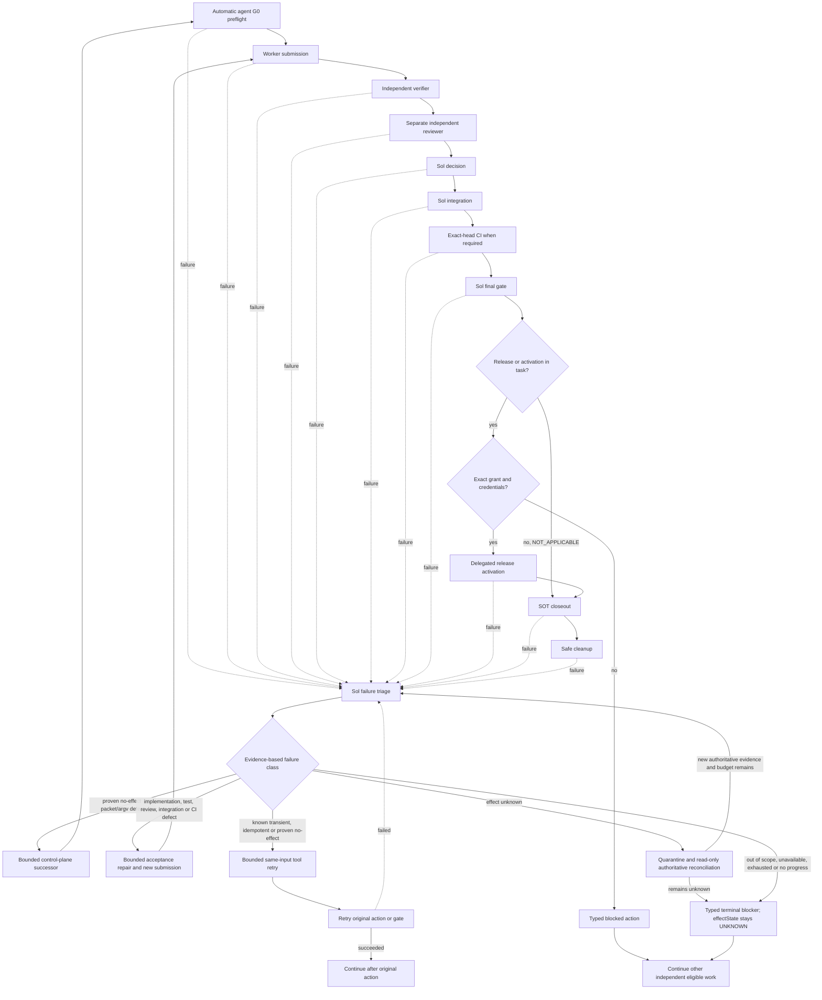

# Coding-delivery workflow policy

**Status:** Active autonomous agent procedure, version 3, adopted at owner
direction on 2026-10-14. The sole machine-readable authority for role bindings,
gates, concurrency and finite limits is
[`contracts/model-policy.json`](contracts/model-policy.json). This procedure
does not establish that a durable workflow controller or full ledger has shipped. A local
contract validator exists; its structural result is not an authorization
receipt.

Earlier per-node and per-gate human approval requirements are superseded for
in-scope coding and documentation work. Explicit user prohibitions and required
external effect grants remain binding. The earlier WF00 admission, its source
pins, packet receipts and [`SOURCE-RECONCILIATION.md`](SOURCE-RECONCILIATION.md)
remain historical and immutable. Package28 ended in terminal G0 PARK; this
policy update is a separate objective and does not restart it or replenish any
exhausted lineage.

## Authority and task admission

The direct current user task or a standing delegation already evidenced in the
trusted conversation or harness is sufficient authority provenance. The root
records that mandate once with its source message/reference, repository,
objective, effects in scope and prohibitions. Derived packets reference this
root-recorded authority record. The user does not need to author or sign a
packet, or repeat an approval. An accountable owner may be a delegated agent
when the mandate binds that delegation. The root agent derives bounded task
admissions from the standing objective and mandate; it does not request a new
human decision at each node or gate.

Actual dispatch requires both the root-recorded trusted mandate and a verified
authority binding derived from trusted conversation or harness evidence. A
structurally valid packet, validator PASS, prior agent statement, copied packet
fields, or historical receipt alone cannot prove that binding. Do not require a
second user-authored artifact or approval. If trusted context or its authority
binding is unavailable, block only the affected lineage before dispatch and
continue independent eligible work.

Sol owns decisions, critical debugging, orchestration, audit, integration and
final disposition. Technical choices, reversible implementation decisions and
in-scope packet repairs are decided by Sol under the mandate without another
approval round. Role-to-model assignments and gate order are read from the
machine-readable contract. Worker, verifier and reviewer are distinct sessions;
the verifier and reviewer cannot share a session or substitute roles.

Preserve existing user and repository prohibitions. Autonomy does not infer
credentials, capabilities, external permissions, production or Supabase
authority, or permission for effects outside the mandate. Commit, push, PR and
merge actions require an existing trusted mandate. An authorized commit, push
or PR may collect CI evidence while CI is pending; publication does not mark the
work accepted. Merge and release wait for all applicable evidence gates.
Applying a Supabase migration remains under
the existing owner-instruction rule. If the trusted mandate does not contain
that instruction, record a typed blocked action. A missing external grant,
target binding or credential never causes an agent to ask for an approval
prompt or invent authority.

## Coordination and gates

Use the contract's role map and concurrency limits. Independent branches may
run in parallel only when their DAG dependencies point to actual accepted
artifacts. Keep branch concurrency within the contract's limits. Serialize shared-source
generation and integration, and lock conflicting write paths. The root owns one
integration queue; generated outputs remain with their designated generator.

Run the gates in the order encoded in the contract:

1. **G0 agent preflight:** the root checks the trusted mandate, authority
   binding, exact base and required pins, task dependencies, read/write scopes,
   forbidden effects, acceptance oracle, environment and receipt destination.
   G0 creates an agent admission; it is not a human approval gate.
2. **G1 worker submission:** the worker returns its exact revision, changed
   paths, self-check, command receipts, evidence map and remaining gaps.
3. **G2 independent verification:** a separate configured verifier checks the exact
   submitted revision and acceptance criteria.
4. **G2R independent review:** a third, separately configured session reviews the same verified
   revision, its meaning, scope, contracts and evidence.
5. **G3 Sol decision:** after G2 and G2R, Sol resolves technical decisions
   within the mandate. This decision cannot grant missing domain, Business,
   provider, production or other external authority.
6. **G3B Sol integration:** Sol composes only accepted revisions, checks scope,
   source conflicts, shared-path locks and evidence, then records the exact
   integrated revision.
7. **G4 exact-head CI:** when required, evidence must attest the exact reviewed
   head and required ancestors before merge or release. Authorized commit, push
   and PR creation may precede this gate to start CI. A changed head invalidates
   affected review and CI evidence.
8. **G5 Sol final gate:** Sol checks the integrated revision, applicable
   exact-head evidence, authority scope and remaining gates before any allowed
   merge.
9. **Conditional `DELEGATED_RELEASE_ACTIVATION`:** if release or activation is
   not part of the task, mark this gate `NOT_APPLICABLE` and proceed to
   closeout. If it is part of the task, reuse its existing target/environment grant and required
   gates, executing without a human prompt when the trusted mandate covers that
   exact effect. Missing authority or credentials yields a typed blocked action
   for that effect; unrelated eligible work continues.
10. **SOT closeout and safe cleanup:** reconcile through the owning canonical
    source of truth, record unresolved conditions and retain receipts before
    removing any worktree or evidence.

There is no mandatory human-in-the-loop gate. Process questions and in-scope
repairs route to Sol. A required authority or capability outside the trusted
mandate is an external blocker, not a reason to pause unrelated work or to seek
an extra approval in the workflow.

Every failed gate, including G0 preflight and exact-head CI, first routes to Sol
for failure triage. Sol classifies the evidence and selects only the matching
bounded route in the contract: a proven no-effect packet/allowlist/argv defect
may use the permitted batched control-plane successor; an implementation,
test, review, integration or CI defect may use an acceptance repair and a new
submission in the same lineage, then reruns every affected downstream gate; a
known transient tool error may retry the same input only when idempotence or no
effect is established. Missing authority, unavailable capability, exhausted
budget, or repeated no-progress blocks that task and leaves independent
eligible work moving. A NOT_APPLICABLE receipt is valid only for a gate not
requested by the mandate and not required by repository policy. It cannot
replace mandatory CI or any acceptance criterion; missing required evidence is
NOT_RUN or BLOCKED, never PASS.

This mandatory ordinary Sol root triage is part of the triggering gate/action
disposition. It consumes no separate escalation, retry, repair, submission, or
successor attempt. Triage remains bounded by the triggering gate/action and the
existing no-progress and deadline budgets. If those budgets are exhausted, Sol
may only record the terminal disposition and continue independent eligible
work; triage cannot authorize another attempt.

If an operation's effect is unknown, quarantine it and perform read-only
authoritative reconciliation. Do not retry while its effect remains unknown.
Keep `effectState: UNKNOWN` separate from the run disposition, including when a
deadline or budget makes the run terminal `BLOCKED` or `FAILED`; terminal status
never converts an uncertain effect into `NONE` or a retryable failure.

The diagram shows the execution path and recovery edges. A repair stays in the
same root lineage. An exhausted or externally blocked task becomes terminal for
that lineage while unrelated eligible work proceeds.

## Packet preflight and evidence

### Bounded preparation before sealed G0

Sol first constructs the packet and its strict `g0-preparation/v1` sidecar as
drafts. Confirm eligibility, prior lineage history, the original deadline and
no-progress budget before invoking
[`prepare-g0.mjs`](../../../tools/delivery-control/prepare-g0.mjs). The tool
validates the existing v1 packet and dependency byte proofs, binds its exact
digest, lineage and active policy, and requires one structured command proof
for every acceptance criterion. The sidecar stays beside the packet; it does
not add unrecognized fields to the sealed v1 contracts.

A malformed draft, missing command proof or failed local publication consumes
the finite preparation allowance and no-progress budget. It does not consume a
sealed G0 evaluation, control-plane successor, worker submission or acceptance
repair. Batch diagnosed draft defects before the next preparation attempt.
Record the original candidate, failure class and semantic input digest; syntax
changes alone do not establish progress. Root retains failed drafts and
diagnostics in private append-only history. The helper requires the stable CLI
lineage and atomically claims a create-exclusive reservation before opening
candidate files; malformed JSON still consumes capacity. Flat slots in the shared
git-common-dir are keyed by SHA-256 lineage ID and sequence number, with no
per-lineage directory initialization. They are never overwritten, deleted or
refunded. Contiguous valid history is required; corrupt, ambiguous or exhausted
history blocks candidate reads. Competing claims fail without waiting or retry
loops. Policy upgrades cannot raise a ledger's original cap. The helper enforces
preparation attempts only; root still enforces the original deadline, no-progress
budget and terminal eligibility. Missing full lineage history blocks the task;
absence of preparation slots never proves the task has no previous failures.

Successful preparation is `PREPARED_NOT_ADMITTED`, never G0 PASS. Before reserving
and evaluating sealed G0, root still proves trusted mandate provenance and
authority binding, actual baseline/pins, complete read closure, environment and
command capability, role sessions, scoped effects, remaining budgets and the
original deadline. If any of those checks fails after sealing, use the existing
bounded failure routes. Preparation cannot reclassify a sealed failure, refund
a reservation or revive a terminal lineage.

For publication, the helper serializes a validated record, parses it again,
checks its semantic digest, writes and fsyncs a private temporary file, and
compares the bytes read back before linking it to a new final receipt name.
The same-directory hard link is create-only: an existing receipt is never
overwritten. Unsupported filesystems fail closed; there is no rename or copy
fallback. A failure after publication may have an effect: reconcile the exact
private path read-only before any retry and retain published evidence. This
protects against publishing `null` or partial JSON as an admission. It does not
claim a durable workflow controller, full counter ledger or crash-proof storage exists.

The machine policy owns the preparation cap. Every validation/publication
attempt, including failures, consumes it; the shared no-progress rule and run
deadline also apply. Exhaustion produces one terminal typed blocker, then
independent work continues. No new approval, renamed packet or repeated prompt
restarts that task. Existing terminal histories retain their original counts;
this change applies only to new or still-eligible lineages.

Read scope and write scope are separate. Before dispatch, derive and validate
the complete read-set closure for repository instructions, dependencies, every
required startup/source/policy pin, prior receipts and expected-missing paths.
Permit only scoped, read-only discovery of those instructions, dependencies and
exact git-common-dir evidence references. Reject path escapes and secret dumps.
Presence checks, hash reads and body reads are distinct operations; read bodies
only when needed. Prove an expected absence with an existence check and record
the result without inventing a hash for a missing file.

Every acceptance criterion has a Given/When/Then oracle, an explicit command,
its executable and arguments, the working directory and environment proof.
Process APIs use `shell=false` with explicit executable, `argv` and `cwd`. When
invoking the Git tree expression in PowerShell, preserve the literal argument:
`git rev-parse 'HEAD^{tree}'`.

The worker and each gate receipt name the exact revision, policy version, role
and session, criteria and checks, evidence locator, command and exit status,
environment, verdict and remaining gaps. Keep `NOT_RUN`, `UNKNOWN`, `FLAKY`,
`SKIPPED`, `PARTIAL`, `FAIL` and `PASS` distinct; missing or negative required
evidence cannot become PASS. The final receipt identifies the integrated
revision and every unresolved gate with its owner and release condition.

A real source-hash mismatch triggers read-only reconciliation against actual
bytes; never repin merely to clear a mismatch. A source edit invalidates every
affected verification. A diagnosed allowlist or quoting defect may use the
control-plane repair successor allowed by the contract only after evidence
proves the failed operation had no effect. Batch the diagnosed control-plane
defects, preserve the old packet and receipts as immutable history, and retain
every old failure as a failure. Do not manufacture a PASS from a repaired
packet. For an acceptance repair, submit the changed implementation as a new
revision in the same lineage and rerun each affected downstream gate from the
earliest invalidated receipt.

## Lineage budgets and stopping

Each `rootLineageId` identifies one independently deliverable task or feature
with a stable objective and acceptance identity. All descendants and new
acceptance versions of that work share its lineage. Independent DAG objectives
may have separate lineages; relabeling the same failed work never creates one.
Reserve each relevant counter before action and persist its outcome and cost.
The initial submission and each repaired submission consume the total
submission allowance. A control-plane successor consumes both its specific
allowance and the total successor-plan allowance. Gate evaluations are keyed by
canonical gate ID across the whole lineage. Never roll back a reservation after
a failed validation. Renaming, rebasing, opening a chat, changing a packet or
upgrading this policy never resets a counter. The single authority for all caps
and deadlines is `contracts/model-policy.json`; do not restate numeric limits
here or create per-node increases.

Anchor the run deadline at the first draft preparation or G0 attempt for the
lineage, whichever happened first, preserving any earlier recorded anchor. Anchor the node
deadline at its first dispatch, and each bounded wait at that wait's start.
Repairs, same-lineage successors and resumes preserve the original deadline
anchors. A new independent task has its own lineage and anchors.

An error fingerprint consists of objective, stage, failure class and semantic
input digest. Cosmetic edits do not count as progress. A genuinely new external
evidence digest may wake a blocked task only within its remaining lineage
budget. Retry a tool only on the same input when it is idempotent or evidence
proves the prior attempt had no effect. Unknown effects remain blocked pending
authoritative reconciliation.

When a counter or deadline is exhausted, mark the affected lineage terminal
`BLOCKED` or `FAILED` and continue other eligible work. Do not prompt for
approval, repackage the same work, automatically extend a budget, or poll an
unchanged input. Missing history blocks only the affected lineage; do not
assume an empty history or silently revive an exhausted run. A future resume
preserves that lineage's history and remaining budget.

Gate exhaustion applies to G0 and CI as well as later gates. If a budget or
deadline expires during unknown-effect reconciliation, the run may become
terminal but the separate effect state stays `UNKNOWN`; only authoritative
evidence can resolve it.

## Runtime and history boundary

This file defines agent procedure. The local contract validator checks contract
structure; no durable ledger or runtime controller is assumed to be shipped.
Do not claim live dispatch, automatic polling, lease/lock enforcement, CI,
deployment, Business use or production acceptance without its own exact
evidence. If the executing environment cannot preserve trusted authority,
lineage counters and receipts, do not dispatch the affected task.

Version diff (2026-10-14): replaces the WF00-only supervised selection with
autonomous v2 admissions derived from trusted standing delegation; supersedes
routine human approval gates for in-scope work; routes
process decisions to Sol; adds a conditional delegated release gate, read-set
and command evidence rules, and global finite lineage budgets. Preserves
historical WF00 receipts, source pins, product authority and all
existing production and Supabase prohibitions. This is policy documentation,
not a claim that a runtime controller or durable ledger was installed.

Version diff (2026-10-14, v3): introduces a finite draft preparation stage and
strict command-proof sidecar before sealed G0, with create-only receipt tooling.
Draft errors no longer spend execution successor capacity; sealed reservations,
terminal histories, authority scope and downstream gates retain their meaning.
