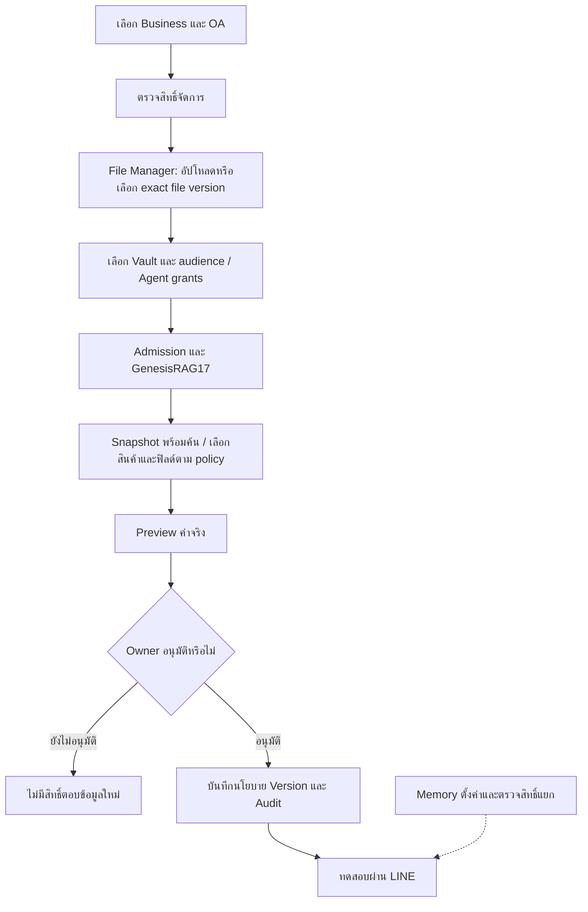
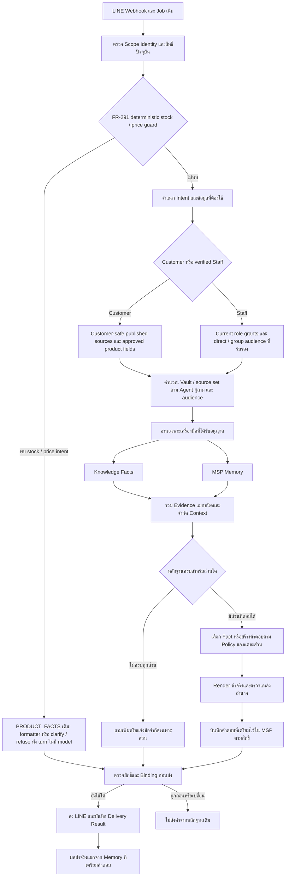

# Proposed File Manager, Knowledge Vault, GenesisRAG17 and LINE Agent specification

## 1. สถานะ ขอบเขต และอำนาจเอกสาร

ร่างนี้ตอบคำขอให้เขียน specification และ flow หลังเปรียบเทียบ SmartGift กับ Zuri
สำหรับ Business Owner, ผู้พัฒนา และผู้ตรวจสอบ เป็นข้อเสนอเพื่อ review เท่านั้น
ไม่ใช่ requirement ใหม่ ไม่อนุมัติ implementation หรือ production activation
ไม่ออกเลข FR/ADR ไม่เปลี่ยน canonical records และไม่สร้างสิทธิ์ให้ข้อมูลใด

เป้าหมายคือเชื่อม Knowledge ให้ agent ใช้ง่าย รวมการจัดการบทสนทนาให้สอดคล้องกัน
โดยรักษาแหล่งอำนาจของ Knowledge, MSP Memory และข้อมูลราคา/ATP แยกกัน
ใช้บริการและขอบเขต Core/Conversation Runtime เดิม ไม่สร้างฐานความรู้อีกชุด
ไม่บังคับเพิ่ม MCP server หรือ dependency จาก SmartGift

วันที่ 2026-10-25 owner ขอขยายร่างเดิมให้ครอบคลุม File Manager → Knowledge Vault →
GenesisRAG17 → Agent แยก audience ลูกค้า/พนักงาน และคงสิทธิ์ราคา/สต็อกเดิม
เป็น mandate ให้ปรับเอกสาร ไม่ใช่การอนุมัติ canonical amendment, RustFS cutover,
production deployment หรือเปิด memory เพิ่ม ข้อเสนอเดิมเรื่อง memory ยังมี gates เดิม
ขอบเขตออกแบบรอบนี้ให้หนึ่ง LINE OA มีหนึ่ง Business binding; ไม่มีการเลือก Business
จากข้อความหรือโมเดล และไม่เพิ่มข้อบังคับย้อนกลับว่าทุก Business ต้องมี OA ได้เพียงหนึ่งบัญชี

## 2. แหล่งอ้างอิงและข้อจำกัดปัจจุบัน

Canonical sources คงเป็นอำนาจเหนือร่างนี้:

| แหล่ง | ขอบเขตที่เกี่ยวข้อง |
|---|---|
| [ZAI:FR-049](../../requirements/FR-049.md) | Evidence-grounded answer และ product fact selection |
| [ZAI:FR-079](../../features/FEAT-004/requirements/FR-079.md) | Local Ollama และขอบเขต profile ทดสอบ |
| [ZAI:FR-149](../../features/FEAT-019/requirements/FR-149.md) | Server/Runtime interaction |
| [ZAI:FR-235](../../features/FEAT-038/requirements/FR-235.md) | Published corpus grounding และ product disclosure |
| [ZAI:FR-291](../../requirements/FR-291.md) | สิทธิ์อ่านสต็อกและราคาที่เผยแพร่ |
| [Customer disclosure](line-customer-product-disclosure-20261024.md) | Owner เลือกสินค้า/ฟิลด์และ preview |
| [Metadata-only source](line-customer-product-metadata-disclosure-20261024.md) | การผูก ProductMaster กับ Product โดยไม่ให้สิทธิ์ราคา/สต็อก |
| [GenesisRAG17 ownership](../knowledge/genesisrag17-ownership-reliability-20261023.md) | อำนาจและความรับผิดชอบของส่วนประกอบ Knowledge |
| [ZAI:FR-045](../../features/FEAT-001/requirements/FR-045.md), [ADR-107](../../decisions/ADR-107-FILE-MANAGEMENT-SERVICE-AND-EXACT-VERSION-PORT.md) | Managed FileAsset compatibility และ independent exact-version FilePort; ไม่ย้าย ownership โดยอาศัยร่างนี้ |
| [ZAI:FR-057](../../requirements/FR-057.md) | MSP episodic-memory vault resolution; ไม่ใช่ Knowledge Vault contract |
| [ZAI:FR-111](../../features/FEAT-013/requirements/FR-111.md), [ZAI:FR-173](../../features/FEAT-013/requirements/FR-173.md) | Classification/processing policy และ source admission/corpus read set |
| [ZAI:FR-288](../../requirements/FR-288.md), [SDD-114](../../requirements/SDD-114.md) | Managed PDF/DOCX/HTML parsing และ exact provenance; OCR ยังอยู่นอกสัญญานี้ |
| [17-stage flow](../../KNOWLEDGE-INGESTION-17-STAGE-FLOW.md), [stage specification](../../KNOWLEDGE-INGESTION-17-STAGE-SPEC.md) | Stage identity, execution scope และข้อจำกัดของแต่ละ profile |
| [Files handoff](../../migrations/service-extraction/FILE-MANAGEMENT-HANDOFF.md), [Files service](../../../services/file-management/README.md) | FilePort มี implementation แต่ Knowledge consumer cutover/provider qualification ยังไม่ใช่ผลสำเร็จจากการมี service |

จากโค้ดที่ revision ข้างต้น:

- [Query selector](../../../apps/server/src/modules/agent/grounded-business-answer.js) เลือก code ที่มีตัวเลขตัวแรกเป็น product identity และไม่เรียกโมเดลเมื่อ Knowledge ไม่มี evidence
- [Customer reader](../../../apps/server/src/modules/agent/line-customer-product-knowledge.js) กำหนดให้ customer-products profile ปิด memory; model เลือก fact IDs แล้ว server render ค่าจริง
- [Answer orchestration](../../../apps/server/src/modules/agent/server-line-answer.js) คืนผล customer-products ก่อน general memory flow
- [Product parser](../../../apps/server/src/modules/agent/line-customer-product-query.js) ใช้ exact approved aliases และจำกัดคำถามหลายเจตนา
- [TEST ONLY RAG reader](../../../apps/server/src/modules/agent/main-dev-test-rag-knowledge.js) รวม timeout และข้อผิดพลาดอื่นเป็น GKS_UNAVAILABLE

ข้อจำกัด memory และ exact alias บางส่วนเป็นสัญญาปัจจุบัน ไม่ใช่บั๊กทั้งหมด
การเปลี่ยนต้องผ่าน reviewed canonical amendment ก่อนเขียนโค้ด
คำขอเขียนร่างนี้ไม่เท่ากับอนุมัติให้ยกเลิกข้อจำกัดเหล่านั้น

Prior art ที่ใช้เป็นแนวทาง interface:
[SmartGift MCP](https://github.com/Freshair129/smartgift/blob/c3ce62328695a2749cc7ae73143d7873ff48f80b/explore_agent/src/explore_agent/mcp_server.py)
ซ่อน retrieval gate หลังเครื่องมือถาม Knowledge และเดินกราฟ
ไม่ได้คัดลอกโค้ดหรืออ้างว่า SmartGift ผ่าน LINE/memory acceptance ของ Zuri

## 3. ทางเลือกและแนวทางเสนอ

| ทางเลือก | ประโยชน์ | ข้อแลกเปลี่ยน |
|---|---|---|
| ปรับข้อความและ UI บน branch เดิม | เปลี่ยนน้อย | ปัญหา memory กับ Knowledge แยกทางยังอยู่ |
| รวม turn orchestration ใช้ typed tools และ authority เดิม | ลดความต่างระหว่างเส้นทาง ทดสอบสิทธิ์และ memory ได้ร่วมกัน | ต้องแก้สัญญาและ contract tests หลายส่วน |
| เปลี่ยนเป็น SmartGift MCP ทั้งชุด | ได้ interface retrieval สำเร็จรูป | ไม่แก้ identity/disclosure ของ Zuri โดยอัตโนมัติ และเพิ่ม deployment/contract boundary |

เสนอทางเลือกที่สองโดยผู้เขียน ยังไม่ใช่การเลือกที่ owner อนุมัติ
Knowledge connector ในร่างหมายถึง façade ของบริการเดิม ไม่ใช่ service/domain/DB ใหม่

สำหรับ Vault ผู้เขียนเสนอให้ต่อยอด admission/corpus และ FilePort เดิมด้วย logical
collection + policy binding แทนการแยก database ต่อ Vault หรือสร้าง ingestion service
ชุดใหม่ การเลือกนี้ลดสำเนาข้อมูลและคงเจ้าของเดิม; ไม่ได้อ้างว่า KnowledgeCorpus
ปัจจุบันรองรับ multi-vault grants แล้ว ต้อง reconcile concrete mapping ก่อน implement

### 3.1 Stack และขอบเขตจัดเก็บที่เสนอ

| ชั้น | เก็บ/ทำอะไร | Stack และสถานะหลักฐาน |
|---|---|---|
| File Manager / Files | File identity, immutable version, hash, provenance, operation receipt และ original-byte reads | FilePort service ใช้ PostgreSQL repository และ private S3-compatible StoragePort; legacy FileAsset/local workspace อยู่หลัง compatibility boundary จนมี consumer migration |
| Object storage | ไฟล์ต้นฉบับและอนุพันธ์ที่มี producer/version ชัดเจน | RustFS เป็น provider ที่ owner เสนอให้ประเมินผ่าน S3 protocol; ยังไม่รับรองว่า deploy หรือผ่าน adapter เดิมแล้ว |
| Knowledge Vault control metadata | ชื่อ/รหัสคลัง, Business, source/version membership, agent/audience grants, review decision และ active corpus generation | เสนอใช้ PostgreSQL ของ Knowledge/Core ใน main-dev; production ใช้ PostgreSQL บน Supabase ได้ตาม deployment contract เดิม ไม่ใช่ database engine คนละชนิด และไม่สร้าง DB ใหม่ต่อ Vault |
| Knowledge semantics / ingestion | Canonical entity/fact decisions, lineage, attempts, quality และ corpus membership ตามเจ้าของเดิม | GenesisRAG17 orchestration ใน Zuri, MSP authorization/relay, GKS semantic/quality และ GenesisBlock worker physical execution |
| Retrieval substrate | Native graph/vector/indexes และ engine-owned relational projection | GenesisBlockDB ผ่าน worker/query port เดิม; ไม่ให้ UI/Agent ต่อ raw engine หรือ SQLite ภายในโดยตรง |
| Agent answer | Intent, authorized evidence, output validation และตอบช่องทางที่อนุญาต | Core/Conversation Runtime เดิม; MSP memory และ ERP tools เป็น capability แยก |

Files ใช้ role/schema/repository ที่ตนเป็นเจ้าของ แม้ใช้งาน PostgreSQL server เดียวกัน
ก็ไม่ให้ Knowledge อ่าน/เขียน Files tables โดยตรง หรือให้ Files ถือ corpus/grants
ไฟล์จริงไม่อยู่ใน Vault metadata table; canonical knowledge ไม่ย้ายออกจาก GKS มาเป็น
สำเนาความจริงใน PostgreSQL และไม่เพิ่ม SQLite/pgvector อีกชุดสำหรับ knowledge retrieval

Supabase เป็น platform ที่มี PostgreSQL และ Storage เป็นคนละบริการ การใช้ Supabase
Postgres ไม่ได้บังคับใช้ Supabase Storage หรือย้าย raw bytes ออกจาก RustFS
อ้างอิง [Supabase architecture](https://supabase.com/docs/guides/getting-started/architecture)
และ [RustFS S3 compatibility matrix](https://docs.rustfs.com/en/reference/s3-compatibility)
ที่ตรวจเมื่อ 2026-10-25; ความเข้ากันได้เป็นราย API ไม่ใช่ใบรับรอง provider ของ Zuri

[S3 adapter เดิม](../../../services/file-management/src/s3-storage.js) ต้องการ bucket
versioning, conditional create และ exact non-null VersionId; adapter ส่ง stream ของ
version ที่ระบุให้ [Files service](../../../services/file-management/src/file-service.js)
ตรวจ hash/length ก่อนยืนยันผล
จึงต้องทดสอบ RustFS รุ่น/image และ disposable bucket ที่ระบุจริงก่อน activation
[deployment overlay เดิม](../../../apps/server/docker-compose.knowledge-storage.yml)
ยังเป็น MinIO/AIStor template; การเปลี่ยน image อย่างเดียวไม่ใช่ RustFS migration
[Supabase Storage compatibility](https://supabase.com/docs/guides/storage/s3/compatibility)
ระบุว่าไม่มี S3 versioning จึงไม่เป็น drop-in replacement ของ adapter นี้
การปรับ spec นี้ไม่แก้ endpoint, credential, image, database หรือ production data

### 3.2 Retrieval capability: แยก engine, composition และสิ่งที่ยังต้องพิสูจน์

ตรวจ Zuri base ข้างต้นและ GenesisBlock checkout revision
`478b5fa6a85ad6105d77385ac85fbade2ed9ab68` แบบ source review เท่านั้น:

| ความสามารถ | หลักฐาน/เจ้าของ | ขอบเขตการกล่าวอ้าง |
|---|---|---|
| Vector และ graph storage/indexes | [GenesisBlockDB README ที่ตรึง revision](https://github.com/Freshair129/GenesisBlock/blob/478b5fa6a85ad6105d77385ac85fbade2ed9ab68/README.md) | Engine primitives; ไม่พิสูจน์ว่า LINE ทุก profile เปิดใช้ |
| Hybrid search ใน RAG17 | [worker searchGeneration](https://github.com/Freshair129/GenesisBlock/blob/478b5fa6a85ad6105d77385ac85fbade2ed9ab68/genesisrag17-worker/src/worker.mjs) รวม lexical กับ native vector results | ใน source ที่ตรวจ worker ให้น้ำหนัก vector 0.7/lexical 0.3; ไม่ใช่ข้อกำหนด tuning ใหม่ และไม่ใช่ neural reranker |
| รวมผลหลาย snapshot | [Knowledge corpus service](../../../apps/server/src/modules/knowledge/knowledge-corpus-service.js) ใช้ RRF และ deterministic tie-break | เป็น composition ฝั่ง Zuri; corpus เป็น read set ของ source snapshots ไม่ใช่ native graph เดียวข้ามทุกเอกสาร |
| Graph traversal | Native capability และ profile-specific query contract | หากจะเปิดกับ Vault ต้องมี bounded hop/type/budget และตรวจสิทธิ์ node/edge ทุกทางเดิน; ร่างนี้ไม่เปิด generic graph tool ให้ Agent |
| Native exact-f32 reranking | Engine มี sidecar reranking สำหรับ quantized collections | RAG17 worker ที่ revision นี้สร้าง collection ด้วย `rerank: false`; ความสามารถใน engine ไม่เท่ากับเปิดใช้ใน profile และต่างจาก model reranker |
| Reranking model | ยังไม่พบการใช้ cross-encoder/model reranker ในเส้นทาง searchGeneration ที่ตรวจ | เป็น extension ที่ต้องเลือกและวัดแยก ไม่อ้างว่า RRF หรือ weighted score คือ reranker model |

### 3.3 Knowledge Vault และสิทธิ์

Vault เป็น logical collection สำหรับเลือก source versions และกำหนดการใช้ข้อมูล
ภายใต้ Business เดียว ไม่ใช่ S3 bucket, folder path, Genesis database หรือ MSP
memory vault โดยอัตโนมัติ ชื่อ Brand Kit/Cost/Accounting เปลี่ยนได้โดยไม่เปลี่ยน
identity; ชื่อหรือการย้ายโฟลเดอร์ไม่สร้าง grant

Mapping ที่เสนอสำหรับรุ่นแรกคือ Vault เป็น policy view ของ existing Business corpus:
เลือก `KnowledgeSource` references ที่ผูก exact file versions และ verified ingestion
จาก corpus generation ที่ตรึงตอน query; Vault ไม่เก็บ fact payload หรือ snapshot สำเนา
เอง และไม่สร้าง native collection ต่อคลังโดยอัตโนมัติ Agent-to-Vault binding เป็น
allow-list ของชุดแหล่งข้อมูลนี้ เปลี่ยน grant ไม่ต้อง embed ใหม่ แต่ต้อง invalidate
authorized read set/cache; เปลี่ยน bytes/parser profile ต้องผ่าน source version ใหม่
ชื่อ field/table สำหรับ metadata เพิ่มเติมยังต้อง reconcile กับ canonical contract
ไม่อาศัย folder name หรือ MSP vault ID เป็น foreign key แทน

| ตัวอย่างคลัง | ผู้ใช้ที่เสนอ | ข้อจำกัด |
|---|---|---|
| Brand Kit / Customer Catalog | Customer Assistant เฉพาะส่วนที่เผยแพร่; Marketing/Sales ตามสิทธิ์ | Brand Kit ไม่ได้เป็น PUBLIC ทั้งเล่มเพียงเพราะชื่อคลัง; product fields ยังต้องผ่าน policy เดิม |
| Product Cost | Purchasing/Accounting ที่ได้รับ explicit grant | ไม่เปิดให้ลูกค้า; เอกสารต้นทุนมี version/date และไม่ยืนยันราคาหรือสต็อกปัจจุบันแทน ERP |
| Accounting | พนักงานที่มีบทบาทและขอบเขตงานที่อนุญาต | Business membership อย่างเดียวไม่พอสำหรับเอกสาร confidential |

Agent profile เลือกได้หลาย Vault; Vault ใช้ร่วมกับหลาย Agent ได้ภายใต้ grant
การค้นแต่ละครั้งใช้ขอบเขตตัดกันของ source policy, Vault grant, Agent capability,
ผู้ถาม/บทบาท, OA Business และ audience ปลายทาง บวก field policy ที่เกี่ยวข้อง
ลูกค้าที่ไม่มี staff identity เข้าถึงได้เพียง customer-safe published scope ตามสัญญาเดิม;
private/staff retrieval ต้อง verified identity และ current Membership/role
ห้าม union สิทธิ์ของสมาชิกกลุ่มหรือใช้สิทธิ์กว้างที่สุดของ Agent เป็นสิทธิ์ผู้รับ

เอกสารต้นฉบับเก็บครั้งเดียวได้ แต่แต่ละ published projection ต้องมีขอบเขตสิทธิ์ชัดเจน
ไฟล์ที่ปนต้นทุนกับข้อมูลลูกค้าต้องมีอนุพันธ์ที่ตัดข้อมูลต้องห้ามพร้อม provenance และ
preview ก่อนให้ลูกค้าอ่าน; หากแยกอย่างตรวจสอบไม่ได้ให้ปฏิเสธการเผยแพร่ customer scope
การ dedup/reuse ห้ามใช้ hash ตรงกันเป็นเหตุให้รวม tenant, grants หรือข้ามความลับ
การเพิ่ม source เดิมเข้า Vault ที่เปิดกว้างขึ้นต้องผ่าน disclosure review ใหม่ ไม่ใช่
OR grants โดยอัตโนมัติ และไม่เปลี่ยน MSP vault IDs/consent/memory enablement

กลุ่ม LINE ต้องมี server-verified binding และนโยบาย audience ที่อนุญาตข้อมูลนั้น
อย่าอนุมานว่าทุกคนเป็นพนักงานจากชื่อกลุ่มหรือบทบาทผู้ถามคนเดียว หากยืนยันผู้รับ/
ขอบเขตกลุ่มไม่ได้ ให้ใช้ customer-safe scope หรือขอให้ผู้ใช้ถามใน direct chat
ที่ตรวจสิทธิ์ได้; ไม่ส่งข้อความส่วนตัวอัตโนมัติและไม่ใช้ stale membership cache
การรับรอง group audience เป็น contract เพิ่มที่ยังไม่ผ่าน live acceptance

### 3.4 ใครทำอะไร: owner, workflow และ retrieval เป็นคนละส่วน

ตารางนี้ใช้เจ้าของเดิมจาก [ADR-073](../../decisions/ADR-073-GENESISRAG17-ISOLATED-EXECUTION-AND-PUBLICATION.md)
และ [wire contract](../../plans/GENESISRAG17-CONTRACT.md) ประกอบกับ Vault proposal §3.3
ไม่ตีความเลข tier เป็นลำดับ HTTP call และไม่สร้าง service ชื่อ GenesisRAG17 เพิ่ม

| ส่วน | ตอนนำเข้า | ตอน Agent ถาม | ขอบเขตที่ต้องรักษา |
|---|---|---|---|
| Zuri / Knowledge | UI, admission, current file ACL, source version, Stages 1–8, job/evidence และติดตั้ง verified corpus | resolve Business/caller/destination, ตรวจ grants, pin read set, รวมผลและตรวจ citation/disclosure ก่อนส่ง | ไม่ต่อ GKS หรือ native database โดยตรง |
| Knowledge Vault | การเลือก source refs และกำหนด audience/Agent grants ภายใต้ Knowledge | เป็น policy input ให้ Zuri ตัดสิน allowed sources/fields | ไม่ใช่ search engine, ไม่ใช่ MSP memory vault, ไม่เพิ่ม network hop หรือ fact store |
| MSP | ตรวจ runtime principal/role/scope และ relay submit/claim/receipts ระหว่าง Zuri, GKS และ worker | ตรวจ scope และ relay published-snapshot query ไป worker; memory ใช้ port/สิทธิ์อีกชุด | ไม่มี ingestion stage และไม่ให้สิทธิ์ลูกค้าแทน Zuri |
| GKS | canonical entity/fact/ontology decisions, Stages 9–14 และ Stage 17 quality/policy verdict | เป็นอำนาจเบื้องหลัง knowledge ที่ผ่าน publication แล้ว ไม่ใช่ executor ของ query ทุกครั้ง | passive authority; worker ดึง decisions ผ่าน MSP, GKS ไม่เรียก DB ออกไปเอง |
| GenesisRAG17 | ชื่อ workflow 17 ขั้นที่ Zuri, GKS และ worker ทำร่วมกันผ่าน MSP | อ่าน published output ของ workflow; ไม่รัน 17 ขั้นใหม่ทุกคำถาม | ไม่ใช่ฐานข้อมูลหรือชื่ออีกชื่อของ GKS/retrieval engine |
| GenesisBlock worker | ดึง decision, physical write Stage 13, embeddings/indexes 15–16, physical publication 17 และ receipts | ใช้ query profile ค้น exact published snapshot พร้อม scope/generation/citations | เป็น execution adapter แยกจาก engine; ตัว worker ไม่ออก grant หรือ canonical fact decision เอง |
| GenesisBlockDB | native graph/vector/indexes และ durable generations ตาม worker execution | engine primitives สำหรับค้นใน snapshot ที่ worker เลือก | ไม่รับ raw Agent/UI access; capability ที่มีใน engine ไม่แปลว่า query profile เปิดทั้งหมด |

Retrieval คือกระบวนการค้นคืน ไม่ใช่ชื่อระบบ GKS: ใน profile นี้ Zuri ประกอบผล,
MSP relay และ worker ใช้ GenesisBlockDB ค้น ส่วน GKS เป็น semantic/publication authority
เส้นทาง `msp_pipeline_query → worker loopback /query` ระบุไว้ใน wire contract ข้อ query
จึงไม่วาด `MSP → GKS → DB` เป็น synchronous query chain และไม่อนุมานว่า
สามารถ bypass MSP หรือเลิกใช้ GKS ใน ingestion ได้ สัญญา adapter/profile อื่นต้องตรวจแยก

## 4. ประสบการณ์ตั้งค่า

1. Owner เลือก Business และ OA ที่ตนมีสิทธิ์จัดการ ระบบตรวจ persisted binding ฝั่ง server
2. อัปโหลดผ่าน File Manager หรือเลือก managed file ที่มีสิทธิ์ ไม่ต้องเชื่อม Drive หรือ cloud connector
3. เลือกเอกสาร/เวอร์ชันเข้า Vault และเลือก audience/Agent ที่ต้องการอนุญาต
4. ระบบตรวจ admission/processing policy แล้วเตรียมข้อมูลด้วย GenesisRAG17 อัตโนมัติ
5. ดู preview ของรุ่นที่พร้อม โดย product metadata ยังเลือกสินค้า/ฟิลด์และอนุมัติตาม workflow เดิม
6. แสดงแยก Knowledge พร้อมค้น, disclosure อนุมัติ/ถอน และ memory ปิด/เปิด/ไม่มีสิทธิ์
7. ทดสอบคำตอบและดูเหตุปฏิเสธที่ปลอดภัยต่อผู้ใช้งาน

ไม่ต้องกรอก manifest hash, snapshot, source receipt หรือ fixture pins ใน normal setup
server ยังคงตรวจรายละเอียดเหล่านี้ ไม่ตัดการตรวจออกเพื่อทำให้ UI ง่าย
profile TEST ONLY เดิมยังใช้เพื่อ qualification ได้และไม่กลายเป็น normal configuration
การเชื่อมคลังหรือเลือก agent ไม่เปิดเผยทุกเอกสาร ไม่เปิด memory และไม่ให้ commercial permission อัตโนมัติ



### 4.1 Ingestion และ publication flow

อัปโหลดสำเร็จไม่ใช่ Knowledge admission: FilePort `STORED`/`UNSCANNED` ไม่ยืนยัน
ว่าไฟล์ปลอดภัยสำหรับ parse หรือ inline preview ต้องผ่าน media/safety และ parser
profile ที่รับรองก่อนประมวลผล; แสดงข้อจำกัดเมื่อยังไม่มี scanner/profile ที่รองรับ
FR-288 รองรับขอบเขต non-OCR PDF/DOCX/HTML ตามสัญญา ผู้ใช้ไม่ต้องแปลงเป็น text เอง
แต่ scan PDF/OCR เป็น extension แยก และไม่ถือว่าการมี spec คือ parser acceptance

```mermaid
sequenceDiagram
    actor O as Owner
    participant F as File Manager / FilePort
    participant Z as Zuri Knowledge
    participant V as Vault policy within Knowledge
    participant M as MSP relay
    participant G as GKS passive authority
    participant W as GenesisBlock worker
    participant DB as GenesisBlockDB
    O->>F: Upload original bytes / immutable file version
    O->>Z: Select source and target Vault
    Z->>V: Read source selection and processing grants
    V-->>Z: Policy inputs, not disclosure approval
    Z->>F: Authorized exact-version read
    F-->>Z: Bytes + version/hash evidence
    Note over Z,DB: GenesisRAG17 workflow spans the following stages
    Z->>Z: Admission/safety/profile checks, then Stages 1–8
    Z->>M: Submit scoped batch / durable attempt
    M->>G: Authenticated submit
    G-->>M: Decisions 9–12 and immutable graph decision; Stage 13 awaits physical receipt
    M-->>Z: Batch acknowledgement, not publication success
    W->>M: Claim pending decision
    M->>G: Claim with worker role
    G-->>M: Immutable decision and hash
    M-->>W: Decision
    W->>DB: Stage 13 graph write, flush and readback
    W->>M: Graph receipt
    M->>G: Verify physical evidence
    G-->>M: Terminal 13 and Stage 14 enrichment
    M-->>W: Derived result and hash
    W->>DB: Stages 15–16 embeddings/indexes and readback
    W->>M: Write receipt then gate request
    M->>G: Validate evidence and Stage 17 quality/policy
    G-->>M: Bound verdict and publication permission
    M-->>W: Verdict
    alt PASS and publication permitted
        W->>DB: Atomic publication pointer switch
        W->>M: Publication receipt
        M->>G: Verify exact receipt / terminal Stage 17
        Z->>M: Read durable stage evidence
        M->>G: Evidence read
        G-->>M: Stage outcomes and publication receipt
        M-->>Z: Evidence
        Z->>Z: Require all 17 successes and matching receipt; install corpus
        O->>Z: Select allowed fields and inspect preview
        O->>Z: Approve disclosure under current owner authority
        Z->>V: Record applicable grants/bindings; retain existing disclosure owner
    else Failure or publication denied
        Note over Z,DB: No new ready source; retain failure evidence, no invented success
    end
```

Diagram ย่อหน้าที่จาก [execution flow](../../KNOWLEDGE-INGESTION-17-STAGE-FLOW.md)
ไม่เพิ่ม Stage 18 และไม่ให้ Tier 1 เขียน Genesis โดยตรง แต่ละ source มี run/snapshot
ของตนเอง; Vault อ่าน verified corpus membership ไม่สร้าง aggregate native graph
หรือสำเร็จ 17 stages จากการรวมไฟล์เฉย ๆ ไม่รัน pipeline ใหม่ทุกข้อความ LINE

สถานะ UI ใช้สามแกนแยกกัน: file version/safety, ingestion/publication readiness,
และ disclosure/grant decision; เป็นมุมมองของสถานะเจ้าของเดิม ไม่ออก enum ใหม่ในร่าง
Stage 17 technical publication ไม่ให้สิทธิ์ตอบลูกค้าโดยอัตโนมัติ
อนุญาตให้เริ่มเตรียม source version ใหม่อัตโนมัติได้เมื่อมี selected source และ processing
authorization ที่ยังใช้ได้; ห้าม auto-approve customer disclosure หรือสืบทอด field approval
ข้าม source/projection revision โดยอาศัยเพียงว่าอยู่ Vault เดิม

FilePort มี `FILE_VERSION_READY` outbox แต่ dispatcher/Knowledge consumer bridge
ยังต้อง qualify; ไม่สร้าง trigger/second queue ข้ามเจ้าของเองในงานเอกสารนี้
version ใหม่ล้มเหลวไม่ลบต้นฉบับหรือประกาศสำเร็จ รุ่นเดิมอ่านได้เฉพาะเมื่อ current source
ACL, disclosure และ freshness policy ยังยอมรับ; correction/withdrawal ต้องหยุดรุ่นเดิม
เมื่อเจ้าของยกเลิกสิทธิ์ ไม่รอ ingestion รุ่นใหม่สำเร็จ การถอนจาก Knowledge ไม่เท่ากับ
ลบไฟล์ต้นฉบับหรือ purge ซึ่งยังผ่าน retention/reference checks ของ Files

## 5. การจัดการหนึ่ง turn ที่เสนอ

ใช้ lifecycle ร่วมสำหรับรับคำถาม อ่านแหล่งข้อมูล สร้างคำตอบ ตรวจซ้ำ และส่ง
ไม่บังคับให้ทุก turn ต้องอ่านทุกแหล่ง และไม่สร้าง controller หรือ task ledger ใหม่

| ประเภทคำถาม | หลักฐานที่จำเป็น | พฤติกรรมเมื่อขาดหลักฐาน |
|---|---|---|
| ข้อมูลสินค้า | Product identity และ approved field facts จาก RAG | ถามระบุสินค้า หรือแจ้งว่าไม่มีข้อมูลที่อนุญาต |
| ราคา/สต็อก | ผล authorized commercial tool เดิม | ปฏิเสธหรือถามข้อมูลเพิ่ม; ไม่ใช้ memory/RAG ทดแทน |
| ความจำบทสนทนา | MSP packet ที่มีสิทธิ์และชนิดข้อมูลที่เปิดใช้ | แจ้งว่าไม่มีความจำที่อนุญาต; ไม่เดาจากโมเดล |
| หลายเจตนาที่ไม่มี stock/price intent | หลักฐานแยกของแต่ละส่วน | ตอบเฉพาะส่วนที่ผ่าน และบอกส่วนที่ยังตอบไม่ได้ |

FR-291 guard มีลำดับก่อน model/semantic routing ของทั้ง turn เสมอ หากตรวจพบ
stock/price intent รวมถึงข้อความที่ปน metadata หรือ memory ให้ทั้งข้อความอยู่ใน
deterministic PRODUCT_FACTS route เดิม: ถ้า parser เดิมรองรับให้ตอบเฉพาะผลตาม
formatter เดิม; ถ้าข้อความผสมไม่รองรับให้ clarify/refuse ตาม contract เดิม ไม่มี model
invocation/fallback, RAG answer generation หรือ extra owner reads เพื่อเติมส่วนอื่น
PARTIAL ที่ FR-291 อนุญาตหมายถึง availability/price facets ตามสัญญาเดิม ไม่ใช่
อนุญาตให้เรียกโมเดลตอบส่วน metadata/memory ใน turn เดียวกัน การรวมแบบนั้นต้องมี
amendment ใหม่และอยู่นอกงานนี้ ข้อนี้มีลำดับเหนือ shared orchestration ด้านล่าง

การจำแนก intent เป็นคำแนะนำการ route ไม่ใช่การให้สิทธิ์
ข้อความผู้ถาม ผลจากโมเดล และผลค้นไม่สามารถกำหนด tenant/business/principal ได้
ใช้ trusted job context และ resolver เดิมเท่านั้น
code ที่ไม่ยืนยันเป็นสินค้าไม่กลายเป็น SKU เพียงเพราะมีตัวเลข
หากพบสินค้าหลายตัวให้ถามเลือก ห้ามเลือกตามอันดับค้นเพื่ออนุมาน identity
รุ่นแรกยังคง exact approved SKU/unique approved name; semantic product identity และ graph traversal ทั่วไปอยู่นอกขอบเขตนี้



### 5.1 Agent query flow: ค้นผลที่เผยแพร่แล้ว ไม่รัน ingestion ซ้ำ

แผนภาพนี้แสดง Knowledge turn โดยมี FR-291 guard ก่อนทุก retrieval/model call
Vault participant เป็น logical policy lookup ใน Knowledge ไม่ใช่ service ที่ต้อง deploy
แยก; ชื่อ message เป็นคำอธิบาย ไม่ใช่การเพิ่ม API หรือ wire fields
GKS อยู่ในภาพเพื่อแสดงอำนาจที่สร้าง published evidence ใน §4.1 แต่ไม่ได้รับ
query แบบ synchronous ใน accepted RAG17 query contract นี้

```mermaid
sequenceDiagram
    actor U as LINE customer / employee
    participant A as Zuri Agent / Conversation Runtime
    participant Z as Zuri Knowledge / Core
    participant V as Vault policy within Knowledge
    participant M as MSP relay
    participant G as GKS publication authority
    participant W as GenesisBlock retrieval worker
    participant DB as GenesisBlockDB
    participant C as Existing price / ATP handler
    U->>A: Question
    A->>A: Trusted OA Business/caller/destination context and FR-291 guard
    alt Recognized stock / price turn, including mixed intents
        A->>C: Existing deterministic authorized contract
        C-->>A: Formatted facts or clarify/refuse; no model/RAG fallback
        A->>A: Existing commercial final-send fence
        A-->>U: Existing price/ATP result or refusal
    else Knowledge question
        A->>Z: Scoped knowledge request under existing capability
        Z->>V: Read current selected sources and grants
        V-->>Z: Policy inputs, never authority from prompt
        Z->>Z: Intersect caller/Agent/audience/file/disclosure policy; pin read set
        Note over G,DB: §4.1 established GKS verdict + verified physical publication
        alt No allowed source or audience cannot be authorized
            Z-->>A: Denial / no authorized evidence
            A-->>U: Clarify or refuse; no broad-corpus fallback
        else Allowed published source set
            loop Each exact snapshot in authorized pinned read set
                Z->>M: Existing scoped snapshot query
                M->>M: Authenticate principal and enforce scope/role
                M->>W: msp_pipeline_query to loopback query endpoint
                W->>DB: Exact published snapshot search under accepted profile
                DB-->>W: Native results
                W-->>M: Validated results + generation + citations
                M-->>Z: Scope-checked response
            end
            Z->>Z: RRF composition, lineage/current ACL and field filtering
            Z-->>A: Authorized evidence only
            A->>A: Applicable model policy; product path selects fact IDs only
            A->>A: Validate output and render actual approved product values
            A->>Z: Revalidate current source/fields/grants/destination
            Z-->>A: Current authorization outcome
            A->>A: Existing durable send fence; deny stale/revoked output
            A-->>U: Permitted answer or safe failure
        end
    end
```

ลูกค้ารับเฉพาะ customer-approved sources/fields; พนักงานต้องมี verified identity
และ current Membership/role เพิ่มจาก Agent grant การตอบกลุ่มต้องผ่าน destination
audience policy ด้วย ไม่ใช้สิทธิ์ผู้ถามคนเดียวแทนสิทธิ์ผู้รับทั้งหมด (§3.3)
Memory ไม่ใช่ output ของ GenesisRAG17 หรือ Knowledge Vault และไม่เป็นหลักฐานราคา/ATP
หาก turn/profile มีสิทธิ์ใช้ memory ให้ใช้ lifecycle และ failure fence เดิมใน §8;
ภาพนี้ไม่อนุมัติ memory บน product profile หรือ production

## 6. Tool และ Evidence contract ระดับออกแบบ

ชื่อด้านล่างเป็น logical operations ไม่ประกาศ HTTP route, MCP tool name หรือ schema ใหม่
implementation ต้อง map เข้ากับ port เดิมและ review concrete contract ก่อนใช้ข้าม service

| Operation | รับจาก caller | บริบทที่ server เติม | คืนให้ orchestration |
|---|---|---|---|
| ค้น Knowledge | คำถาม ขอบเขตงานที่ขอ | Tenant/Business/OA, trusted principal/audience, authorized Vault/source set และ policy revision | Approved facts/citations, binding, result reason |
| อ่าน Memory | ความต้องการ recall ที่จำกัด | Principal/thread/project/audience และ authorization เดิม | Authorized memory slices และ references |
| อ่านราคา/ATP | Product identity, quantity/unit ที่ตรวจแล้ว | Customer/business scope และสิทธิ์เดิม | Typed commercial facts พร้อม binding |

ผลต้องแยก success, no evidence, ambiguous identity, forbidden, stale source,
timeout, upstream unavailable และ invalid model output อย่างตรวจสอบได้
ชื่อ enum จริงยังต้อง reconcile กับสัญญาเดิม; ตารางนี้ไม่ออก error codes ใหม่
ข้อมูลที่ส่งเข้าโมเดลต้องคัดสิทธิ์แล้ว จำกัดขนาด และถือว่าเนื้อหาเป็นข้อมูลที่ไม่เชื่อถือ
คำสั่งที่ฝังในเอกสารไม่เปลี่ยน tool permissions, audience หรือ system rules

Vault IDs/source IDs จาก client เป็น selection request เท่านั้น Server resolve กลับไปยัง
สิทธิ์ปัจจุบันก่อน retrieve ทุก lane รวม lexical/vector/graph/citation; reranker ถ้ามีต้อง
เห็นเฉพาะ candidates ที่ผ่านสิทธิ์แล้ว Graph expansion ห้ามผ่าน node/edge ที่ไม่มีสิทธิ์
หรือเผยชื่อ/จำนวน/ความสัมพันธ์ของเอกสารที่ถูกซ่อน การพิสูจน์นี้ต้องครอบคลุม native query
ไม่ใช่เรียก broad search แล้วกรองเฉพาะคำตอบสุดท้าย
Cache ต้องผูก Business, authorized scope, audience, source/generation และ policy revision
การถอนสิทธิ์ทำให้ผล cache/summary/derived evidence เดิมไม่สามารถขยายสิทธิ์ได้
packet เก็บ provenance และ source version ของทุก fact; ห้าม dedup ข้าม scope เพื่อ reuse grants

## 7. Data flow และ Source of Truth

```mermaid
flowchart LR
    O[Owner] -->|เลือกฟิลด์ Preview อนุมัติ| DP[(Disclosure Policy เดิม)]
    FM[File Manager / FilePort] --> OB[(Private object storage: originals / versions)]
    FM --> FD[(Files-owned metadata)]
    FM -->|authorized exact-version read| ING[Knowledge admission และ GenesisRAG17 เดิม]
    VM[(Vault metadata / grants: Knowledge-owned PostgreSQL)] --> ING
    ING -->|submit / evidence| MR[MSP scoped relay]
    MR -->|submit / claim / receipts / gate requests| GK[GKS passive authority]
    GK -->|decisions / verdict / evidence responses| MR
    WK[GenesisBlock worker] -->|claim / receipts / gate through MSP| MR
    MR -->|claimed decisions / verdict responses| WK
    WK -->|physical writes / publication| GB[(GenesisBlockDB graph / vector)]
    ING --> KC[(Verified Corpus / Lineage / Receipts)]
    KC --> KR[Scoped Knowledge Reader]
    KR -->|exact authorized snapshot query| MR
    MR -->|query to worker, not GKS| WK
    WK -->|native search| GB
    GB -->|hits| WK
    WK -->|results / citations| MR
    MR -->|scope-checked results| KR
    VM --> KR
    PM[(ProductMaster owning component)] -->|verified product / source identity binding| KR
    DP --> KR
    U[LINE User] --> J[Trusted Job Context]
    J -->|Core-resolved caller / Business / destination binding| KR
    J --> GR{FR-291 guard ก่อน model routing}
    GR -->|ไม่ใช่ commercial turn| T[Knowledge / Memory Orchestration]
    GR -->|commercial turn| CT[PRODUCT_FACTS เดิม / ไม่มี model]
    T -->|คำขออ่านที่มีสิทธิ์| KR
    KR -->|Approved Facts และ Citations| T
    MS[(MSP)] -->|Authorized Memory| T
    CD[(Commerce / Inventory)] -->|Authorized Published Price / ATP| CT
    T --> LLM[Model ตามชนิดงาน]
    LLM --> V[Typed Output Validation และ Server Renderer]
    T --> V
    V --> SF[Final Send Fence]
    CT -->|Deterministic result / refusal| SF
    SF -->|คำตอบที่ผ่านการตรวจ| U
    SF --> AU[(Audit / Trace / Delivery Result)]
```



Knowledge owns admission/corpus/grants และ serving accountability; GKS owns semantic/quality
และ worker owns physical publication; Files owns original versions และ storage mapping
ProductMaster owning component/disclosure records own product/source identity and allowed fields;
Core resolves caller/Business/destination from trusted persisted context, not product records
Commerce/Inventory contracts own price/ATP; MSP owns memory
agent/model ไม่มีอำนาจยืนยันราคา สิทธิ์ หรือข้อมูลธุรกิจจากความจำของตัวเอง
แผนภาพนี้เป็น data dependencies; call ordering และ response directions ใช้ §4.1/§5.1
ลูกศรเข้า GKS ในภาพนี้เป็น ingestion/control traffic ไม่ใช่ทุก query ต้องผ่าน GKS
GenesisRAG17 ครอบคลุม workflow การนำเข้า ไม่เป็น datastore อีกใบในภาพ
แผนภาพไม่เปลี่ยน domain ownership หรือย้าย persistence ข้าม service

## 8. กฎการตอบและการเปลี่ยนแปลงระหว่างประมวลผล

- Product metadata คง strict fact-ID selection และ server renderer เดิม
  ไม่รับ model prose มาแทนค่าจริง ไม่ย้าย memory ไปอยู่ใน approved product facts
- เอกสาร Customer Catalog/Brand Kit ไม่เป็นทางอ้อมให้ตอบ product fields ที่ไม่อนุมัติ
  หากเอกสารมีราคา/ต้นทุน/จำนวนสต็อก ต้องไม่ส่งส่วนต้องห้ามให้ customer model
  คำถามราคา/ATP ปัจจุบันยังใช้ FR-291 และ natural-language eligibility เดิมเท่านั้น
  Staff cost/accounting document access ไม่เพิ่ม commercial tool grants หรือเปลี่ยน
  เอกสารย้อนหลังให้เป็นค่าปัจจุบัน; การขยาย staff commercial tools เป็น amendment แยก
- ราคา/ATP คง deterministic authorized result รวม quantity/unit, ราคาเผยแพร่,
  tax status และคำอธิบาย ATP เดิม ไม่เปิดจำนวนสต็อกจริงหรือรับประกันจัดส่ง
- Memory-only turn ใช้ MSP evidence โดยไม่ต้องมี product evidence แต่ห้ามใช้เป็น
  หลักฐานราคาปัจจุบัน สต็อก สิทธิ์ หรือ grant การเปิดเผยข้อมูล
- ค่าตัวเลขใน memory ต้องเป็นชนิดที่ policy อนุญาต โดยไม่ลด numerical guard ของข้อมูลการค้า
  credential, secret และข้อมูลอ่อนไหวที่ไม่มี policy รองรับยังห้ามเก็บ/เรียกคืน
- การรวมหลายเจตนาที่ไม่มี commercial intent ต้อง render แต่ละส่วนตาม validator
  ของแหล่งนั้น; recognized stock/price turn ใช้ FR-291 ทั้ง turn ตาม §5 โดยไม่มี model
  และไม่มี commercial section ในคำตอบของโมเดล ไม่แปลง memory เป็น product field
- ก่อนส่งต้อง revalidate policy/version, owner, Product/source binding และ memory authority
  เฉพาะส่วนที่ใช้ หากเปลี่ยนให้สร้างผลใหม่จากหลักฐานที่ยังใช้ได้หรือปฏิเสธ ห้ามส่ง packet เก่า
- รวม Vault/Agent grants, current Membership และ destination audience ใน final fence
  โดยรักษา durable SENDING claim เดิม: การถอนที่ชน claim ต้องใช้ conflict/settlement
  semantics เดิม ไม่อ้างว่าย้อนเรียก network attempt ที่ claim ไปแล้วได้
- Corpus generation ใหม่เป็นสิ่งที่ server ตรวจได้ แต่ไม่ใช่การอนุมัติ disclosure ใหม่
  projection/source เปลี่ยนแล้วนโยบายเดิมใช้ไม่ได้ ต้อง preview/อนุมัติตามสัญญาเดิม
- ห้าม fallback ไปยัง fixture, broad corpus, โมเดลอื่น หรือข้อมูลคนละ Business โดยอัตโนมัติ
  fallback ที่ canonical mode อนุญาตอยู่แล้วคงขอบเขตและ trace เดิม
- ใช้ job claim/retry/idempotency/send fencing เดิม ไม่เพิ่มช่องทางส่ง LINE อิสระ
  แยก memory ที่เตรียมคำตอบออกจากหลักฐานว่าข้อความส่งสำเร็จ ห้าม replay แล้วสร้างคำตอบซ้ำ
- คงลำดับ MSP เดิม: append inbound และอ่าน context ก่อน inference; บันทึก injection
  receipt ตาม wrapper เดิม; append outbound ที่เตรียมไว้ก่อนคืนคำตอบให้ caller ส่ง LINE
  outbound memory ไม่ได้แปลว่าส่ง LINE สำเร็จ Delivery Result เป็นอำนาจของสถานะการส่ง
  การเปลี่ยนลำดับหรือเพิ่ม memory status model ไม่อยู่ในร่างนี้
- หาก injection receipt เป็น UNKNOWN ให้คง durable UNKNOWN และห้าม retry inference
  หรือแปลงเป็นคำตอบบางส่วน เพราะโมเดลอาจถูกเรียกแล้ว หาก outbound append ล้มเหลว
  ให้ใช้ failure/fencing เดิม ห้ามส่งคำตอบผ่านทางลัดหรืออ้างว่าบันทึกสำเร็จ

## 9. Failure behavior และการสังเกตปัญหา

| สถานการณ์ | คำตอบ/พฤติกรรมต่อผู้ใช้ | สิ่งที่ trace ต้องแยกได้ |
|---|---|---|
| ไม่มีสินค้าตรง/กำกวม | ขอ SKU หรือชื่อเพิ่ม โดยไม่เผยข้อมูลสินค้าที่ไม่มีสิทธิ์ | Lookup miss / ambiguous |
| ไม่มี approved fields | แจ้งว่าไม่มีข้อมูลที่อนุญาตให้ตอบ | Disclosure denial |
| RAG timeout | แจ้งว่าตรวจข้อมูลไม่ได้ชั่วคราว ไม่กล่าวว่าสินค้าไม่มี | Timeout, budget และ dependency |
| Source/policy เปลี่ยน | ไม่ส่งค่าจาก binding เก่า | Stale/revoked และ revision |
| Memory ปิด/ไม่มีสิทธิ์ | ไม่ recall; ส่วน Knowledge ที่ยังมีสิทธิ์ทำงานตาม policy | Memory disabled/denied |
| MSP ล้มเหลวก่อน inference ใน turn ที่ต้องใช้ | คง fail-closed เดิม ไม่ downgrade เป็น partial answer เพื่อข้าม gate | Dependency failure แยกจาก no memory |
| Injection receipt UNKNOWN | คง UNKNOWN ไม่ retry inference ไม่ส่งผ่านทางลัด | Model invocation กับ receipt outcome แยกกัน |
| Outbound append ล้มเหลว | คง failure/fencing เดิม ไม่ถือว่าส่งหรือบันทึกสำเร็จ | Append failure และ delivery status แยกกัน |
| โมเดลส่ง Fact ID ผิด | ไม่แสดง model prose หรือ facts นอก packet | Invalid selection |
| File เก็บสำเร็จแต่ parser/pipeline ไม่ผ่าน | แสดงไฟล์อยู่แล้วและเหตุ Knowledge ยังไม่พร้อม; ไม่อัปโหลดสำเนาอัตโนมัติ | File receipt แยก ingestion outcome |
| Staff identity/group audience ยืนยันไม่ได้ | ไม่อ่านหรือส่ง private Vault; ให้ถามใน direct chat ที่ยืนยันได้ | Caller grant แยก destination authorization |
| RustFS ไม่ให้ exact version/readback | ไม่รายงาน storage VERIFIED และไม่ admission ด้วย latest key | Provider incompatibility แยก business denial |

บันทึก correlation/job ID, intent, tool reason, evidence reference, policy/source version,
เวลาที่ใช้ และผล final fence; ไม่บันทึก raw memory, secrets หรือ customer content ลง diagnostic trace
ใช้ request budget ที่กำหนดได้ แยก dependency budgets และจำกัด retry ภายในงบรวม
ร่างนี้ยังไม่กำหนด SLA/60 FPS/latency ตัวเลขใหม่โดยไม่มีผลวัด

## 10. Acceptance ที่ต้องมีหลักฐานก่อนกล่าวว่าใช้งานได้

| กรณี | ผลที่คาดหวัง |
|---|---|
| ตั้งค่าปกติ | Owner ไม่ต้องกรอก hashes/pins แต่ server ยังตรวจครบ |
| SKU/name ที่อนุมัติ | RAG จริงและ source references ตรง; แสดงเฉพาะฟิลด์อนุมัติ |
| Test marker มาก่อน SKU | marker ไม่กลายเป็น product identity |
| หลาย intent ที่ไม่มี stock/price | แยกส่วนและตรวจสิทธิ์แต่ละส่วน ไม่เดาหรือเปิดเผยเพิ่ม |
| Metadata/memory ปน stock/price | FR-291 route ทั้ง turn; zero model calls/fallback และไม่มี owner reads นอกที่ contract อนุญาต; unsupported mixed request clarify/refuse |
| ถาม memory อย่างเดียว | ใช้ authorized MSP context ได้โดยไม่ต้องค้นสินค้าพบ |
| Metadata + memory | ผ่านสิทธิ์ทั้งสองชนิด และไม่ปะปนแหล่งอำนาจ |
| ราคา/ATP | ผลเดิมจาก authorized tools; ไม่ใช้ Knowledge/Memory ยืนยันแทน |
| ถอนสิทธิ์ระหว่างรอโมเดล | Final fence ไม่ส่งข้อมูลที่ถูกถอน |
| เปลี่ยน corpus/projection | ไม่สืบทอดอนุมัติใหม่โดยอัตโนมัติ |
| Cross tenant/business/OA/thread | ปฏิเสธ ไม่มีข้อมูลรั่วหรือ alias ช่วยค้นข้าม scope |
| Timeout/invalid output/injection | ผลปลอดภัย เหตุภายในจำแนกได้ ไม่ bypass gate |
| Retry/duplicate webhook/send unknown | คง deduplication และไม่ส่งซ้ำจากการ replay |
| Injection receipt UNKNOWN หลัง model invocation | Durable UNKNOWN; ไม่เรียกโมเดลซ้ำหรือ fallback ข้าม receipt gate |
| Outbound memory append ล้มเหลว | ไม่ส่งผ่านทางลัด; คง failure/fencing และไม่บันทึก delivery สำเร็จเท็จ |
| Local upload โดยไม่มี Drive/cloud connector | File Manager รับไฟล์ผ่าน storage backend ที่กำหนด; source admission ใช้ exact version และ hash ไม่ใช้ browser path |
| RustFS provider conformance | บน pinned disposable endpoint: versioning/conditional create/read exact version/hash, retry หลัง lost response และ version ไม่ปนกันผ่านจริง |
| FilePort ยังไม่พร้อม/ไฟล์ UNSCANNED หรือ format ไม่รองรับ | ไม่ bypass authority/safety/parser; UI แยก File กับ Knowledge outcome |
| Stage 17 ผ่านแต่ยังไม่อนุมัติลูกค้า | ไม่ค้นหรือส่งข้อมูลใหม่บน customer path |
| Customer Agent ถูกผูก Cost/Accounting โดยไม่มี audience grant | ปฏิเสธก่อนข้อมูลเข้าโมเดล แม้ Agent มีสิทธิ์อ่านภายใน |
| พนักงานมี role แต่ถามในกลุ่มที่ยืนยันผู้รับไม่ได้ | ไม่เปิด private facts ให้ทั้งกลุ่ม; direct chat ต้องตรวจ current identity ใหม่ |
| หนึ่ง Agent หลาย Vault / ถอนหนึ่ง grant | ค้นได้เฉพาะ intersection ที่เหลือ รวม cache/citation/graph; ไม่เพิ่มสิทธิ์จาก membership ในอีก Vault |
| ไฟล์เดียวกันปนต้นทุน/ราคาขาย/metadata | Customer projection มีเฉพาะข้อมูลที่อนุมัติและ provenance; hidden fields ไม่เข้า context หรือ derived summary |
| Source ใหม่/permission เปลี่ยนระหว่าง ingestion/query | ไม่มี auto-disclosure; current revoked source ไม่เสิร์ฟจาก generation เก่า |
| Graph edge ไป confidential source | ไม่ traverse หรือเผยชื่อ/จำนวน/ความสัมพันธ์ผ่าน result, explanation หรือ citation |
| OA binding กับ Business | ใช้ persisted same-Business binding ทุกครั้ง ไม่รับ Business/Vault scope จากข้อความ; ไม่เพิ่ม global one-OA-per-Business constraint |

หลักฐานต้องแยก unit/contract, PostgreSQL integration, Server/Runtime parity,
Docker main-dev และ LINE จริง การบันทึก MSP สำเร็จไม่พิสูจน์ว่าโมเดลใช้ context
LINE memory acceptance ต้องเห็น inbound, authorized recall/injection, model context receipt,
คำตอบ recall ที่ถูกต้อง และผลส่งจริงในบทสนทนาเดียวกัน
ห้ามใช้ canned answer/fixture หรือเพียง UI เปิดสวิตช์แทนหลักฐานนี้
ยังไม่มีผลทดสอบ implementation ของร่างนี้

## 11. ผลกระทบต่อสัญญาและสิ่งที่ยังต้องอนุมัติ

| ข้อเสนอ | สิ่งที่ต้อง reconcile ก่อน implementation |
|---|---|
| Metadata ใช้ร่วมกับ memory | FR-079/FR-235 และ disclosure contract ที่ห้าม memory อยู่ปัจจุบัน |
| Memory-only ไม่ผูก product evidence | FR-049/FR-235 และ memory contracts ที่เกี่ยวข้อง รวม acceptance และ guard ของตัวเลข |
| Multi-intent orchestration ที่ไม่ใช่ commercial | Query/parser, registered-query contract และ Server/Runtime parity; FR-291 whole-turn no-model precedence คงเดิม |
| Normal setup ซ่อน profile/pins | FR-079 และขอบเขตทดสอบเดิม; ไม่อนุมานว่าเปิดใช้ production ได้ |
| Typed errors และ diagnostics | API/tool error contracts และ safe logging policy |
| File Manager → Vault → ingestion | ADR-107 และ FR-045 compatibility, FilePort authority/outbox bridge, FR-173 admission/corpus และ source-version lineage; ไม่ถือว่า T1 service คือ consumer cutover |
| Knowledge Vault grants และ staff/group audience | FR-111/SEC-013, Knowledge ownership, identity/Agent binding และ LINE destination contract; ไม่ reuse MSP memory-vault schema เป็น Knowledge authority |
| RustFS / production metadata host | ADR-107 provider boundary, storage binding/version semantics, conformance และ environment-specific migration/release evidence; PostgreSQL/Supabase ใช้ schema/roles ของ owner เดิม |
| Binary/OCR/external sync | FR-288/SDD-114 profiles และ adapter contracts; OCR/Drive ยังไม่เปิดจากการปรับ flow |
| Wider retrieval | Worker query contract, bounded graph authorization และ reranker placement/budget; ไม่อ้าง engine capability เป็น LINE runtime acceptance |

ต้องตรวจ FR-057 และสัญญา MSP ปัจจุบันเพิ่มในงาน amendment โดยใช้ canonical registry
ไม่ย้ายข้อเสนอไปเป็นคำสั่งแก้ requirement อัตโนมัติ และไม่เปลี่ยน customer consent
production memory คงปิด; activation แต่ละ environment เป็นงานแยก
ขอบเขตแรกที่เสนอคือ LINE main-dev และสินค้าเดิมที่ owner อนุมัติแล้ว
ไม่ขยาย real-SKU commercial eligibility, semantic identity, generic graph tools,
bulk disclosure, external channels หรือ production rollout ในร่างนี้
การออกแบบ staff Knowledge Vault ใน v0.2.0 เพิ่ม target contract/acceptance เท่านั้น
ไม่ยกเลิกข้อจำกัด memory/customer-products เดิม ไม่ใช้ private memory ในกลุ่ม และไม่ให้
สิทธิ์บัญชี/ต้นทุนแก่พนักงานจริงจนมี reviewed grants และ implementation ที่ตรวจแล้ว

### 11.1 Owner-authorized Thai parser/chunking experiment (2026-10-25)

Owner authorizes an isolated evaluation of OXR against the current parser and
chunker, not adoption or production activation. OXR is a candidate Stage 2
document parser; Thai-aware chunking is a separate Stage 7 candidate. Neither
replaces GKS, Vault policy or retrieval authority. Preserve original bytes,
source/page/block provenance, current field grants and all FR-291 boundaries.

Use reproducible, explicitly synthetic Thai business documents with frozen
reference text, table cells and retrieval questions before model calls. Include
digital PDFs and raster-only equivalents, Thai prose, conditions/negation,
mixed Thai/English SKU/unit text and tables. No private company documents or
credentials go to the public demo. Official hosted OXR is permitted for these
public synthetic samples only; hosted results are not local model acceptance
or proof of a pinned server build. Record endpoint, time, input/output hashes,
provider identity if exposed, errors and missing cases.

Use the authored static HTML through the existing HTML parser as a separate
clean-text/table control for chunking. This is not an OXR arm or a substitute
for PDF results. It distinguishes PDF text-layer/recognition failures from
chunking limitations without feeding reference answers into either chunker.

Compare four arms: existing parser + existing chunker; existing parser +
experimental Thai/structure-aware chunker; OXR + existing chunker; OXR +
experimental chunker. Hold the embedding artifacts, query set, ranking and
budgets constant. Chunkers consume parser output only, never reference answers.
Keep digital and raster results separate; IMAGE_ONLY_DOCUMENT is an existing
unsupported outcome, not a fabricated empty parse or silently dropped sample.

Report normalized character error rate (with normalization explicit), critical
string preservation, table cell/content and row/column association separately,
retrieval evidence hit@1/@5 and reciprocal rank against answer-bearing chunks,
token overflow, latency and sample counts. Empty/failed parses contribute to
coverage and end-to-end misses; conditional accuracy must state its denominator.
Measure source-hit separately from answer-bearing retrieval; the correct file
without supporting text is not a correct answer. No model-generated answer is
needed to score retrieval, and no benchmark price becomes commercial authority.

Offline fixed-embedding retrieval is a comparison harness, not GenesisBlockDB
hybrid/graph or GKS/LINE acceptance. Document the inspected current source and
model revision; distinguish measured findings from corpus bias and proposed
adoption criteria. Retain all arms, failures and negative results. Do not tune
on test answers or claim Thai-wide quality from this small synthetic corpus.
Provider licensing, hardware conformance and reviewed profile/lineage contracts
remain separate before any integration. Link the dated outcome from the
[assessment index](../../../reports/README.md); results do not change this
proposal's lifecycle or authorize production.

The [2026-10-25 measured outcome](../../../reports/oxr-thai-2026-10-25/README.md)
retains all arms and errors. It recommends against adopting the tested hosted
OXR path on this synthetic Thai corpus. The chunking candidate remains
experimental; neither result changes production or price/stock authority.

### 11.2 Owner-authorized Thai parser alternatives (2026-10-25)

The owner requests local Thai/table parser alternatives using the same frozen
PDFs, questions and scoring as §11.1, with no production activation. Preselect
Docling with Thai/English full-page Tesseract OCR and table structure recognition,
and PP-StructureV3 with the explicit Thai PP-OCRv5 recognizer. Language claims
justify evaluation, not adoption. Preserve baseline/OXR raw evidence and use a
separate output directory; freeze actual packages, model hashes and configuration.
Keep both chunkers and E5/ranking unchanged, report unavailable/failed cases,
and distinguish setup/download time from offline inference. Do not tune output
against reference answers or change disclosure, price or stock authority.
The [same-corpus alternative assessment](../../../reports/oxr-thai-2026-10-25/alternatives/README.md)
owns dated measurements, setup limitations and the resulting recommendation.

### 11.3 Owner-authorized real Thai/native follow-up (2026-10-25)

Extend the experiment to public real Thai PDFs with multi-level headers,
multi-page tables, Thai numerals and dense numeric columns. Freeze source bytes,
independently reviewed sampled ground truth and questions before inference.
Compare existing parsing and the bounded Thai Paddle profile, with repeated
CPU timing and cgroup peak-memory measurements. Send both uncorrected projections
through the same current TEXT chunker and isolated Zuri/MSP/GKS/Genesis worker
ingestion/publication/query path. Retain actual stage receipts and citation
lineage; offline cosine scoring is not a substitute for native execution.
Separate document lookup, complete ordered-row evidence and header-token
co-presence. Header tokens in a chunk do not prove column association; that
requires separate structural evidence. Parser success or a publication integrity
probe is not answer accuracy. This pilot completed all 17 stages for both arms,
but Paddle returned complete sampled rows for only 3/16 held-out questions;
neither arm qualifies for customer table answers from this evidence.
The [real-document/native assessment](../../../reports/oxr-thai-2026-10-25/real-native/README.md)
owns the protocol, dated evidence and operational limits. No production activation,
binary parser registration, field grant or price/stock authority changes.

### 11.4 Owner-authorized table-preserving chunking experiment (2026-10-25)

Preserve the previous Paddle output and gold unchanged. Compare its plain text
projection with bounded row sections carrying literal header cells, column spans
and complete rows in the section body. Do not correct OCR labels, values or
misordered headers, and do not derive preparation from evaluation questions.
Keep the same native TEXT parser identity and budgets, publish through the actual
17-stage path, and verify eligible sections become exact single chunks. Measure
retrieval evidence and resource costs separately from OCR correctness. Oversize,
headerless or ambiguous blocks retain raw text as explicit fallback, not claimed
atomic rows. Native citations resolve transformed text; PDF/cell links remain
sidecar evidence. The [table-chunking assessment](../../../reports/oxr-thai-2026-10-25/table-chunking/README.md)
owns the experimental protocol and results. A VL parsing trial is separate;
production, approved fields and commercial authority remain unchanged.
The measured candidate preserved 114 eligible row bundles as native chunks and
improved strict complete-row retrieval from 3/16 to 4/16 queries. OCR/column errors
remain; this result does not qualify production or generated table answers.

The later [PaddleOCR-VL v1 parser-by-projection comparison](../../../reports/oxr-thai-2026-10-25/paddleocr-vl-v1/README.md)
uses the same two PDFs and frozen gold across the existing Paddle and VL plain
and table-preserving arms. Paddle matched 43/63 selected table values versus
0/63 for VL; native table-arm complete-row hit@1 was 4/16 versus 0/16, while
plain was 3/16 versus 0/16. VL table column-binding hit@5 was also 0/16. This
small result does not qualify a parser or table-answer feature for production.

The [Hyper-Extract v1 follow-up](../../../reports/oxr-thai-2026-10-25/hyper-extract-v1/README.md)
uses candidate name mentions to select an exact-source subset from the frozen
Paddle OCR text, then sends only that text through a separate actual native TEXT
arm. Its conservative verifier found no edge with a complete exact relation
quote in one same-chunk source zone. Hyper retrieval matched Paddle/plain at
3/16 complete rows and remained below Paddle/table-preserving at 4/16. The graph
stayed a sidecar, and the result does not change pipeline contracts or production.

### 11.5 Hyper-Extract relation-evidence diagnosis and bounded companion (2026-10-25)

Audit the frozen 85 edge occurrences without using reference answers to select
or validate candidates. Preserve the original run, then separate model
descriptions from exact evidence and test a generic row-bound cell/header
resolver on the same frozen source. Keep relation semantics `NOT_ASSESSED`, the
graph sidecar-only, and the native input limited to exact source TEXT. The
[relation-evidence report](../../../reports/oxr-thai-2026-10-25/hyper-relation-audit-v1/README.md)
attributes the original 0/85 admission to a mismatch between generated edge
descriptions and a literal-description checker, with 18 supported paraphrases,
25 unsupported candidates and 42 ambiguous claims in a diagnostic-only audit.
The bounded companion emitted no relation candidates and admitted five lexical
table-fact candidates from economy rows; its 5-zone native TEXT arm completed
17 stages but retrieved no target rows and matched the correct document for
6/16 intents. This experiment diagnoses a validator contract gap and tests a
narrow source-grounding repair; it does not establish relation truth, improve
retrieval, add a GKS graph contract, or change production authority.

### 11.6 Hyper-Extract held-fact source audit and geometry recheck (2026-10-25)

Audit all 115 run-5 facts held by the v6 validator against the exact emitted
chunks, frozen Paddle OCR/table representation, and original PDF pages without
using QA or metrics to select or validate candidates. The independent audit
classifies 10 OCR/layout cases, 93 extraction cases (including seven duplicate
emissions), 10 source-supported table-projection false negatives, and two
ambiguous token/column cases; it found no demonstrated validator defect. A
generic exact-cell and physical-box alignment recheck covers all 120 original
facts, retains five prior admissions, and grounds 10 previously held candidates.
Descriptions and predicates remain unverified, semantic status stays
`NOT_ASSESSED`, and only source TEXT enters an isolated native arm.

The [held-fact audit report](../../../reports/oxr-thai-2026-10-25/hyper-fact-audit-v1/README.md)
records the 15-zone economy-only projection and its 2/16 row hit@5 result. The
historical table-preserving arm returned 4/16 row hits in a separate run. This
does not establish population retrieval quality, semantic correctness, graph
admission, or production adoption; stage and graph contracts remain unchanged.

### 11.7 Hyper-Extract extraction audit and source-native comparison (2026-10-25)

Audit the 93 extraction-primary records among the 115 run-5 facts held by v6,
then test deterministic extraction from all 114 frozen source table packets.
Keep candidate IDs and the per-ID audit out of enumeration and native input.
Preserve every source/header literal, hold ambiguous OCR/layout or header
bindings, and do not use reference questions to select, correct or validate
records. Keep the original run-5 candidates and v6 decisions unchanged; new
source-native cell references must retain their own origin and stay
`NOT_ASSESSED` with graph admission `NONE`.

The [extraction-repair report](../../../reports/oxr-thai-2026-10-25/hyper-extraction-repair-v1/README.md)
records 632 structurally resolved value-cell candidates, 239 held cells and 13
unresolved row sequences across the complete frozen source projection. It
compares that all-row TEXT arm with the unchanged current table-preserving arm
through the same isolated GenesisRAG17 profile. The source-native arm returned
3/16 row hits at rank 1 and 4/16 at rank 5, against 4/16 and 4/16 for the table
arm; row-plus-header-token hits were 4/16 in both, and document hits were 16/16
in both. This treatment did not improve top-5 retrieval and had higher input,
chunk, runtime and memory costs. It changes no stage, graph contract or
production authority and does not recommend adoption.

### 11.8 Hyper held-cell source audit and PDF-derived retrieval overlay (2026-10-25)

Re-evaluate all 972 source-cell and row-label records, including every one of
the 239 cells held by the previous source-native pass. Bind header structure to
original-PDF vector geometry and numeric text to a uniquely matched PDF vector
cell/native text word; retain every original Paddle OCR string and span, and
record any PDF-derived value as a separate provenance-bearing source view.
Do not use query IDs, expected values or manual cell lists to select repairs.
Keep cells without unique row/cell geometry held in unchanged source context.

The [held-cell source audit and native comparison](../../../reports/oxr-thai-2026-10-25/hyper-held-cell-audit-v1/README.md)
reports 152 recovered held cells, 118 source-PDF numeric transcription
corrections (23 from the held cohort and 95 collateral cells), and 87 economy
cells that remain held. The unchanged table baseline and one v2 overlay arm
completed the isolated 17-stage path. The legacy row-format metric is 4/16 to
2/16 at rank 1 and ties 4/16 at rank 5. A separate post-hoc union of the legacy
row hit and complete PDF-derived gold-matching row body is 4/16 to 10/16 at
rank 1 and 4/16 to 12/16 at rank 5; this is a retrieval diagnostic, not a new
primary metric or semantic acceptance. Row meanings remain `NOT_ASSESSED`, graph
admission remains `NONE`, and there is no production or stage-contract change.

### 11.9 Economy PDF-native rows for previously held OCR cells (2026-10-25)

The [economy held-cell follow-up](../../../reports/oxr-thai-2026-10-25/hyper-economy-cell-repair-v1/README.md)
keeps the 87 historical held OCR-cell records unchanged and adds 37 separate
PDF-derived economy rows with 259 source-bound numeric values. The combined
candidate preserves the prior 59-row population overlay and compares against
the current table baseline through actual GenesisRAG17; it is not an
economy-only causal arm. Strict legacy row hit@5 ties at 4/16, while a
post-freeze source-row union is 14/16 at @5 and remains exploratory, not semantic
acceptance. Meanings remain `NOT_ASSESSED`, graph admission is `NONE`, and no
production or stage-contract change is made.

### 11.10 GenesisRAG17 E5 fixed-batch resource experiment (2026-10-25)

The [paired microbatch report](../../../reports/oxr-thai-2026-10-25/e5-microbatch-v1/README.md)
compares global E5 embedding with ordered sequential batches of 32 on the same
frozen 302-chunk input through actual isolated GenesisRAG17. Passage and query
vectors plus all 48 native result rows match exactly; one paired run measured
lower Stage 15 elapsed time and cgroup peak with fixed batches. This is a
resource experiment using a read-only helper override, not an application or
production change, retrieval improvement, or adoption decision.

## 12. Version diff

0.0 → 0.1.0: ร่าง setup, turn flow, data flow, authority boundaries, failure behavior
และ acceptance จากการเปรียบเทียบ SmartGift/Zuri เพิ่ม navigation เท่านั้น
ไม่มี canonical migration, implementation, deployment หรือ runtime permission change

0.1.0 → 0.2.0 (2026-10-25): ขยายร่างเดิมด้วย local File Manager → Knowledge Vault →
GenesisRAG17 → scoped Agent flow, customer/staff/destination authority, storage-owner
matrix และ retrieval capability evidence เพิ่ม publication/disclosure separation,
version/revocation behavior, acceptance และ peer-contract impact คง FR-291 และฟิลด์
ที่อนุมัติเดิม RustFS/การผูก Vault เป็น target ที่ต้อง qualify ไม่ใช่ deployment claim
ไม่เปลี่ยน canonical records หรือ production/runtime configuration
Independent Luna Max review ชี้ความกำกวมของ mixed commercial turns; ร่างนี้แก้ให้
FR-291 whole-turn no-model guard มาก่อน shared flow และแยก native reranking ที่ปิด
ใน profile ออกจาก model reranker ไม่มีการอ้าง application tests หรือ live acceptance

0.2.0 → 0.3.0 (2026-10-25): แยก responsibility matrix, ingestion sequence และ
Agent query sequence ให้เห็น Zuri, logical Vault, MSP, passive GKS, GenesisRAG17
workflow, worker และ GenesisBlockDB ตาม ADR-073/wire contract แก้ภาพย่อที่อาจอ่าน
เป็น GKS เรียก worker/DB โดยตรง ระบุ query relay ไป worker และไม่รัน 17 stages ซ้ำ
คง audience/disclosure, FR-291 whole-turn no-model, memory และ production boundaries
ไม่เพิ่ม API, service, grant หรือ canonical requirement; ยังเป็น proposed design

0.3.0 → 0.4.0 (2026-10-25): records the owner-authorized isolated Thai OXR/parser
and chunking experiment, controlled comparison and evidence limits. No product
parser/chunker replacement, new field grant or production activation.

0.4.0 → 0.5.0 (2026-10-25): adds the owner-authorized same-corpus local Thai/table parser comparison; no parser adoption, runtime integration or authority change.

0.5.0 → 0.6.0 (2026-10-25): adds public real-document and isolated native GenesisRAG17 evaluation, independent sampled truth and repeated resource measurements; no production adoption.

0.6.0 → 0.7.0 (2026-10-25): adds the owner-authorized frozen-OCR table projection/segmentation experiment and unchanged native retrieval comparison; no production adoption or OCR correction.

0.7.0 → 0.8.0 (2026-10-25): adds the same-corpus PaddleOCR-VL v1 parser-by-projection follow-up and its weaker sampled table/native retrieval results; no parser adoption, OCR correction or production change.

0.9.0 → 0.10.0 (2026-10-25): adds the Hyper-Extract relation-evidence diagnosis and bounded source-grounded table-fact companion; no retrieval improvement, graph adoption or production change.

0.10.0 → 0.11.0 (2026-10-25): adds the all-115 held-fact source audit, generic Paddle OCR-box geometry recheck and actual native TEXT retest; no OCR correction, graph admission, or production change.

0.11.0 → 0.12.0 (2026-10-25): audits the 93 extraction-primary facts and compares a deterministic all-row source-native TEXT projection with the current table arm; no top-5 retrieval gain, graph admission, or production change.

0.12.0 → 0.13.0 (2026-10-25): rechecks all held table cells using original-PDF vector geometry and text-layer evidence, preserves Paddle OCR, and compares a separately versioned PDF-derived TEXT overlay against the table baseline; primary and post-hoc retrieval metrics are reported separately, with no semantic or production adoption.

0.13.0 → 0.14.0 (2026-10-25): adds a separate source-native economy PDF-row follow-up while preserving the prior overlay and all historical held OCR statuses; retrieval and post-hoc source-row diagnostics are reported without semantic or production adoption.

0.14.0 → 0.15.0 (2026-10-25): records the paired fixed-batch E5 resource
experiment on the same frozen input; vectors and retrieval rows are unchanged,
with no application, stage-contract, or production adoption change.
