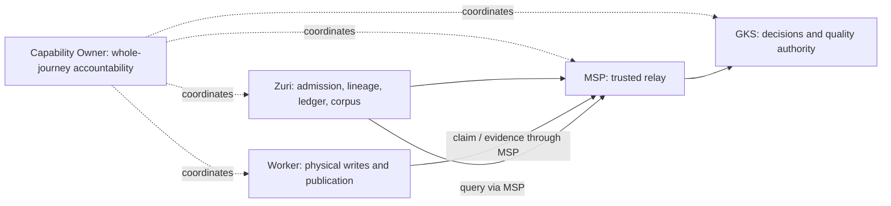

# GenesisRAG17 ownership and reliability design

## Status and mandate

The user requested a design and improvements to GenesisRAG17 on 2026-10-23,
then selected: retain four repositories, add end-to-end ownership and shared
contracts. The user then explicitly approved this complete design and directed
implementation planning followed by implementation in the same session.
The user's staffing clarification is solo development: Knowledge is Zuri's
architectural capability owner; the user holds product, development and
operations responsibilities. GKS retains external canonical-knowledge and
quality authority. Design approval does not certify standards compliance or
establish deployed behavior.

Audience: the Knowledge capability owner, the four component maintainers,
release/operations owners and implementation reviewers. This intake is the
reviewable design, not a second requirement registry. Acceptance below is
design acceptance; canonical statements and issued identities retain
their current authority.

## Intent and approaches

Make one identifiable owner accountable for a user's complete ingestion and
published-query journey while keeping each component's authority explicit.
An incident must have an accountable coordinator even before the failing tier
is known. A compatible release must be demonstrated across its actual consumers.

| Approach | Tradeoff | Disposition |
|---|---|---|
| Four repositories with a capability owner, component owners and coordinated contracts | Keeps shared infrastructure and existing authority; requires cross-repository qualification and an explicit operational handoff | Selected by the user |
| A separately deployed GenesisRAG17 orchestration service | Could isolate orchestration lifecycle; introduces a process, deployment, failure boundary and ledger-ownership decision | Considered; no evidence currently requires this extraction |

The selected design introduces no fifth service. Execution records remain on
the existing FR-071 ledger. Contract coordination uses normal source review,
CI and release records, not a new developer task ledger or DDC procedure.

## Current sources and evidence limits

| Source inspected | What it establishes |
|---|---|
| [Knowledge charter](../../domains/knowledge/CHARTER.md) | Knowledge owns Tier 1 preparation, lineage and receipt-bound evidence; consumes external knowledge authority |
| [Canonical feature](../../features/FEAT-013/feature.md) and its explicitly bundled records | Existing ingestion-governance scope; this proposal does not change membership |
| [Execution flow](../../KNOWLEDGE-INGESTION-17-STAGE-FLOW.md) | Component/stage responsibilities and historical isolated acceptance |
| [Approved wire contract](../../plans/GENESISRAG17-CONTRACT.md) | Exact scope, attempts, idempotency, evidence, quality gate and publication receipt |
| [ADR-073](../../decisions/ADR-073-GENESISRAG17-ISOLATED-EXECUTION-AND-PUBLICATION.md) | A prior implementation integration owner and separated logical/physical authority |
| [ADR-063](../../decisions/ADR-063-RETIRE-TIER1-GENESISBLOCKDB-DIRECT-CLIENTS.md) | MSP, GKS and GenesisBlock are external shared systems; Tier 1 cannot bypass their boundaries |
| [ADR-110](../../decisions/ADR-110-RETIRE-EDGE-DEVICE-AND-HARNESS-SURFACES.md) | Retired device/harness surfaces do not retire or transfer Knowledge/RAG |

The inspected Server source locates orchestration, evidence import and
publication guards in `apps/server/src/platform/integrations/core/`:
`genesisrag17-executor.js`, `genesisrag17-worker.js`,
`genesisrag17-importer.js` and `genesisrag17-publication.js`.
Knowledge contracts, admission and lineage remain under
`apps/server/src/modules/knowledge/`. Source placement does not transfer business
ownership. Older documents naming the executor under `modules/knowledge` need
reader reconciliation during adoption, with historical locators preserved.

Existing contracts already define several safeguards proposed below for
continued enforcement. This is not a finding that those safeguards are absent.
The accepted sources document a production SmartGift structured-record profile
and parser/ontology deployment pins in effect since 2026-09-21 (ADR-073's
production amendment and wire contract version 1.4.0b). Those documented facts
are retained. Local source inspection does not verify present-day liveness,
health, active grants, on-call rosters or SLO performance, nor the current
source heads of the other three repositories. Fresh operational/source evidence
is still required for adoption; historical deployment is not a current health check.

## Ownership and decision rights

Proposed enduring role: **GenesisRAG17 Capability Owner**, accountable for the
Zuri Knowledge ingestion-to-serving outcome. The role belongs with the
Knowledge capability, and coordinates the shared systems through their own
maintainers. It does not acquire ownership of those products or permission to
override their security, quality or publication decisions.

The user is the sole product owner, developer and operator. The roles below
describe decision rights, not additional teams or required hires. Knowledge is
the architectural owner of Zuri's integration capability; GKS is the external
authority it consumes. One person holds the product/development/operations
responsibilities, with no staffed backup currently declared. Document the
installation's contact and recovery handoff in its existing release/operations
evidence. Each decision still has one accountable role. AI worker session names
are not evidence of an independent operator or human backup.

| Outcome or decision | Accountable role | Execution responsibility and required participation |
|---|---|---|
| Business scope, priorities, whole-journey acceptance and reliability policy | Capability Owner | Knowledge and all affected component owners contribute; user/product authority approves changed product scope |
| Tier 1 admission, current ACL, immutable source lineage and corpus membership | Zuri Knowledge component owner | Knowledge maintainers implement business rules; Server integration maintainers implement process orchestration |
| Tier 1 orchestration, evidence import and lifecycle recovery | Server integration component owner | Maintain existing Core execution paths within Knowledge contracts and FR-071 semantics |
| MSP principal authentication, exact scope/role enforcement and relay | MSP component owner | MSP maintainers; Zuri agent-port owner participates for its consumer boundary |
| Canonical entity/fact/ontology decisions and Stage 17 quality verdict | GKS component owner | GKS maintainers; Capability Owner cannot turn a denial into approval |
| Native writes, checkpoints, candidate generations and atomic physical publication | GenesisBlock worker component owner | Worker/native-store maintainers; physical receipt requires actual evidence |
| Cross-repository contract compatibility and integrated release qualification | Capability Owner | A designated integration maintainer assembles evidence; every affected provider/consumer owner accepts its boundary |
| Production rollout and runtime operations for an installation | Installation operations owner | Component operators execute within existing deployment authority; Capability Owner owns user impact and coordination |
| Incident coordination until service recovery is verified | Capability Owner | Named incident lead coordinates; component owners diagnose/repair; operations controls live actions |

The Capability Owner retains accountability when work is delegated. External
component owners retain authority over their code, stores and contracts. An
unresolved owner disagreement blocks the affected change and escalates through
the documented product/installation authority; it is not resolved by direct
store access or by adding a new privileged caller.

## Stage and data authority

| Boundary | Preserved authority | Completion evidence |
|---|---|---|
| Before Stage 1 and Stages 1–8 | Zuri authorizes admission; owns versioned raw/parsed/chunks, attempts and source dispatch | Authorized immutable source, lineage hashes/offsets and measured stage evidence |
| MSP relay | MSP validates runtime principal and exact scope/role; executes no ingestion stage | Authenticated bounded relay outcome; no invented stage-success row |
| Stages 9–14 decisions | GKS owns semantic decisions; Stage 13 physical writes belong to worker | Decision-bound evidence; Stage 13 completion requires actual graph-write receipt |
| Stages 15–16 | Worker performs embedding/index construction within the accepted profile | Physical write/readback, checkpoint and benchmark evidence |
| Stage 17 | GKS decides quality/permission; worker performs atomic publication | Matching verdict and publication receipt under the exact accepted profile |
| Corpus serving | Zuri installs only verified read-set membership; MSP routes exact snapshot queries | Matching receipt, pinned corpus generation, validated citations and current ACL/revocation checks |

There is no new Stage 18. The existing `genesisrag17.v1` wire, stage identities,
profile-specific thresholds and distinction between a retry and a new attempt
remain authoritative. A general stage specification and the isolated profile
can use different verdict vocabularies: consumers must apply their selected
contract instead of accepting a convenient label from another profile.

Coordination arrows grant no runtime access. Query and worker routes remain
exactly those of the accepted wire contract; the diagram is an ownership view.

## Shared contract and change qualification

The approved wire contract remains the source for its current profile. Provider
schemas in external repositories remain provider-owned. During adoption, pin
the actual provider/consumer source revisions and resolve any differences
through a coordinated contract change before changing dependent code.

For every integrated release, the normal release evidence must bind the four
source/artifact revisions, wire/profile versions, parser/chunker/ontology and
embedding identities, relevant schema/migration versions, supported operations,
deployment topology and the executed consumer/provider qualification results.
Use the existing release/deployment evidence location; do not introduce a
second writable contract catalog or copy credentials into it.

An additive field is compatible only when all relevant parsers accept its
presence and its absence has a defined meaning. Reject incompatible scope,
identity, hash or publication semantics. Breaking changes require a separately
versioned contract and explicit in-flight drain or dual-version support; do not
silently reinterpret `genesisrag17.v1`. A receipt's version and generation must
be interpreted by a consumer qualified for them.

The integration maintainer collects compatibility evidence; each affected
component owner reviews its provider/consumer change. The Capability Owner
accepts the whole journey, while the installation owner separately authorizes
any live rollout. A Zuri-only change cannot certify other repositories or grant
authority over their production runtimes.

## Reliability, recovery and observability

Retain durable intent/outbox, immutable attempts, evidence-cursor validation,
receipt-required completion and candidate-before-publication behavior. Document
their actual implementation and measured limits per component before claiming
whole-system readiness.

| Failure | Required recovery behavior and owner |
|---|---|
| Submit succeeds but response is lost | Tier 1 retries the same immutable batch/key/attempt; provider deduplicates |
| Worker crashes during candidate writes | Worker reconciles durable transaction/checkpoint state; old published generation stays valid |
| Publication happens but acknowledgement is lost | Worker retries the same receipt; Zuri reconciles evidence without publishing or replaying a new attempt blindly |
| Evidence is duplicate, late, mismatched or out of scope | Owning receiver rejects/quarantines the mismatch without moving its durable cursor past invalid evidence |
| Dependency unavailable or retry budget exhausted | Operator can identify failing boundary, last durable progress and safe recovery action; no synthetic downstream success |
| Source access is revoked or deleted during a query | Zuri denies current serving/citation under existing current-ACL checks |
| Release compatibility fails | Stop promotion; preserve the old compatible serving generation; choose documented drain/rollback/reconciliation based on actual persistence compatibility |

Recovery must be bounded: define timeouts, transient/permanent error classes,
retry count/time budget and jitter, maximum admitted backlog, per-scope fairness,
and operator escalation for each active profile. First inventory existing
behavior; any changed runtime behavior needs its own canonical contract review
and implementation plan. No automatic deletion, blind replay, rollback across
incompatible persisted formats or new privilege follows from this design.

Operational telemetry should correlate the existing run/stage/step/attempt,
batch, decision, snapshot and generation identities. A trace ID supplements
those durable identities; it never authorizes a caller or substitutes for a
receipt. Follow OpenTelemetry context propagation where transport supports it;
do not add unreviewed fields to strict wire v1 merely for tracing.

Record queue age/depth, last durable stage/progress, dependency error class,
retry exhaustion, evidence-import lag and publication-to-corpus lag. Put
high-cardinality run/record IDs in protected logs/traces, not metric labels.
Exclude raw documents, chunks, prompts, credentials and personal data from
routine telemetry. Alerts identify a responsible role and a recovery procedure.

## Service indicators and target-setting

Proposed measurement definitions, subject to implementation qualification:

| Indicator | Numerator / denominator or measurement |
|---|---|
| Eligible-ingestion completion | Successfully served source versions / admitted versions whose agreed completion deadline fell in the window; service-caused failures and overdue unfinished work remain in the denominator |
| Policy outcome accounting | Separately report policy/security-denied and user-withdrawn admissions with audited reasons; neither is a successful publication or a hidden service error |
| End-to-end freshness | Admission timestamp to receipt-validated corpus-serving timestamp, per source version/profile and input-size band; also report overdue unfinished work |
| Query availability and latency | Authorized valid requests answered within the agreed deadline / authorized valid requests; include dependency timeouts/errors and report latency percentiles |
| Integrity and isolation | Count invalid publication, receipt/lineage mismatch and unauthorized cross-scope disclosure; each is an incident, never traded against an availability budget |

Measure a source version once for the end-user outcome; separately expose all
attempts/retries so replay cannot inflate success. Attribute exclusions to an
audited reason. Do not label a rejected request a successful query.

Collect a representative baseline across profile, input size and expected load,
then the Capability Owner and installation owner agree numeric targets,
measurement window, exclusions, error budget and alert policy. No 99.9% promise,
production capacity claim or zero-leak proof is invented from a synthetic run.
Every production profile needs approved numeric targets before declaring this
proposed operational profile adopted. Existing publication-quality thresholds
remain in force independently of later SLO calibration.

## Adoption and proposed acceptance

1. **Ownership and source reconciliation.** Record the solo owner, installation
   contact and recovery handoff; verify external repository instructions, current source and
   installation topology. Reconcile charter, Core service explanation and flow
   ownership wording through accepted decisions. Preserve historical evidence.
2. **Contract qualification.** Pin all four revisions; inventory schemas,
   operations, profile versions and persistence compatibility. Identify which
   safeguards already exist and which require canonical behavior changes.
3. **Implementation planning.** Produce a separately reviewed, file-owned plan
   after this design is accepted. Use existing commands/tests and ordinary Git
   review/CI; propose only necessary code, instrumentation or recovery changes.
4. **Integrated verification.** Qualify a real native ingestion/publication/query
   journey and the failure cases above in isolated scoped data. Include invalid
   credentials/scope, retry/restart, lost replies, stale evidence and revocation;
   bind every result to the exact four revisions and profile. Mocks prove only
   their seam, and historical acceptance does not count as a fresh run.
5. **Operational handoff.** Establish numeric SLOs, alerts, accessible runbooks,
   rollback/recovery compatibility and contacts. The installation owner approves
   rollout in its environment; subsequent live verification is recorded separately.

Acceptance requires identifiable staffed roles, no ambiguous authority at
Stage 13/17, qualified contracts, demonstrated safe recovery and whole-journey
evidence. A design review, passing Zuri governance, green component tests and a
live cross-repository run are separate acceptance facts.

## Decisions still required

- The user has identified sole product/development/operations ownership, and
  Knowledge is the architectural capability owner. Installation contact and a
  recovery handoff still need environment-specific documentation. No staffed
  backup or additional team is assumed.
- Select the first installation/profile for qualification and measure its
  workload, deployment state and numeric reliability targets.
- External maintainers must adopt any changed external contracts in their own
  repositories. Current provider source heads and present-day runtime health
  are unverified here; the documented SmartGift deployment is retained above.

Implementation choices left to the builder: telemetry backend, internal helper
layout and existing test-fixture reuse, within accepted authority, privacy and
contract boundaries. Extracting a service or changing ownership authority is
outside those routine choices.

## Engineering guidance used

This design applies published engineering guidance; it is not certification
against a formal standard or a requirement to use those cloud products.

- [AWS Well-Architected ownership](https://docs.aws.amazon.com/wellarchitected/latest/operational-excellence-pillar/relationships-and-ownership.html): identifiable resource, process and operations owners with negotiated team responsibilities.
- [Azure workload flow ownership](https://learn.microsoft.com/en-us/azure/well-architected/reliability/identify-flows): identify complete workload flows, process owners and escalation paths.
- [Google SRE SLO implementation](https://sre.google/workbook/implementing-slos/): define reliability from user outcomes and refine objectives using measurements.
- [OpenTelemetry context propagation](https://opentelemetry.io/docs/concepts/context-propagation/): correlate signals across execution boundaries without replacing business identity or authorization.

## Version and verification record

0.2.0: records explicit design/execution approval and the user's solo-developer
clarification. Knowledge owns Zuri's integration outcome; GKS retains its
external knowledge authority. No staffing, credentials or production state is
invented. See the [implementation plan](genesisrag17-implementation-20261023.md).

0.1.0: initial proposed design under the user's selected four-repository
approach. Adds proposed accountability, decision boundaries, contract
qualification, reliability measures and adoption acceptance. No canonical record,
issued ID, runtime behavior or deployed configuration is changed by this draft.

Independent builder review found no material planning questions after the
documented-deployment qualification above. Executed documentation checks and
their results are reported in the task handoff, separately from design authority.
External component tests, native acceptance and live rollout have not been
executed for this design.
