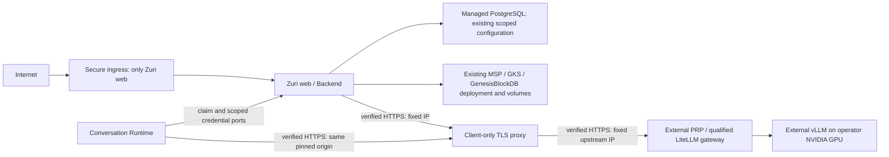

# Private Runtime integration operations

This guide implements the existing [FR-267](../features/FEAT-045/requirements/FR-267.md)
client boundary under [ADR-100 D7](../decisions/ADR-100-LINE-OA-RUNS-SERVER-EXECUTED-ON-BROWSER-PROVISIONED-API-KEYS.md).
It does not activate a Business, change cohort ownership, migrate a database or
qualify an inference engine. See the [implementation/audit plan](../plans/PRIVATE-RUNTIME-INTEGRATION-20261031.md).



The overlay adds only `prp-tls` and connectivity for existing `web` and
`conversation-runtime`. PRP owns its gateway, alias grants, vLLM, persistent key
state, model cache, GPU admission and engine operations. Do not deploy a second PRP
or GenesisBlockDB from this repository. [Existing knowledge deployment](docker-ngrok.md)
retains its qualified images, state/store volumes and backup procedure.
Supabase mode does not enable Compose's `local-db` profile. LiteLLM's virtual-key
database must use a separately owned database/schema and role; never point its
migration tool at Zuri tables. Supabase Auth/Storage are not migrated by this patch.

## Proposed amendment: Vercel frontend placement

The requested Vercel frontend plus self-hosted Backend conflicts with
[ADR-058](../decisions/ADR-058-DOCKER-COMPOSE-AND-NGROK-REPLACE-VERCEL.md),
which ships the combined Next.js UI/API in Docker. **Proposed, not adopted:** retain
that Backend and publish a separate frontend after its API-origin, cookies,
authentication, CSRF/CORS and release contracts are reviewed and tested.
This patch supports the current combined app; it does not claim a frontend split.
Neither a VPS nor a GPU cloud service is required for this integration.

## Security and transport

- `ZURI_PRIVATE_RUNTIME_BASE_URL` is operator-only. The browser supplies the
  provider, key and alias through existing Integration handlers, never an endpoint.
- Both executors accept HTTPS, or HTTP on exact loopback hosts only. Metadata,
  link-local, mapped-IP metadata spellings and non-destination literals are refused.
  `http://litellm:4000` remains invalid.
- Runtime requires its own matching `ZURI_PRIVATE_RUNTIME_BASE_URL`; a different
  Core-provided URL fails before key transmission. Deploy the environment setting
  with the Runtime update, including when using an existing HTTPS PRP directly.
- Docker uses a dedicated `internal: true` client network and one fixed proxy IP
  (default `10.246.99.10`). Its leaf certificate must contain that **IP SAN**. No
  DNS resolution occurs on the inference connections in this profile. The proxy
  connects to one literal upstream IPv4 address and verifies its configured TLS
  certificate identity against a separate upstream CA.
- Supply a dedicated CA through `NODE_EXTRA_CA_CERTS` at Node process startup;
  normal system trust remains enabled. No insecure TLS option is used. Protect CA
  custody: trusting a CA grants its signer server-identity authority in that process.
- The proxy permits only GET `/v1/models`, POST `/v1/chat/completions` and a local
  proxy health probe. No ports are published. It blocks administration, queries
  and other paths; it does not follow redirects. Both clients refuse redirects too.
- Existing arbitrary operator HTTPS hostname configurations retain their TLS
  behavior; their DNS/egress admission remains the operator's responsibility.
  The fixed-IP profile supplies the stricter connection-time destination binding.
- Bearer keys remain in the Business vault and claim-bound process memory. They
  are not proxy configuration, image layers or command-line arguments. Proxy
  access logs are disabled. Error bodies are not returned to users. PRP success
  bodies are bounded to 1 MiB; model lists to 256 KiB; timeouts include body reads.
  Cancellation prevents publication and aborts transport, but does not attest that
  upstream GPU computation stopped. Existing unknown-delivery reconciliation remains.
  The legacy HTTP worker does not turn an aborted polling request into durable-job
  cancellation. Its claimed job expiry reaches the provider; a signal is honored
  when explicitly supplied to the answer API. Runtime uses its existing claim and
  process cancellation boundaries. No new job-cancellation authority is introduced.

## Required operator configuration

Keep a mode-0600/owner-ACL environment file and private keys outside the checkout.
The existing [Docker runbook](docker-ngrok.md) defines `DATABASE_URL`, secret-store
and LINE/Core settings. This overlay additionally needs:

| Variable | Meaning |
|---|---|
| `CONVERSATION_RUNTIME_TOKEN` | Existing dedicated private Core token; never a model key |
| `ZURI_PRP_TLS_IMAGE` | Approved nginx image **with SHA-256 digest**, containing curl and envsubst |
| `ZURI_PRP_NETWORK` | Existing isolated external PRP Docker network |
| `ZURI_PRP_UPSTREAM_ADDRESS` | Exact gateway IPv4 and HTTPS port, e.g. `10.246.100.11:4443` |
| `ZURI_PRP_UPSTREAM_TLS_NAME` | Gateway certificate identity and HTTP Host; its virtual host must match this name |
| `ZURI_PRP_CLIENT_CA_FILE` | Client trust CA PEM, public certificate only |
| `ZURI_PRP_TLS_CERT_FILE` | Proxy PEM certificate, signed directly by that dedicated CA |
| `ZURI_PRP_TLS_KEY_FILE` | Matching protected private key; mounted only into proxy |
| `ZURI_PRP_UPSTREAM_CA_FILE` | Upstream trust CA PEM; mounted only into proxy |
| `ZURI_PRP_TLS_IP` | Optional proxy fixed IPv4, default `10.246.99.10` |
| `ZURI_PRP_CLIENT_SUBNET` | Optional unused Docker subnet, default `10.246.99.0/24` |
| `ZURI_PRIVATE_RUNTIME_MODEL` | Optional alias suggestion for the owner form |

The overlay sets `ZURI_PRIVATE_RUNTIME_BASE_URL` identically on web and Runtime,
and mounts only the client CA into them. It does not transfer web's env file,
Supabase credentials or proxy/upstream private keys to Runtime. Compose secrets
are read-only file mounts, not a claim of encrypted host storage.

Issue a leaf with `subjectAltName=IP:<ZURI_PRP_TLS_IP>`, appropriate server-auth
usage and a matching private key. Verify expiry, protect CA/private-key custody,
and keep the CA private key offline. Mount a separate upstream trust CA and
configure its exact TLS name. Never use the committed synthetic test certificates
for production. Docker secrets must be readable by their consuming process.
Choose non-overlapping subnets before creating networks.

From repository root (replace `PRIVATE_ENV` with the protected absolute path):

```sh
node --env-file=PRIVATE_ENV apps/server/deploy/private-runtime/check-config.mjs --network
docker compose --env-file PRIVATE_ENV --project-directory apps/server --profile conversation-runtime -f apps/server/docker-compose.yml -f apps/server/docker-compose.conversation-runtime.yml -f apps/server/docker-compose.private-runtime.yml config --quiet
```

The guard checks pinned proxy image, fixed destinations, certificate validity,
IP identity, matching key and CA, and rejects the committed public fixture key
even if it is reused in a different certificate. `--network` also requires an internal external
PRP network containing the exact upstream IP. It is configuration evidence,
not upstream authentication, readiness or generation evidence. Do not print a
resolved Compose configuration containing environment values into a public log.
Starting these services in a real environment is a separately authorized operation.
The proxy health check proves local TLS only. Runtime `/readyz` proves Core's
authoritative owner handshake, not PRP or GPU readiness.

## External LiteLLM and vLLM contract

The accessible PRP checkout at `E:/prp`, inspected at `12f0aab`, is separate and
unchanged. Its `prp-client.yaml` defines the two operations, Bearer auth, granted
model aliases and strict `ChatRequest` properties. Its control plane has no
runtime adapters; successful validation still leads to `503 STATE_STORE_UNAVAILABLE`.
The WP24 LiteLLM sub-spike is explicitly NOT_QUALIFIED, not a running platform.

The PRP operator must qualify its pinned release and configure a Business-limited
client key whose model listing and generation both enforce the same alias grants.
Do not give Zuri a LiteLLM master/admin key. An alias is an access-controlled
identifier, not a weight name or hardware-attestation claim. An illustrative
external LiteLLM mapping is:

```yaml
model_list:
  - model_name: business-a-local
    litellm_params:
      model: hosted_vllm/exact-served-model-name
      api_base: os.environ/VLLM_HTTPS_BASE_URL
      api_key: os.environ/VLLM_API_KEY
litellm_settings:
  drop_params: false
router_settings:
  num_retries: 0
  fallbacks: []
  content_policy_fallbacks: []
  context_window_fallbacks: []
  enable_weighted_failover: false
```

This is an example for the external operator, not a qualified replacement for
PRP routing or a guarantee that every LiteLLM release rejects every extra field.
Zuri sends exactly `model`, `messages`, `max_tokens`, `stream`. Reject unsupported
parameters at the PRP contract boundary. Do not configure wildcard aliases,
public-provider deployments, external default models, fallbacks, hedging or
automatic parameter-dropping. Verify provider/model access with restricted keys,
including a known existing alias denied to that key. See official
[virtual-key setup](https://docs.litellm.ai/docs/proxy/virtual_keys),
[vLLM route](https://docs.litellm.ai/docs/providers/vllm) and
[configuration reference](https://docs.litellm.ai/docs/proxy/config_settings).

vLLM must run from a pinned compatible image with NVIDIA Container Toolkit,
an admitted GPU device, a complete locally available pinned model/tokenizer,
an exact served-model alias and a measured context/VRAM budget. Require GPU
availability (`nvidia-smi` in the selected container), engine `/health` and a
synthetic completion before admission. Persist model cache on an external-owned
volume; disable unreviewed remote code and public model downloads. Use verified
TLS/private transport, API-key authentication, private ports, resource limits,
restart/log policies and appropriate prefix-cache isolation. Consult the pinned
[vLLM serving documentation](https://docs.vllm.ai/en/stable/serving/openai_compatible_server/)
and [security guidance](https://docs.vllm.ai/en/stable/usage/security/).

## GPU-free development and verification

The disposable fixture runs a mock HTTPS PRP and the **same nginx template** on
two private networks. It invokes the production Runtime model adapter with a
synthetic key, model listing, negative authentication and completion. It starts
no Backend database or real model and publishes no ports:

```sh
docker compose -p zuri-prp-dev -f apps/server/deploy/private-runtime/compose.dev.yml up -d --wait
docker compose -p zuri-prp-dev -f apps/server/deploy/private-runtime/compose.dev.yml run --rm probe
docker compose -p zuri-prp-dev -f apps/server/deploy/private-runtime/compose.dev.yml restart mock-prp prp-tls
docker compose -p zuri-prp-dev -f apps/server/deploy/private-runtime/compose.dev.yml run --rm probe
docker compose -p zuri-prp-dev -f apps/server/deploy/private-runtime/compose.dev.yml down
```

Fixture images use release tags for convenience; production requires independently
reviewed immutable digests. The committed fixture private key is intentionally
public and has no authority outside these tests. The existing Runtime image drain
smoke also uses synthetic HTTPS now; it must not require unsafe service-name HTTP.

For an authorized real TEST endpoint, start Node with the approved CA bundle,
`ZURI_PRIVATE_RUNTIME_BASE_URL`, `ZURI_PRIVATE_RUNTIME_PROBE_MODEL` and
`ZURI_PRIVATE_RUNTIME_PROBE_KEY_FILE` (a protected file). Run
`node services/conversation-runtime/scripts/probe-private-runtime.mjs`.
It sends synthetic evidence only, tests model-list membership, negative auth and
completion, and prints no key or answer. Set `ZURI_PRIVATE_RUNTIME_PROBE_DENIED_MODEL`
to a known existing alias withheld from the test key to require a 403 generation
refusal and its absence from the listing; without it that check reports NOT_RUN.
This is one provider-path check;
Business vault provisioning, forbidden aliases, GPU outages, exact model-to-node
mapping and deployed Core→Runtime execution need their own receipts.

## Production checklist, troubleshooting and rollback

Before release: qualify the external contract/release, per-Business grants,
invalid/unauthorized/missing aliases, unsupported fields, no-cloud-fallback behavior,
node outage, rate limiting and engine deadlines; record exact images, model hashes
and GPU identity. Verify TLS/CA expiry and fixed-IP/network admission. Validate
Compose, state backup/restore and persistent GenesisBlockDB volumes using its
existing acceptance procedure. Supabase target/credentials stay separately scoped.
Only publish Zuri through secure ingress; never tunnel PRP, vLLM, Genesis or
admin ports. Drain/reconcile existing claims under ADR-106 before switching any
cohort; release matching Core and Runtime configuration. Observe a separately
authorized synthetic end-to-end job with content-free receipts before real LINE.

| Symptom | Action |
|---|---|
| `PRIVATE_RUNTIME_NOT_CONFIGURED` / Runtime configuration refusal | Check both operator URLs and supported protocol; do not replace with service-name HTTP |
| TLS/network error | Check IP SAN, trusted CA, expiry, upstream TLS name and network membership; restart Node after CA changes |
| Model-key rejected | Verify the correct Business client key and grant; never substitute a master key |
| Model not found / 403 / 404 | Compare exact granted alias and vLLM served alias; no public fallback |
| 429 / 503 / timeout | Check external PRP admission, GPU health, capacity and deadline; preserve uncertain work instead of retrying into another provider |
| Empty answer | Inspect restricted provider diagnostics for truncation/reasoning-only output; never send private reasoning to LINE |
| Healthy proxy but failed conversations | Proxy health is local TLS only; run the scoped provider probe and inspect Core/Runtime claim receipts |
| Subnet overlap | Choose an unused subnet/IP and issue its IP SAN certificate; preserve existing networks |

Rollback: stop new Runtime claims, drain or explicitly reconcile in-flight and
ambiguous delivery states, then restore the previous matching Core/Runtime images,
URL and CA files. Keep the Business selected on `prp`; an unavailable PRP is a
controlled refusal, not permission to choose a public provider. Remove only the
opt-in proxy/connectivity after clients are drained. Keep all existing database,
Genesis, MSP/GKS and LiteLLM key-state volumes. Never use `down -v` as rollback.

Version 0.1.0: adds transport operations and external ownership/acceptance limits;
approved ADRs and canonical requirement records are unchanged.
