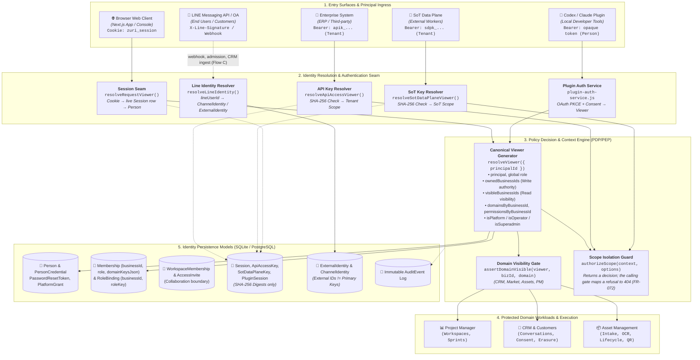
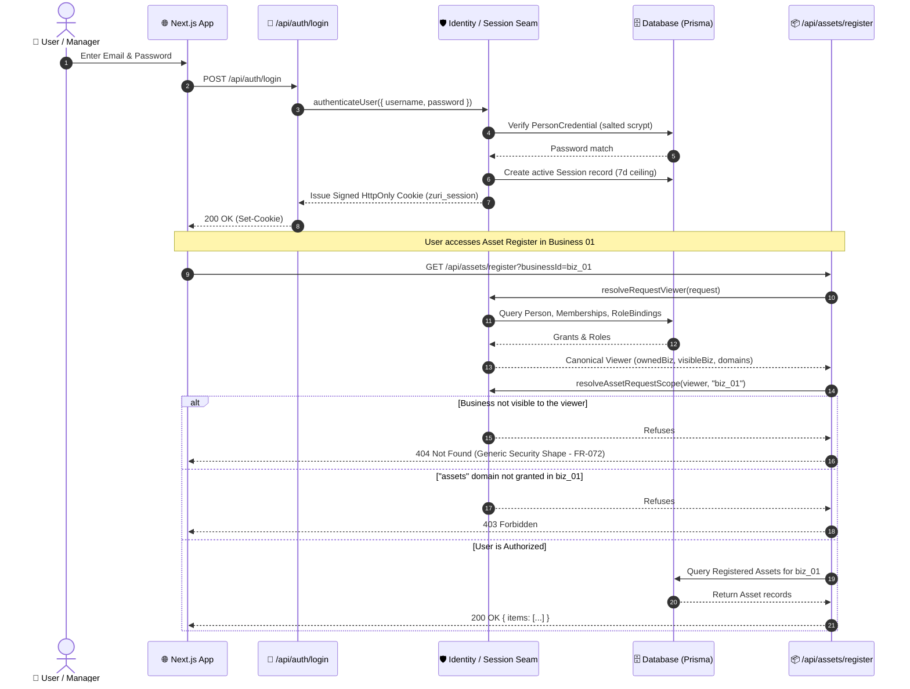
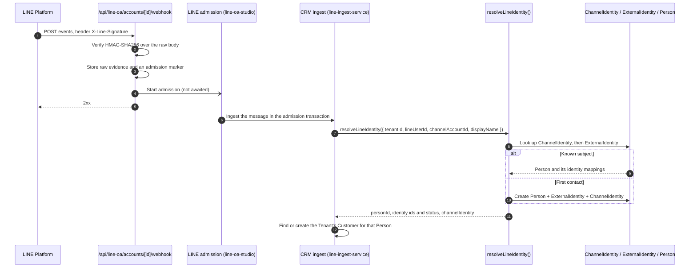

# Identity Domain — System Diagram & Architecture Specification

| Field | Value |
|---|---|
| **Domain** | `identity` (`DOM-IDENTITY`) |
| **Module** | `src/modules/identity` |
| **Authority** | Principal Resolution, Authentication Seams, Multi-Tenant PDP/PEP, Credential Isolation, PDPA Erasure |
| **Key Directives** | BR-001, BR-002, BR-016, SEC-001, SEC-005, SEC-014, SEC-023, SEC-025, ADR-017, ADR-018, ADR-027, ADR-045, ADR-047, ADR-052, ADR-079, ADR-088, ADR-110 (ADR-041 and ADR-059 are history) |

**Current state (2026-11-12).** The Edge Device and harness surfaces are retired
by ADR-110. Their flow and resolver are gone from the diagram below; the matrix
keeps one struck-through row, and the `EdgeDeviceCredential` and
`HarnessCredential` models remain in the schema. Sections 5 to 9 describe the
login, session, write-protection and isolation mechanics as the code stands at
`49b10eb3`; where a control is partial, the section says so. Function names,
viewer fields and token formats in sections 1 to 4 were corrected against the
same revision.

**Update (2026-11-13).** Section 7 now describes the same-origin write guard
(`src/middleware.js`) that sits in front of every API write route. Sections 5.1,
5.4 and 6 were adjusted to match; the other statements above still describe
`49b10eb3`.

---

## 1. High-Level System Architecture



---

## 2. Multi-Credential Separation Matrix

Per **ADR-047 D2**, credentials cannot be reused across mismatched security boundaries. Leaking one credential never satisfies a check for another:

| Credential Type | Token Format / Seam | Bound Scope | Context Produced | Target Routes / Usage |
|---|---|---|---|---|
| **Human Browser Session** | `zuri_session` (Signed HttpOnly Cookie) | **Person** (across visible Businesses) | Full `Viewer` object (`ownedBusinessIds`, `visibleBusinessIds`, `domainsByBusinessId`, `permissionsByBusinessId`) | Web App Console, Back-office navigation, settings |
| **Enterprise API Key** | `Bearer apik_...` | **Tenant-bound** | `{ isApiAccess: true, tenantId, serviceAccountId }` — no Person; routes test it with `isApiAccessFor(tenantId)` | `POST /api/import/*`, `GET /api/resolve`, `GET /api/docs` |
| **SoT Data Plane Key** | `Bearer sdpk_...` | **Tenant-bound** | `{ isSotDataPlane: true, tenantId, serviceAccountId }` — no Person; routes test it with `isSotDataPlaneFor(tenantId)` | SoT decision submit and export; the knowledge pipeline reporter routes under `/api/pipelines/knowledge/[executionRunId]` (ADR-067) |
| **Plugin Session** | An opaque Bearer token (32 random bytes, base64url; 15-min TTL), stored as a hash | **Person-Delegated** via PKCE + Consent | `Viewer` without platform authority | IDE Tools, Codex MCP calls |
| **API write CSRF token** | Header token from `GET /api/auth/csrf`, bound to the live session; lives at most 15 minutes and never past the session's expiry | **One session** | None. The write guard checks `Origin` separately; the token proves the caller holds that session | The session-cookie writes listed in §7 |
| **Password reset token** | Single-use (claimed atomically, so concurrent requests cannot both spend it; §5.3), 1-hour TTL, stored as a SHA-256 digest | **One Person** | None — it authorizes one credential change | `POST /api/auth/reset-password` |
| **Internal service bearer** | Deployment bearer token, one per contract | **One service contract** | Service identity only; Core re-resolves scope per call | `/api/internal/conversation-runtime/*`, `/api/internal/market-intelligence/*`, `/api/internal/scm/*`, `/api/line-oa/worker` and `/api/line-oa/rich-menu-worker` (the two LINE workers share one token) |
| **Provider webhook signature** | HMAC-SHA256 over the raw body (`X-Line-Signature`, `X-Notion-Signature`). Notion's first-time setup challenge is checked against a pinned verification token instead | **One provider account** | Verified origin of one event | LINE and Notion webhook routes |
| ~~Edge Device Credential~~ | `Bearer edgk_...` | Retired by ADR-110 | — | No route. Schema rows are historical |

---

## 3. Core Interaction & Authentication Flows

### Flow A: Human Login & Viewer Resolution (`resolveViewer` + `assertDomainVisible`)



---

### Flow B: Zuri Edge Device Authentication (`edgk_...`) — retired

Retired by [ADR-110](../../decisions/ADR-110-RETIRE-EDGE-DEVICE-AND-HARNESS-SURFACES.md).
No `/api/edge/**` or harness route exists in the current route tree (enumerated
at `49b10eb3`), and `tests/unit/edge-surface-retirement.test.js` asserts that a
fixed list of those paths stays absent. The `EdgeDeviceCredential` and
`HarnessCredential` models remain in the schema; no resolver reads either on a
request path. Whether a deployed database still holds such rows is not
something the repository shows. The sequence diagram that stood here described the ADR-059 pull
model and is kept in version control history.

---

### Flow C: External Channel Identity Resolution (LINE Webhook)



The webhook route never calls the resolver. It verifies, captures and
acknowledges; identity is resolved later, inside CRM ingest. The resolver
returns no principal type — `classify-principal.js` classifies a subject as
`STAFF`, `CUSTOMER` or `UNKNOWN` separately — and it creates no `ExternalRef`:
a LINE subject is mapped through `ExternalIdentity` and `ChannelIdentity`. The
`Customer` row is CRM's, created downstream of the resolver.

---

## 4. Non-Negotiable Invariants

1. **External IDs are Never Primary Keys (BR-002):**
   - External identifiers (`lineUserId`, `taxId`, `dbdNumber`, `deviceId`) are never to be used as internal primary keys. Records use internal UUID primary keys, and many business records also carry a human-readable code (identity records such as `Session` and `MfaFactor` have no code). The rule has known exceptions in the current schema, `NotionWebhookReceipt.eventId` being keyed by Notion's event id among them; the identifier page lists them. A LINE subject maps to a `Person` through `ExternalIdentity` and `ChannelIdentity`; `ExternalRef` maps a customer system's id to a Project-system entity and is not used for people. The [identifier and code system](../../architecture/IDENTIFIER-AND-CODE-SYSTEM.md) page lists the mapping tables found in a static review (not proven complete) and the known exceptions to this rule.
2. **Generic 404-Shaped Refusal (FR-072 / SEC-001):**
   - At the visibility and ownership gates — an invisible Business, a missing domain grant, a target the caller may not see — the system returns `404 Not Found` rather than `403 Forbidden` to prevent resource enumeration. This is a rule of those gates, not of every API: other refusals keep their own status, for example a `422` for an out-of-scope reference inside a sales-task write, or a `403` when minting a password reset without authority.
3. **Digest-Only Token Storage (SEC-025):**
   - Bearer credentials (`apik_…` API keys, `sdpk_…` SoT keys, and plugin access tokens, which are opaque random strings with no fixed prefix) and password reset tokens exist in plaintext only in the mint response and are persisted as hashes.
4. **PDPA One-Way Erasure Boundary (FR-022):**
   - `eraseCustomerPrincipal` (`POST /api/crm/customers/[customerId]/erasure`) requires explicit `confirmation: 'ERASE'`, executes in a single transaction, tombstoning `Message.body` and `RawExternalRecord` payloads permanently.

---

## 5. Human sign-in flows

Flow A covers password sign-in. These are the other ways a session comes into
being, changes strength, or ends.

### 5.1 Signup

`POST /api/auth/signup` creates a `Person` and a `PersonCredential`, then issues
a session through the same path as a password sign-in. It grants no Business,
Workspace, capability or platform authority — a new account can see nothing
until someone gives it a Membership or it creates its own Workspace (ADR-027).
The cookie is a browser-session cookie (no `maxAge`). Like every API write, the
route sits behind the same-origin write guard (§7), so a form posted from another
site is refused before the route runs.

### 5.2 Passkey sign-in and step-up

```mermaid
sequenceDiagram
    autonumber
    actor User as User
    participant Web as Next.js App
    participant Opt as /api/auth/webauthn/login/options
    participant Ver as /api/auth/webauthn/login/verify
    participant Up as /api/auth/step-up
    participant DB as Session / MfaFactor / PasskeyCredential

    User->>Web: Sign in with passkey
    Web->>Opt: POST
    Opt-->>Web: Challenge (held in this process, 5 min)
    Web->>Ver: POST signed assertion
    Ver->>DB: Verify credential, create Session (assurance WEBAUTHN)
    Ver-->>Web: Set-Cookie zuri_session (7 days)

    Note over Web,DB: A password session is AAL1 until it steps up
    User->>Web: Sensitive action
    Web->>Up: POST TOTP code
    Up->>DB: Verify sealed TOTP secret, set elevatedUntil = now + 15 min
    Up-->>Web: 200 (same session, now AAL2)
```

- A passkey session is AAL2 for its whole life. A password session is AAL2 only
  while `elevatedUntil` is in the future (`STEP_UP_WINDOW_SECONDS = 900`). The
  stored `assuranceLevel` column is descriptive and grants nothing.
- Step-up raises the current session; it does not issue a new one.
- TOTP secrets are AES-256-GCM envelopes bound to the Person and factor
  (ADR-088). Enrolling a factor and verifying a secret need the sealing key; in
  production a missing key makes those operations fail closed. Listing and
  revoking factors do not need it.
- The passkey challenge lives in a `Map` inside one Node process
  (`webauthn-challenge.js`) for five minutes and is single-use. The store holds
  at most 10 000 challenges; at the cap the oldest is evicted, never the new
  one refused. Production runs one `web` container (root `CLAUDE.md`, ADR-058,
  ADR-114; `docker-compose.yml` sets no replicas), so the process that issued a
  challenge is the one that verifies it, and a restart only costs the user one
  retry of the ceremony. **Limit:** a second web process would not see the
  first one's challenges, so scaling `web` out needs a shared challenge store
  first. This is a deliberate single-instance choice, not a durable store.
- Passkey sign-in options and verify are rate limited per client address and
  per identifier (§8). The limit is what bounds how fast an anonymous caller can
  fill the challenge map.

### 5.3 Password reset

There is no public "forgot password" request. An installation operator, or an
owner of a Business in which the target person holds a Membership, mints a
token for that person (`POST /api/platform/users/password-resets`); being an
owner somewhere else is not enough. The token is
shown once, stored as a SHA-256 digest and expires after one hour. The person
spends it at `POST /api/auth/reset-password`, which changes the credential and
revokes **every** active session of that person. Spending is atomic: a single
conditional update claims the token (`usedAt` still null and not expired) before
the credential is touched, so of any number of concurrent requests with the
same token exactly one succeeds; the others open no transaction and get the
same generic `INVALID_OR_EXPIRED_TOKEN`. Only the winner runs the short
credential-and-audit transaction. If that transaction fails, the claim is
released best-effort so the token is not burned; a process crash between claim
and commit does burn it, and the operator mints a new one.

### 5.4 Sign-out

`POST /api/auth/logout` revokes the current `Session` row and clears the
cookie. Because a request with a persisted session checks the cookie against
its row (§6), a revoked session stops working at once even if the cookie is
replayed. Outside production, a legacy token that carries no session id is
accepted without a row, and sign-out has no row to revoke for it.

Sign-out is **not** an exception to the same-origin write guard (§7). A forged
cross-site `POST /api/auth/logout` could otherwise end a victim's session, and the
guard costs the legitimate caller nothing: the sign-out `fetch` is same-origin, so
the browser already sends a matching `Origin`. A caller that sends no `Origin`
(curl, a script) is still admitted, as for every write.

### 5.5 Invitation

Workspace invitations (`/api/workspace-invites`, `/accept`) require a live
session and bind the new `WorkspaceMembership` to that session's Person — the
invite link alone creates nothing. Tenant- and Business-scoped `AccessInvite`
operations are exposed through `POST /api/access-invites`, `POST
/api/access-invites/accept`, `POST /api/access-invites/decline` and `DELETE
/api/access-invites/[id]`. All four resolve the live request viewer and verify
the session-bound API-write CSRF token before mutation. Acceptance and decline
use the session principal, never an invited email or LINE identity. TENANT and
BUSINESS grants remain `Membership` writes through the Identity service; the
scope-specific authority refusals and audit events are unchanged. The existing
`/api/workspace-invites` routes and `mintWorkspaceInvite` are unchanged under
AC-195.9.

## 6. Session contract

| Property | As built |
|---|---|
| Cookie | `zuri_session`; `HttpOnly`; `SameSite=Lax`; `Secure` in production; path `/` |
| Token | `zuri_sess.<payload>.<HMAC-SHA256>`; payload carries `sub`, `iat`, `exp` and, on every token the current sign-in paths issue, `sid`; signed with a session secret of at least 32 characters |
| Server record | A `Session` row holding the token's SHA-256 hash, status, assurance, `lastSeenAt` and expiry |
| Lifetime | Seven days from issue (`SESSION_MAX_AGE_SECONDS`). No refresh, no rotation, no idle timeout |
| Cookie persistence | Password sign-in: browser-session, or seven days with "remember me". Signup: browser-session. Passkey: seven days |
| Validation | A request verifies the signature and then, for a token with `sid`, the live `Session` row. Production rejects a token without `sid` and fails closed when the session store is unreachable; outside production a legacy token without `sid` is accepted on its signature alone |
| Revocation | Sign-out revokes one session; password reset revokes all |
| Viewer | `resolveRequestViewer` returns 401 without a session and 503 on a store failure. `resolveViewer({ principalId })` recomputes active, unexpired Memberships on every request; operator and superadmin grants are re-read from the database, never taken from the cookie |

There is exactly one `middleware` file, `apps/server/src/middleware.js`, and it
does one thing: the same-origin write check in §7. It authenticates and
authorizes nothing. An authenticated resource route still resolves its own viewer,
and the owning service decides whether that viewer may touch the resource. Public
sign-in, signup, reset consumption and logout use their own seams (logout accepts
a missing cookie and revokes only when one is present); a machine-facing route
checks its own bearer, signature or token instead. Nothing global stands in front
of a route that checks none of these: that control is each route's own code and
tests.

## 7. Protection of cookie-authenticated writes

Three controls exist. The first two cover every API write route; the third adds a
session-bound token on the routes it names.

| Control | What it checks | Where it applies |
|---|---|---|
| `SameSite=Lax` | The browser withholds the cookie on a cross-site `POST` | Every cookie-authenticated route. Kept as defence in depth; it is no longer the only control |
| Same-origin write guard (FR-252, ADR-097; `src/middleware.js` calling `modules/identity/same-origin-write.js`) | For `POST`, `PUT`, `PATCH` and `DELETE` under `/api/**`: a present `Origin` must equal the origin of `PUBLIC_BASE_URL` (when it is configured) or the request's own host (first `X-Forwarded-Host` value, else `Host`) with the same scheme (the configured origin's scheme, else the first `X-Forwarded-Proto` value, else any). `Origin: null`, an empty or an unparsable value is refused. With no `Origin`, `Sec-Fetch-Site: cross-site` or `same-site` is refused. A refusal is `403 CSRF_INVALID` with `Cache-Control: no-store` and an `X-Request-ID`, returned before the route runs | Every route handler that exports a write method: 271 route files at `d01c388c`, all under `/api` |
| API write CSRF token (FR-252-P2, `api-write-csrf.js`) | `Origin` equals the origin parsed from `PUBLIC_BASE_URL` (never the request host, and a missing `Origin` is refused), plus a token bound to the live session that lives at most 15 minutes and never past the session's expiry | Project feature writes, project governance snapshots, agent approval decisions and notifications, agent mission submissions, Office Design registration, managed-blob transfer and recovery, `POST /api/access-invites`, `POST /api/access-invites/accept`, `POST /api/access-invites/decline`, `DELETE /api/access-invites/[id]`. These keep the stricter check on top of the guard |

**What the guard does and does not prove.** It makes a cross-site page unable to
drive a browser into an API write, including `POST /api/auth/login`,
`/api/auth/signup`, `/api/auth/reset-password` and `/api/auth/logout`. It does not
authenticate anyone, and it does not replace a route's viewer, step-up or
ownership checks.

A request that carries neither `Origin` nor `Sec-Fetch-Site` passes. That is
deliberate: bearer callers, provider webhooks (LINE, Notion), service callers
(`/api/internal/**`, the LINE workers), plugin tools and curl send neither header.
A browser always sends `Origin` on a cross-origin write, so a missing header means
no browser is forging the request. The guard trusts the `X-Forwarded-Host` the
proxy supplies for the host comparison; a page on another site cannot set that
header in the victim's browser, and a caller who can set it holds no browser
cookie to forge.

**Same-origin clients need no change.** A same-origin `fetch` or form `POST`
carries an `Origin` equal to the page, so the web console, the sign-in and signup
forms and the consent form already satisfy the guard. A contract test
(`write-client-origin-contract.test.js`) fails if client code sets `mode:
'no-cors'`, `referrerPolicy: 'no-referrer'` (which turns `Origin` into `null`) or
posts to an absolute URL of an app write route.

**Coverage is enforced, not assumed.** `write-route-coverage.test.js` walks every
`route.*` under `src/app`, finds each exported write method, and fails when a
write route lies outside `/api`, when the middleware matcher does not cover it,
when a cross-site `Origin` is not refused for it, or when a Server Action
(`'use server'`) appears. A future route therefore inherits the guard by default.

**Exceptions.** `CROSS_ORIGIN_WRITE_ALLOWLIST` is empty. No route supports a
browser caller from another origin, so no bearer or signature route needs an entry
either: its callers send no `Origin` and already pass. An entry would be needed
only for a route that a page on another origin must call. Its reason must state
that the route authenticates by bearer token or signature and never by cookie, and
the test fails on an entry with no reason or one that matches no route. Sign-out
is covered, not excepted (§5.4).

**Limits of this evidence.** The decision function, the middleware and the route
walk are unit-tested. The refusal was also confirmed over HTTP against a built
`next start` (cross-site login, logout with `Origin: null`, and a cross-site
`DELETE` returned 403; a same-origin request passed the guard and reached the
route, which then failed for lack of a database). No real browser was driven, so the claim that browsers send a matching `Origin` on
same-origin writes rests on the Fetch specification and the contract test above.

Other route-specific checks still apply to most routes (a viewer, step-up, an
owner or operator gate). A static scan at `49b10eb3` found 24 write route files
that do not name `resolveRequestViewer` or `resolveViewer` themselves; the scan was
not repeated at `d01c388c` and judged no seam sufficient. Seven delegate to a
helper that resolves the viewer. The other seventeen have another seam:

- public credential flows: `auth/login`, `auth/signup`, `auth/reset-password`;
- session read directly: `auth/logout`;
- provider signatures: `integrations/notion/webhook`, `line-oa/accounts/[id]/webhook`;
- service and deployment bearers: `internal/conversation-runtime/v1` and `v2`,
  `line-oa/worker`, `line-oa/rich-menu-worker`, `agent/memory-retention`,
  `crm/retention-sweep`, `platform/programme-usage-reports`,
  `platform/usage-events/rollup`, `growth/external-marketing-reports`;
- plugin tokens: `plugin/auth/token`, `plugin/auth/revoke`.
## 8. Rate limiting


| Surface | Limit | Storage | Note |
|---|---|---|---|
| Password sign-in | 10 per identifier + address, 50 per identifier, 200 per address, each per 15 min | `RateLimitBucket`, compare-and-set | The address comes from `x-forwarded-for`, counted from the right by `ZURI_TRUSTED_PROXY_HOPS`. When the chain is missing, too short or not an IP, only the identifier bucket is consumed |
| TOTP verify and step-up | 5 per Person per 15 min, one shared bucket | `RateLimitBucket` | |
| Credential writes | 5 per Person + Business per 15 min; actions that call LINE also consume an installation-wide 60 per 60 s | `RateLimitBucket` | ADR-089 D4 |
| Signup | 20 per source key per 15 min | **Memory of one process** | Multiplies by replica count and resets on restart; `signup-rate-limit.js` says so itself |
| Passkey sign-in options and verify | 60 per client address (one bucket shared by both calls) and 20 per identifier (options: the requested email; verify: the credential id; hashed into one key space, so a value used as both counts in one bucket), each per 15 min | `RateLimitBucket`, compare-and-set | Same address rules as password sign-in. With no usable address only the identifier bucket is consumed; with neither, nothing is. Keys are hashed. The refusal is `429 PASSKEY_LOGIN_RATE_LIMITED` with `Retry-After` |
| Reset-password consume | **No request limit** | — | The token is 256 random bits, expires in an hour and is spent atomically (§5.3), so a guess cannot succeed and a replay cannot double-spend. There is still no cap on how many guesses a caller may send |

## 9. Application authorization and database isolation

Tenant isolation is enforced in two places that must not be confused.

- **Application layer — always.** An ordinary viewer's visible and owned
  Business ids come from persisted Memberships; platform and superadmin grants
  widen visibility from their own persisted grant state. The owning services
  filter by that scope. There is no global gate (§6), so this holds route by
  route, and it is the control on every database profile, including local
  SQLite.
- **Database layer — cloud target.** ADR-018 requires row-level security for
  the Supabase production target. The migrations enable RLS across the
  application schema (`20260818084011_application_schema.sql`) and force it on
  `Person` (`20260922100000_force_person_rls.sql`).

The intended runtime roles (`zuri_app_runtime`, `zuri_web_login`) and their
grants are described in [SYSTEM-DIAGRAM.md](../../SYSTEM-DIAGRAM.md) and the
[Phase B persistence security policy](../../architecture/project-manager-system/25-PHASE-B-PERSISTENCE-SECURITY-POLICY.md).
What the repository does not establish: whether the self-hosted PostgreSQL
production target (ADR-114) carries the same RLS contract, and which role a
deployed application actually connects as. A migration file proves neither
that the migration was applied nor which role the running application uses.

## Version diff

1.1.1b → 1.2.0b (2026-11-13): adds the same-origin write guard (`src/middleware.js`, FR-252 / ADR-097) in front of every API write route, with a route-tree coverage test and an empty cross-origin allowlist; closes the sign-in/signup login-CSRF gap and covers sign-out instead of excepting it; replaces the former list of 24 session writes that relied on `SameSite=Lax` alone. Introduces no route, model, permission or requirement id.

1.1.0b → 1.1.1b (2026-11-13): records two identity code changes and their
remaining limits. Password-reset consumption claims the token with one
conditional update (§5.3, §8), closing the concurrent double-spend. Passkey
sign-in options and verify are rate limited (§8), and the in-process passkey
challenge store is bounded with the single-instance limit stated (§5.2).
Documents code changed in the same pull request; no route, model, migration or
requirement id is introduced.

1.0.0b → 1.1.0b (2026-11-12): removes the retired Edge Device nodes and
sequence diagram and strikes through its matrix row (ADR-110); corrects Flow A
to salted scrypt, a seven-day session and the real function names; redraws
Flow C to the admission and CRM-ingest path the code follows; corrects viewer
fields, key contexts, the plugin token format and invariants 1 and 2 against
source; adds the remaining credential kinds to the matrix; adds
sections 5–9 for signup, passkey and step-up, password reset, sign-out,
invitation, the session contract, write-protection coverage, rate limiting and
the application/database isolation boundary. Describes existing code only; no
route, model, permission or requirement is introduced.
