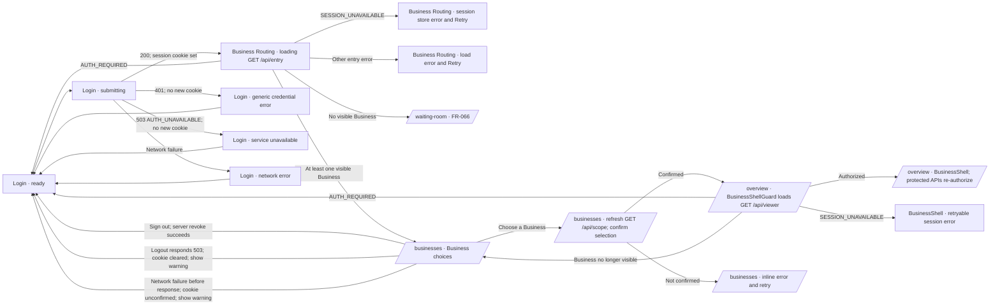

# FR-046 — Production viewer session and entry contract

| Field | Value |
|---|---|
| **Version** | 0.3.1b |
| **Status** | Implemented — beta |
| **Date** | 2026-10-03 |
| **Relates to** | ADR-017, SDD-024, SEC-008, FR-031, FR-044, ZV2-CR-002 |

## User story

Browser fixture clarification (0.3.0b → 0.3.1b): `loginAsOwner` completes only
after successful credential submission reaches `/businesses`. Callers may then
navigate to another protected surface. A delayed-response browser regression
guards this boundary; see the [login race RCA](../../../../.brain/rca/2026-10-03-e2e-login-navigation-race.md).
Production authentication and session behavior are unchanged.

As a signed-in Zuri user, I want Business Routing to return only Businesses that my
server-authenticated identity may access, so that hidden tenant/business information
cannot be inferred from browser traffic.

## Requirements

1. WHEN `/businesses` loads THEN the system SHALL obtain its complete routing payload
   from one viewer-scoped `GET /api/entry` response.
2. WHEN a trusted session resolves a principal THEN the system SHALL apply
   `resolveViewer()` and query only Businesses in `visibleBusinessIds` plus their
   minimum Portfolio/Tenant ancestry.
3. WHEN no trusted session exists THEN the system SHALL return `401 AUTH_REQUIRED`
   without querying or returning Business inventory.
4. WHEN an authenticated viewer has no Business grant THEN the system SHALL return
   `200` with an empty Business list and no unrelated ancestry.
5. IF a client supplies a principal, role, platform flag, visible ID, or domain grant
   THEN the system SHALL ignore or reject it; authorization SHALL come only from the
   server session and persisted Membership/platform authority.
6. WHEN the session adapter fails THEN the system SHALL return a non-disclosing `503`
   and SHALL NOT fall back to a demo owner or broad scope.
7. WHILE the compatibility window is active THEN `/api/viewer` SHALL use the same
   request-session seam and `/api/scope` SHALL NOT be used by Business Routing.
8. WHEN a user submits an identifier (email or account code) and password to
   `/api/auth/login` THEN the system SHALL verify the persisted `PersonCredential`
   and return a signed, expiring HttpOnly `zuri_session` cookie; missing or invalid
   credentials SHALL return a generic `401` without issuing a cookie.
9. WHEN a user posts `/api/auth/logout` THEN the system SHALL clear the signed
   session cookie; no local-demo capability, seeded-owner fallback or client identity
   input SHALL authenticate a request.

## Acceptance criteria

- [x] AC-046-01 OWNER receives only Businesses granted by persisted Membership scope.
- [x] AC-046-02 MEMBER receives only explicitly granted or tenant-wide allowed Businesses and only granted domains.
- [x] AC-046-03 DEV access requires a server-held platform grant; Membership cannot promote a user to DEV.
- [x] AC-046-04 Empty grants return `200` with `businesses: []` and no hidden ancestry.
- [x] AC-046-05 Missing/expired/revoked session returns `401` before any scope query.
- [x] AC-046-06 Forged client principal/role/platform/business fields do not affect the result.
- [x] AC-046-07 Cross-tenant IDs and unrelated Portfolio/Tenant labels never appear in the payload.
- [x] AC-046-08 Session adapter failure returns `503` and no local fallback.
- [~] AC-046-09 `/businesses` loads choices from one entry fetch and does not call `/api/viewer`; current selection confirmation still calls `/api/scope` (see UX map implementation deviation below).
- [x] AC-046-10 BusinessShell and protected APIs still re-authorize the active Business/resource server-side.
- [x] AC-046-11 Credential login verifies `PersonCredential`, rejects empty/invalid credentials generically, and issues no cookie on failure.
- [x] AC-046-12 Successful login issues a signed expiring HttpOnly session; logout clears it; tampered and expired tokens are unauthenticated.
- [x] AC-046-13 No local-demo capability, seeded-owner fallback or client-controlled identity path remains in runtime authentication.
- [~] AC-046-14 Authentication unit/contract/integration/browser paths, build, docs graph/preflight/check, and diff gates pass; four unrelated global-view smoke assertions still require explicit project/workspace scope.
- [x] AC-046-15 Login issues a browser-session cookie by default and the existing signed seven-day cookie only when the caller opts in ("remember me"). The signed ceiling at `SESSION_MAX_AGE_SECONDS` is unchanged, and the opt-in never enters the token payload or the credential check — it selects the cookie's `Max-Age` and nothing else.

## Credential login to Business Routing — UX maps

This is an as-built interaction map checked against `origin/main` at commit
`982ae10ab9e03be8a9ef4af34fb46ba58c24d04b` on 2026-10-18. It describes the
current route and screen structure; it does not add or change an authentication,
membership, or authorization rule.

Design handoff terms used here:

- **User flow** records the user's goal and the decisions that change the route.
- **Wireflow** connects screen states to the actions and system results between
  them.
- **Wireframe** records each screen's content hierarchy and control placement.
- **High-fidelity UI mockup** (also called a UI design frame) is the detailed
  visual page a designer presents in Figma. A linked, clickable series of those
  frames is a Figma prototype. A mockup is a proposal; it is not a screenshot
  of the running application or approval to change its behavior.

### User flow: credential login to an authorized Business

```mermaid
flowchart TD
  A[Open /login] --> B[Enter email or account code and password]
  B --> C{POST /api/auth/login}
  C -->|PersonCredential verified| D[Issue signed HttpOnly zuri_session]
  D --> E[Redirect to /businesses]
  C -->|401 invalid credentials| F[Show generic credential error; no new session cookie]
  F --> B
  C -->|503 authentication unavailable| G[Show service unavailable error; no new session cookie or local fallback]
  G --> B
  C -->|Network failure| H[Show network error]
  H --> B
  E --> I[GET /api/entry with signed session]
  I --> J{Any Business grants visible to this viewer?}
  J -->|One or more| K[Show Business choices, including when only one exists]
  K --> L[User selects a Business]
  L --> M[Persist selection; current code refreshes GET /api/scope]
  M --> N{Selected Business remains in refreshed scope?}
  N -->|Yes| O[Open /overview; BusinessShellGuard checks GET /api/viewer]
  N -->|No| P[Stay on /businesses and show an inline retry message]
  J -->|None; response has businesses: []| Q[Route to /waiting-room per FR-066]
  E -->|AUTH_REQUIRED| A
  E -->|SESSION_UNAVAILABLE or entry read error| R[Show an error state with Retry]
```

Between choosing a Business and entering `/overview`, the current code refreshes
`GET /api/scope`; see the implementation deviation below.

The login page also links to `/reset-password` and `/signup`. Those are separate
credential-redemption and account-creation paths ([FR-104](FR-104-owner-assisted-password-reset.md)
and [FR-120](FR-120-self-serve-account-creation.md)); they are not intermediate
steps in the successful credential-to-Business path above.

### Wireflow: screens, states, and route transitions



### Implementation deviation: Business selection refresh

The accepted FR-046 AC-046-09 and ADR-017 D5 require Business Routing to avoid
`/api/scope`. The current page loads its Business choices from `GET /api/entry`,
but after an explicit choice it calls
`ScopeContext.refreshForBusinessEntry()`, which forces a fresh `GET /api/scope`
before navigating to `/overview`. For ordinary viewers, the endpoint filters
the response by the current viewer; trusted installation operators receive full
scope with either a server-held platform grant or the distinct superadmin grant.
It returns a wider payload than the minimal entry DTO, including Portfolio,
Tenant, Business, Workspace, and Project data. After navigation, the
`BusinessShellGuard` separately loads `GET /api/viewer` and checks the current
viewer and selected Business before mounting the shell; protected APIs authorize
their own requests. The `/api/scope` call is an unresolved implementation
deviation, not an approved routing contract. AC-046-09 is marked partial until
the selection transition uses an accepted viewer-scoped confirmation path. The
page must not use that refresh to expand the Business choices shown to the user.

`/businesses` remains an explicit selection boundary for a viewer with one
visible Business; it does not auto-skip to `/overview`. A viewer with no visible
Business goes to the profile-first pre-Business journey instead of seeing an
empty picker. The sign-out control is provided by the shared
[`BusinessRoutingShell`](../../../../apps/server/src/components/layouts/BusinessRoutingShell.jsx).

### Low-fidelity wireframes: screen anatomy

These tables capture the current information hierarchy without pretending to be
a pixel-accurate screenshot. The `/businesses` page is the main design target
for a Figma-style high-fidelity mockup.

#### Login — `/login`

| Screen region | Current content and control | Behavior |
|---|---|---|
| Entry header | `ZURI` mark and `ETOHGROUP` label | Uses the minimal EntryShell, outside BusinessShell. |
| Heading | `Console Sign In`, `Sign in to Zuri`, and a short account-access description | Establishes that this is credential sign-in. |
| Credential form | Email or account code; password; optional `จดจำฉันไว้` checkbox | Submits to `POST /api/auth/login`; the checkbox chooses cookie lifetime only. |
| Support actions | `ลืมรหัสผ่าน?` and `สมัครสมาชิก` | Link to `/reset-password` and `/signup`; these have separate feature contracts. |
| Form feedback | Submit label changes to `Signing in…`; generic credential, service, or network feedback appears beside the form | Prevents a service outage from being described as a wrong password. |
| Primary action | Full-width `Sign in` button | Disabled while the request is in flight. |

#### Business selection — `/businesses`

| Screen region | Current content and control | Behavior and visibility |
|---|---|---|
| Pre-shell canvas | Neutral page surface and a centered content area up to `max-w-5xl`; no BusinessShell sidebar or DomainBar | The user is signed in but has not entered an operating Business. |
| Top action | `ออกจากระบบ` at the top right | Posts to `/api/auth/logout` and routes to `/login`; an HTTP 503 revoke-failure response clears this browser cookie and warns that the server session may remain active elsewhere. If the request fails before a response, the same warning text says browser sign-out succeeded even though cookie clearing is unconfirmed and the cookie may remain. |
| Page header | Eyebrow `Business Routing`; title `Choose a Business`; subtitle explains that Portfolio and Tenant are context labels only | Gives the user one clear task before entering the product shell. |
| Business choices | One card per visible Business: `Building2` icon, Business name, code, Portfolio and Tenant labels, and an arrow | Each full card is a keyboard-operable button; the list is limited to the viewer-scoped `/api/entry` response. |
| Opening state | `กำลังตรวจสอบสิทธิ์ธุรกิจ…` and the chosen card reports `aria-busy` | All choices are disabled until the selected Business scope is confirmed. |
| Selection failure | Inline Thai retry message beside the heading | Keeps the user on `/businesses`; selection state is not treated as authorization. |
| Conditional owner action | `Add a Business to an owned Tenant`, Tenant selector, Business name, and create action | Rendered before the Business choices and uses the primary button style; available only when an entry Business includes `canCreateBusiness: true` for an owned Tenant. |
| No Business grant | Redirect to `/waiting-room` under FR-066 | The normal route does not show an empty Business picker or invite the user to create an operating scope without the required grant. |
| Entry read failure | Retryable error state | `AUTH_REQUIRED` routes to `/login`; session-store failure stays an error so an outage is not misreported as sign-out. |

The list uses a two-column layout at the existing `sm` breakpoint and a single
column on narrower screens. Focus uses the shared focus-ring token. The optional
create form appears before the selection list only for viewers whose response
contains an owned Tenant with `canCreateBusiness: true`; that order and primary
button prominence reflect the current source.

### State and authorization contract

| State | User-visible result | Next action |
|---|---|---|
| Invalid credentials (`401`) | Generic credential error; no new session cookie is issued | Correct the credentials and retry. |
| Authentication service unavailable (`503`) | Service-availability message; no new session cookie and no local authentication fallback | Retry when the service is available. |
| Login network failure | Network error on `/login` | Retry sign-in. |
| Entry request loading | Loading surface while the single `GET /api/entry` settles | Wait. |
| Missing/expired session (`AUTH_REQUIRED`) | Replace route with `/login` | Sign in again. |
| Session store unavailable | Retryable session error on Business Routing | Retry the entry read; do not present the state as invalid credentials. |
| No visible Business | Route to `/waiting-room` under FR-066 | Follow the pre-Business onboarding path. |
| One or more visible Businesses | Show explicit choices; keep the screen even for one result | Choose the Business to enter. |
| Selected Business remains in refreshed scope | Route to `/overview` | BusinessShellGuard loads `/api/viewer` and checks the viewer and selection; protected APIs authorize their own requests server-side. |
| Selected Business scope not confirmed | Inline error; remain on `/businesses` | Select again to refresh the current scope from `GET /api/scope` and confirm access; this current behavior conflicts with AC-046-09. |
| BusinessShell guard has no valid session | `AUTH_REQUIRED` returns to `/login`; `SESSION_UNAVAILABLE` shows a retryable error | Sign in again for `AUTH_REQUIRED`; retry the viewer read for a session-store outage. |
| Selected Business is no longer visible | Return to `/businesses` before BusinessShell mounts | Choose a Business from the current entry list. |
| Sign-out revoke fails with an HTTP 503 response | Warning alert says browser sign-out succeeded and server revocation could not complete; the response clears this browser cookie and routes to `/login`, while the server-side session may remain active elsewhere | Sign in again when needed. |
| Sign-out request fails before an HTTP response | The same warning alert says browser sign-out succeeded, then routes to `/login`; cookie clearing and server revocation are unconfirmed, and the HttpOnly cookie may remain | Restore connectivity and try signing out again. |

Authorization and data invariants for the wireframe and any later mockup:

1. `GET /api/entry` is the viewer-scoped source for the initial choice list and
   no-grant route decision. It returns only Businesses allowed by the
   authenticated viewer's `visibleBusinessIds`; the page must not expose
   broader Tenant or Business inventory. The current post-selection
   `/api/scope` refresh is the unresolved deviation above.
2. On existing Business choices, Portfolio and Tenant appear as ancestry labels,
   not as operating contexts. The owner-only create form separately lets an
   authorized viewer choose an owned Tenant as the destination for a new
   Business; that selection does not enter or grant access to the Tenant.
3. A browser-side Business selection records intent; it does not grant access.
   The current implementation refreshes `/api/scope` before entering
   `/overview`, contrary to AC-046-09. BusinessShellGuard checks the current
   viewer and selected Business through `/api/viewer`; protected APIs continue
   to authorize their own requests server-side.
4. Business names, codes, and ancestry in a design mockup are illustrative. The
   real UI must render the current viewer's authorized response, never fixed
   sample inventory.
5. Keep Zuri Heritage tokens, the IBM Plex Sans Thai / Manrope font stack, and
   Lucide icon family from [ADR-010](../../../decisions/ADR-010-ZURI-HERITAGE-DESIGN-SYSTEM.md).

### Source mapping

- Login form and post-auth redirect:
  [`app/login/page.jsx`](../../../../apps/server/src/app/login/page.jsx).
- Business selection, loading/error states, owner-only create form, and explicit
  scope confirmation:
  [`businesses/page.jsx`](../../../../apps/server/src/app/%28entry%29/businesses/page.jsx).
- Fresh current-scope read after an explicit Business choice:
  [`ScopeContext.jsx`](../../../../apps/server/src/context/ScopeContext.jsx).
- Signed session and entry-read contract: [ADR-017](../../../decisions/ADR-017-PRODUCTION-VIEWER-SESSION-AND-ENTRY-READ-MODEL.md)
  and [FR-044](FR-044-entry-landing-login-business-routing.md).
- No-Business pre-onboarding route: [FR-066](FR-066-profile-first-workspace-onboarding.md).

## Out of scope

- choosing a hosted auth vendor, LINE Login or OIDC;
- account recovery, MFA, device management, and session-management UI;
- redesigning Landing/Login visuals or design tokens;
- changing Membership, Person, Tenant, Business, or Project ownership semantics;
- making the broad `/api/scope` mutation surface production-ready.

## Exit gate

Credential login and logout use the signed server session; no seeded-owner or
local-demo fallback exists; security review finds no client-controlled identity
input; generated traceability links FR-046, SDD-024, and SEC-008 to code and tests.
AC-046-09 remains partial until the post-selection `/api/scope` refresh is removed
from Business Routing. Four global-view smoke assertions remain an
authorization-scope follow-up, not a login bypass.

## Decision — logout had no surface until now (2026-09-04)

`POST /api/auth/logout` (this file's AC-046-09/-12) revoked the live `Session`
and cleared its cookie since 0.3.0b, but nothing in the UI ever called it —
`grep -rn "logout" src/components src/app --include=*.jsx` found no caller. A
signed-in person had no way to sign out: only session expiry or clearing
cookies by hand ended a session. This closes that gap without opening a new
requirement, because the behaviour it needed was already specified here and in
FR-095 (Session/IAM boundary) — adding a caller to an existing, tested contract
is not a new capability.

The request-and-redirect decision lives in one pure module,
`src/modules/identity/sign-out.js` (`buildSignOutRequest`,
`resolveSignOutRedirect`, `performSignOut`), so the four shells that can hold a
signed-in person call the same logic instead of four hand-written
fetch-then-redirect copies:

- `src/components/layouts/Topbar.jsx` — the BusinessShell chrome (`/overview`
  and Business domains).
- `src/components/layouts/PlatformControlShell.jsx` — the operator surface
  (`/control/**`).
- `src/components/layouts/BusinessRoutingShell.jsx` — the shared pre-shell for
  `/businesses`, `/onboarding/profile`, `/waiting-room` and `/workspace-home`.
  The Waiting Room in particular holds the person most likely to need
  sign-out: Profile-only, no Business grant yet.

`/login`, `/signup` and `/reset-password` (EntryShell) get no control — nobody
is signed in there. The redirect to `/login` is unconditional (`router.replace`,
never `push`). A received 503 response clears the cookie even though the
server-side revoke did not confirm; if fetch fails before a response, cookie
clearing is unconfirmed and the HttpOnly cookie may remain. Both failures show
the same `window.alert` copy, which says browser sign-out succeeded. That text
overstates the local result after a transport failure, so the flow above records
the cookie state as unconfirmed.

## CHANGELOG

| Version | Date | Status | Summary | Commit Hash | Agent |
|---|---|---|---|---|---|
| 0.5.0b | 2026-09-04 | beta | Added the sign-out UI surface (`src/modules/identity/sign-out.js`) that was missing across every signed-in shell; no change to the route or its ACs | working-tree | Claude Opus 5 |
| 0.4.0b | 2026-08-29 | beta | AC-046-15: "remember me" makes the seven-day cookie opt-in; the default is now a browser-session cookie. The token's `exp` and the verified ceiling are untouched, so opting out is strictly shorter-lived and opting in restores exactly the previous behaviour | working-tree | ATHER |
| 0.3.0b | 2026-08-22 | beta | Added PersonCredential verification, signed session login/logout, and removed the local-demo authentication path | working-tree | ATHER |
| 0.1.0b | 2026-08-14 | candidate | Initial EARS requirements, AC and scope boundary | pending | ATHER |
| 0.2.0b | 2026-08-14 | beta | Approved implementation with request-session, entry read model, compatibility and security proof | pending | ATHER |
