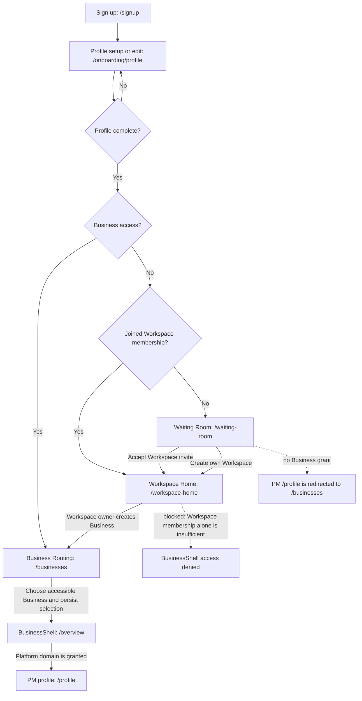

# FR-066 — Profile-first Workspace onboarding

| Field | Value |
|---|---|
| **Version** | 1.2.0b |
| **Status** | 🟠 As-built review updated (2026-10-15) — current-person profile summary and Home navigation are present in source with existing test coverage; profile-edit discoverability for a Profile-only member remains open (see below) |
| **Date** | 2026-08-17 |
| **Relates to** | [ADR-027](../../../decisions/ADR-027-PROFILE-FIRST-WORKSPACE-ONBOARDING.md), FR-038, FR-044, FR-046, SDD-038 |

## Intent

The first-run experience must identify the person before asking for an operating
scope. A new member can complete a Profile and remain in a Waiting Room without
creating an Organization, Tenant, Business, Space, or Project.

`Profile` is the user-facing completion step over `Person`. It is not an access
grant and is not a replacement name for Workspace.

## Target journey

```text
Landing → local identity/session → Profile setup
  ├─ no Business access → Waiting Room
  ├─ Workspace membership → Workspace Home
  └─ Business membership → Business Routing → BusinessShell
```

A profile-complete person may continue through the Waiting Room to create a
top-level Workspace; the creator receives its OWNER membership. The API checks
Profile completion and a non-empty Workspace name, with no separate
pre-existing owner grant. Organization/Tenant, Business, Space and Project are
added only when the operational context exists; they are not mandatory
first-run fields.

## As-built wireframe, user flow and route contract

This is a low-fidelity map of the current content and navigation, not a pixel
specification. It was checked against `main` at `e82f6fd5` on 2026-10-15. The
canonical FR-066 requirement and ADR-027 remain product authority. This section
maps current source behavior to them and records observed deviations.

### User flow and wireflow



`getOnboardingState` applies this precedence: incomplete Profile → `PROFILE`;
otherwise active Business access → `BUSINESS_ROUTING`; otherwise one or
more joined Workspaces → `WORKSPACE_HOME`; otherwise `WAITING_ROOM`. Thus the
branches are evaluated in that order when a person has both Workspace and
Business memberships. The profile page saves the current person's details, reads
the updated onboarding state, then navigates to its returned step.

### Low-fidelity screen sketches

**Profile setup — `/onboarding/profile`**

```text
┌ เริ่มต้นใช้งาน · ตั้งค่าโปรไฟล์ ─────────────────────┐
│ ชื่อ *                    │ นามสกุล *                 │
│ เบอร์โทรศัพท์ *                                       │
│ ชื่อที่แสดง (ไม่บังคับ)                              │
│ อีเมล (ไม่บังคับ)                                    │
│ [บันทึกโปรไฟล์]                                      │
└──────────────────────────────────────────────────────┘
```

The form is prefilled from the signed-in person's own onboarding state and can
update that same profile. Required fields are first name, last name and phone;
display name and email are optional. There is no guard that sends a completed
Profile away from this route, so it can act as an edit form when opened directly.

**Waiting Room — `/waiting-room`**

```text
┌ ห้องรอ · รอคำเชิญเข้าทีม                 [กลับหน้าแรก] ┐
│ โปรไฟล์ของผู้รอ: ชื่อ · อีเมล · โทรศัพท์             │
├ คำเชิญที่รอดำเนินการ ─────────────────────────────────┤
│ รายการคำเชิญของฉัน หรือข้อความว่ายังไม่มี              │
│ [วางรหัสเชิญที่ได้รับ                  ] [ใช้รหัสเชิญ] │
├ Workspace ที่คุณเข้าร่วมแล้ว ─────────────────────────┤
│ รายการ Workspace ของฉัน หรือข้อความว่ายังไม่มี          │
├ สร้าง Workspace ของคุณเอง ────────────────────────────┤
│ [ชื่อ Workspace                       ] [สร้าง Workspace]│
└──────────────────────────────────────────────────────┘
```

The page reads `/api/onboarding/state`, which is scoped to the authenticated
principal. It does not query a directory of other people. Creating a Workspace
requires a completed Profile and a non-empty name; the server creates the
Portfolio and gives its creator the `OWNER` WorkspaceMembership. The button is
disabled until a name is entered. The current service does not require a separate
pre-existing owner grant, so every signed-in, profile-complete person can use
this self-service path. No Tenant, Business, Space or Project is created by this
action.

**Workspace Home — `/workspace-home`**

```text
┌ Workspace ของคุณ ─────────────────────────────────────┐
│ Joined Workspaces and role                             │
│ Owner controls: members/invites; create Business when  │
│ needed (name Business, select owned Workspace if > 1)  │
│ [กลับไปห้องรอ / ใช้รหัสเชิญ]   [ไป Business Routing]  │
└──────────────────────────────────────────────────────┘
```

The Workspace interface uses schema `Portfolio`; its membership is not a
Business grant. The existing Business creation flow supplies a Business-scoped
Default Space in the same transaction and does not ask the user to choose or
name a Space. Business Routing then requires an explicit selection before the
BusinessShell opens.

### Route and access checks

| Given | Current destination or result | Source behavior |
|---|---|---|
| Signed-in person has an incomplete Profile | `/onboarding/profile` | Profile completion is checked before memberships. |
| Profile complete, no active Business membership, no joined Workspace | `/waiting-room` | Waiting Room is the valid resting state; its summary and lists are for this person. |
| Profile complete, no active Business membership, joined Workspace | `/workspace-home` | Workspace access remains outside BusinessShell. |
| Profile complete, active Business membership | `/businesses` | User selects a Business explicitly; the app persists selection before `/overview`. |
| Any profile-complete person submits a non-empty Workspace name in Waiting Room | `/workspace-home` after create succeeds | Creates only a top-level Portfolio and caller's OWNER WorkspaceMembership. |
| Profile-only person directly opens `/profile` | Redirect to `/businesses`, then `/waiting-room` if no Business is available | `/profile` is inside `(pm)`; guard requires selected accessible Business first. |
| Selected Business is accessible, and its `platform` domain is visible | `/profile` can mount | This is the PM account/session profile screen, distinct from onboarding Profile setup. |

### Verified gap and interpretation

The onboarding editor and the PM profile screen are different routes. ADR-027
D1 says authenticated `/profile` is the existing edit surface, but the current
`(pm)` layout guard prevents a Profile-only member from reaching it: without an
explicit, accessible Business selection it redirects to `/businesses`; if no
Business is available, that page returns the member to Waiting Room. A
Profile-only member can update their Profile at `/onboarding/profile`, but the
Waiting Room currently has no visible “edit profile” link. This is an
implementation/design discrepancy and a discoverability gap. Add a link or
change the route contract in a separate product decision; this document does
not change the current access rule.

Likewise, the Waiting Room copy says “สำหรับเจ้าของทีม” while the API enforces
Profile completion and a non-empty Workspace name, not a separate owner role.
The creator becomes the new Workspace's owner. If “owner” was intended to mean a
pre-authorized subset of people, that intent is not enforced by current code and
needs a product rule before the flow can be changed.

The `FR-066` feature note's 2026-09-04 status text was stale for the profile
summary and Home link: both are in the page and covered by the Waiting Room unit
and E2E specs. This review confirms their source presence; it does not claim a
fresh browser capture or full accessibility acceptance.

### Source and test mapping

- Routing predicate and per-person state: [`onboarding-service.js`](../../../../apps/server/src/modules/identity/onboarding-service.js), [`onboarding-steps.js`](../../../../apps/server/src/modules/identity/onboarding-steps.js).
- Profile editor, Waiting Room and Workspace Home: [`onboarding/profile/page.jsx`](../../../../apps/server/src/app/%28entry%29/onboarding/profile/page.jsx), [`waiting-room/page.jsx`](../../../../apps/server/src/app/%28entry%29/waiting-room/page.jsx), [`workspace-home/page.jsx`](../../../../apps/server/src/app/%28entry%29/workspace-home/page.jsx).
- Business Routing and BusinessShell boundary: [`businesses/page.jsx`](../../../../apps/server/src/app/%28entry%29/businesses/page.jsx), [`business-shell-guard.js`](../../../../apps/server/src/lib/business-shell-guard.js), [`(pm)/layout.jsx`](../../../../apps/server/src/app/%28pm%29/layout.jsx).
- Existing verification: [`FR-066 onboarding E2E`](../../../../apps/server/tests/e2e/fr066-waiting-room.spec.js), [`onboarding service unit tests`](../../../../apps/server/tests/unit/onboarding-service.test.js), [`Waiting Room presentation tests`](../../../../apps/server/tests/unit/waiting-room-page.test.js), [`BusinessShell guard tests`](../../../../apps/server/tests/unit/business-shell-guard.test.js).

## Acceptance criteria

- **AC-066.1** A new person is routed to Profile setup before any Business or
  Project creation prompt.
- **AC-066.2** A Profile-only member can enter Waiting Room with zero Tenant,
  Business, Space and Project records created by onboarding.
- **AC-066.3** Waiting Room lists only the current person's pending invitations
  and joined Workspaces; it does not expose broad scope inventory.
- **AC-066.4** A Profile or Workspace membership alone cannot mount
  BusinessShell or reveal Business-bound domains.
- **AC-066.5** An owner can continue from Profile to create a Workspace without
  being forced through Business or Project creation.
- **AC-066.6** A user can later continue from Workspace Home to an authorized
  Business Routing surface without changing the Profile identity.
- **AC-066.7** The no-external-provider mode still uses a server-owned identity
  and trusted session; browser-local labels are never authorization input.

Space is removed from the path the user walks (ADR-027 §D2) but stays required in
the model, so the next three criteria are what stop that from failing at first
use (ADR-027 §D8):

- **AC-066.8** Creating a Business creates a **Default Space** for it in the same
  transaction, with `scopeType: 'BUSINESS'` and that Business's `businessId` set.
  `Project.workspaceId` is a required column, so a Business whose owner was never
  asked to create a Space must still have one to create a Project into.
- **AC-066.9** A Default Space is never created with a null `businessId`.
  Authorization for Project work reads `workspace.businessId` — team management,
  FR-065 import, and `resolveProjectBusinessId` all do — so a Business-less
  Default Space would present a working product that silently refuses every
  write.
- **AC-066.10** Onboarding may create the Organization/Tenant implicitly so the
  user never sees that step, and never attaches a Business to a Workspace without
  one. `Business.tenantId` is required and Tenant is the BR-001 isolation
  boundary; skipping it in the interface is a simplification, skipping it in the
  data is removing tenant isolation.
- **AC-066.11** Project creation from onboarding names a Business and a Project
  only. No screen in the first-run path asks the user to pick, name or create a
  Space.
- **AC-066.12** Waiting Room renders a summary of the current session principal's
  completed Profile using the already-scoped onboarding state. It never lists or
  queries the profiles of other waiting people.
- **AC-066.13** Waiting Room exposes an accessible `กลับหน้าแรก` action to `/`
  without mounting BusinessShell or inventing Business access.

## Non-goals

- choosing a real authentication provider;
- creating a Personal Space automatically for every Profile;
- changing Project ownership or the seven execution modes;
- ~~implementing the route or database changes in this documentation slice~~
  (that later slice is now this one — implemented 2026-08-26).

## CHANGELOG

| Version | Date | Status | Summary | Commit Hash | Agent |
|---|---|---|---|---|---|
| 1.2.0b | 2026-10-15 | source-audited | Added as-built low-fidelity wireframes, evaluated routing order and documented the Profile-only edit-navigation and Workspace-creation policy gaps against `e82f6fd5` | working-tree | Codex |
| 1.1.0b | 2026-09-04 | beta | Added current-person profile-summary and public Home-navigation acceptance | working-tree | RWANG |
| 1.0.0 | 2026-08-26 | implemented | Delivered Profile-first onboarding, Waiting Room and Workspace collaboration boundary | historical | Claude Fable 5 |
