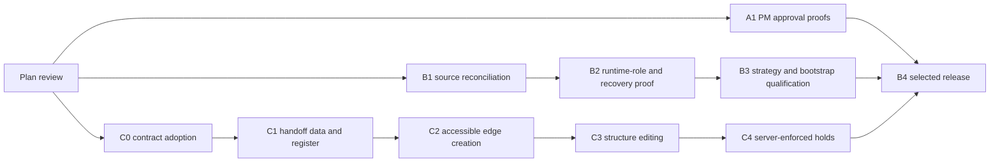

# Project Manager Remaining Implementation Plan

> **For agentic workers:** REQUIRED SUB-SKILL: Use superpowers:subagent-driven-development or superpowers:executing-plans to implement this plan task-by-task. Steps use checkbox (`- [ ]`) syntax for tracking. This document creates no developer controller or admission ledger.

**Goal:** Close the remaining PM implementation/evidence gaps within the approved linked SRS, with independently reviewable increments and explicit release boundaries.

**Architecture:** Retain the Server modular monolith, PM-owned writers and repository interfaces, the existing import lane, Identity authorization and immutable audit evidence. Qualify implemented capabilities before proposing additional code. The Pipeline Builder is a separately gated track with C0 v0.1.5 adopted at `1b76049a`; C1 merged and C2 selected separately.

**Tech Stack:** Existing Next.js/React JavaScript, Zod, Prisma SQLite and generated PostgreSQL adapter, Vitest, Playwright and repository governance. No new framework or external service is selected.

**Spec:** [Approved Project Manager linked SRS](../domains/project-manager/SRS.md), approved input v0.1.0 at `e1014247b01cd42bca589e679c840d2c2c8f2857`, SHA-256 `f3e852a158912d262b31bf5dd5f616195c334ea9c8a06afffc1124012d32f8ac`; v0.2.0 records the owner's approval. Canonical sources remain at their SRS-linked paths.

## Global Constraints

- The owner approved this plan package at `c291afcd` on 2026-10-23 and explicitly authorized A1 implementation, tests and independent review first, followed by B1 source reconciliation. A1 and B1–B4 were qualified through PR727/730. C0 v0.1.5 was adopted at `1b76049a`; C1 merged through PR737 with exact-commit post-merge checks. The owner selected C2 only on 2026-10-24; C3–C4 and production remain unselected.
- Canonical statements, explicit FEAT membership and subject anchors remain pinned. This SRS approval is not approval of a canonical-row migration or of the wider PMR candidate.
- Execution modes remain `SOFTWARE_SPRINT`, `DATA_MIGRATION`, `B2B_SALES`, `B2C_CAMPAIGN`, `PRODUCT_LAUNCH`, `OPERATIONS`, `BUSINESS_EXPANSION`; consume their existing enum/contract source.
- Preserve Tenant isolation, Business operation, Project ownership, strategy-weighted progress and the current neutral work model. Team and Employment never supply access grants.
- Use server-resolved viewers and the existing service authorization; all test viewers come from `apps/server/tests/factories/viewer.js`.
- Keep SQLite and PostgreSQL evidence distinct. Embedded test clusters and disposable fixtures must not accept production/UAT database URLs.
- Follow [ADR-113](../decisions/ADR-113-RETIRE-DEVELOPER-DELIVERY-CONTROL.md): ordinary Git/PR review, scoped checks and hosted CI; no DDC task records, G0 procedures, `delivery:*` commands or replacement receipts.
- One integrator owns shared schemas, generated PostgreSQL outputs and document generators. Delegated worker/verifier/reviewer roles use GPT-6 Luna Max per AGENTS.md; a plan task does not mandate parallel sessions.
- Production access, migration apply, grants and runtime replacement retain the existing [ADR-057](../decisions/ADR-057-ASSET-EVIDENCE-PRODUCTION-DEPLOYMENT-AND-MIGRATION-BOUNDARY.md), [ADR-104](../decisions/ADR-104-PRODUCTION-MIGRATION-LINEAGE-RECONCILIATION.md) and [ADR-112](../decisions/ADR-112-PRIMARY-CHECKOUT-DEV-DOCKER-AND-DATABASE-ISOLATION.md) boundaries.

## Review Focus

| Input or failure condition | Expected protection | Owning task |
|---|---|---|
| Two reviewers or executors reach the same request together | One durable transition/effect; deterministic conflict or idempotent projection; atomic audit | A1 |
| Session/grant expires or is revoked while a request waits | Authority is re-resolved at the protected transition; no stale cached grant | A1, B2 |
| Connection reuse carries a previous Business's scope or uses bypass RLS | Missing/foreign scope refuses; transaction-local settings reset; actual runtime role is tested | B2 |
| Two graph writers each pass a stale preview | Commit rechecks versions, endpoint authority and cycle/hold invariants inside one serialized transaction | C0, C1, C4 |
| A mouse-only canvas or old undeclared edge reaches a user | Equivalent keyboard/single-pointer controls ship with the gesture; legacy edges remain explicit and do not gain retroactive holds | C1–C4 |

## 1. Baseline and remaining-work disposition

Source review is bounded to `e1014247`; no application acceptance tests or live probes
were run while writing these plans. The [dated application assessment](../../reports/gap-analysis-2026-10-23/README.md),
[roadmap](../roadmap/ROADMAP.md), SRS exclusions, current source and named tests are
inputs, not fresh test receipts. The snapshot counts in PM document 28 are not current totals.

| Scope | Source-derived state | Planned action |
|---|---|---|
| FR-272 / ADR-103 | Implementation and five PM integration cases exist; roadmap retains unresolved concurrency/audit evidence. Agent-domain quorum tests prove a different gateway | [Track A](PM-APPROVAL-VERIFICATION-20261023.md): three deterministic PM concurrency/rollback proofs and scoped regression evidence |
| FR-252 | Schema, repository, service, routes and UI are present; W3/main wording in the canonical row/roadmap is older than composition evidence; production role/recovery gates stay open | [Track B](PM-EXISTING-DELIVERY-QUALIFICATION-20261023.md): reconcile source evidence and qualify actual policy/service/recovery behavior; do not rebuild Feature CRUD |
| FR-268/269/270/271 | Code is merged; canonical phase wording and SMART design note are stale; production migration/live-Business acceptance remains unclaimed | Track B: current adapter/browser qualification, accurate supporting notes and separately authorized release |
| FR-286 | Bounded template/provisioning implementation is merged through PR667; local Docker/production apply and live activation were not part of that delivery | Track B: retain the atomic bootstrap/backup contracts as regression and release preconditions, not a new provisioning implementation |
| FR-082/083/084/085 / FEAT-007 | Four planned canonical FRs; WBS/map/Board lack the new interactions/contracts. [ADR-035](../decisions/ADR-035-DIRECT-MANIPULATION-PIPELINE-CANVAS.md) explicitly remains design-only | [Track C](PM-PIPELINE-BUILDER-20261023.md): contract-resolution task first; four implementation slices only after its concrete design is adopted |
| Other 62 SRS-linked FRs | Existing registered scope and shared dependencies; this bounded review does not establish complete current runtime acceptance for every clause | Preserve them and select regression checks by changed behavior. B1 must surface any newly found gap before adding code to this plan |
| 8 FEAT and 27 NFR/BR/SEC/SDD records in the SRS | Bundles and shared constraints, not 35 additional missing features | Apply the original sources to each affected task; retain exact membership and lifecycle |

The 73 linked FRs are therefore partitioned into 1 approval-evidence item,
6 existing-delivery qualification items, 4 design-gated Pipeline items and
62 retained-scope items. This is a planning disposition, not a completion score.
Additional existing Pipeline constraints BR-017, SDD-046 and NFR-008 are linked
from Track C because the selected FEAT's source already names them.

## 2. Delivery units and order

| Plan | Independently reviewable deliverable | Dependencies | May start coding now? |
|---|---|---|---|
| [A: approval verification](PM-APPROVAL-VERIFICATION-20261023.md) | Real PostgreSQL PM races, atomic audit rollback and exact source-bound results | Approval of this plan; unchanged ADR-103 scope | Yes; owner authorized A1 on 2026-10-23 |
| [B: existing-delivery qualification](PM-EXISTING-DELIVERY-QUALIFICATION-20261023.md) | Current-source disposition, runtime-role/service proof, adapter/recovery/browser evidence and a release candidate | B1 source reconciliation; A before a release containing approval behavior | B1 accepted at 56b6ed97; owner authorized B2 isolated role/service/recovery qualification. B3 local adapter/browser qualification is recorded below; external/live steps need the selected environment's authority |
| [C: Pipeline Builder](PM-PIPELINE-BUILDER-20261023.md) | Handoff contract, accessible canvas editing and server-enforced release holds | C0 accepted technical supplement/ADR-035 disposition; C1 before C2, C3 and C4 | C0 adopted at `1b76049a`; C1 merged as `cb0bfbbc` (PR737). C2 is selected; C3–C4 remain unselected |

Track A is the recommended first implementation unit: it closes an explicitly
unverified contract without creating new product behavior. B1 can be prepared
alongside it; schema/config mutations are integrated serially. The A/B release
does not depend on selecting Pipeline Builder. Include C in B4 only if that
feature is selected and all C tasks are independently accepted.

## 3. Files and interfaces shared across plans

| Surface | Existing owner/interface | Integration rule |
|---|---|---|
| PM approval | `approval-gateway.js`: `requestApproval`, `decideApproval`, `admitApprovedStep` | A1 preserves public signatures; fix only a reproduced invariant failure |
| PostgreSQL test selection | `apps/server/vitest.postgres.config.js`, `tests/global-setup-postgres.js`, `tests/setup.js` | A/B add explicit suites and use injected/owned disposable targets; default SQLite is not PG proof |
| Feature authority | `createProjectFeatureRepository({db,dialect,...}).withProjectTransaction(options, callback)` and `project-feature-service.js` | B2 tests actual scoped transactions/policy; no second writer |
| Intake | `dryRunPlan(rawPlan,{workspaceId,viewer,db})`, `commitPlan(rawPlan,options)` at `/api/import/dry-run` and `/api/import/commit` | C0 must adopt a delta contract/receipt extension before C1 writes; existing full PlanEnvelope versions remain compatible |
| Dependencies and work status | `dependency-service.js`, `work-service.js` | C shares transaction-aware domain helpers across register/import/Board; no client-only release guard |
| Schema/recovery | `prisma/schema.prisma`, generated PG schema/SQL, provider migration tree, `phase-b-backup.js`, recovery CLI | One integrator; new models/columns require migration, scope and recovery parity |
| Current status | `docs/roadmap/ROADMAP.md` and supporting domain notes | Record actual results and unresolved gates, not planned results; frozen snapshots stay unchanged |

All source paths are Server-relative when shown without `apps/server/` in a
subplan's file table. New file names and interfaces in C0 are proposed builder
decisions for review, not existing runtime contracts or new canonical authority.

## 4. Common task exit and verification

- [ ] Re-verify base/head, relevant accepted sources and actual changed paths before executing each task; retain unrelated edits in isolated checkouts.
- [ ] Run each task's named tests against the intended engine; zero tests, skipped required evidence, flaky retry-only passes and cancelled runs cannot close a task.
- [ ] For behavior changes run selected existing regression tests, build and configured type/lint checks. The Server has no standalone configured typecheck script; report Next build's validity phase accurately.
- [ ] Obtain independent review on the same composed patch. Fix important findings before integration.
- [ ] Run schema/contract generators only when their source changed; after documentation changes regenerate owned graph/views serially and run `npm run govern`. Entrypoint/corpus edits also run `docs:llms` and `docs:llms:check`.
- [ ] Use exact-head hosted GitHub checks before merging; record E2E/Desktop skips as skips and execute the required local/manual acceptance separately.
- [ ] Commit only task-owned paths and update the roadmap/supporting note with revision, command/result and environment limits. A plan checkbox is not release evidence.

## 5. Exclusions and decisions still required

| Item | Disposition |
|---|---|
| Workforce capacity/performance, Fleet/Agent design, provider/MCP gateway and remaining PMR families | Still proposal-only under the approved SRS exclusions. Require their own adopted behavior/contracts and separate plans; no route or staffing assumptions |
| Canonical status-row repair | B1 may prepare the precise migration proposal, but cannot label an unapproved migrated row source-preserved or repair hashes/ledger manually |
| Actual runtime-role grant/credential changes | B2 can qualify isolated roles. External role configuration and real-role proof belong to the environment owner and ADR-097 release boundary |
| Historical document-20 developer procedures | Retired by ADR-113; no current task packet, rule-check, G0 or DDC receipt is introduced |
| Planning-time verification | At initial plan drafting, only governance/profile/corpus and independent plan review ran; application commands were scheduled. A1 execution results are now recorded below; B/C commands remain scheduled |

## 6. Self-review and version history

Plan self-review checks the approved SRS's purpose, 20 capability rows, all 108
record links, contracts/evidence exclusions and change history against the
disposition above. Each selected missing behavior has a task; unchanged behavior
has a regression/discovery boundary, not a fabricated completion result. Track C
cannot proceed around unresolved product/transport semantics. Each Review Focus
row has a named owning task and test cases in that subplan.

| Version | Date | Change |
|---|---|---|
| 0.1.0 | 2026-10-23 | Initial proposed plan package against e1014247 and the explicitly approved linked SRS; implementation, production and candidate adoption remain unstarted |

0.1.1 (2026-10-23): owner approved the plan package at c291afcd and selected A1 for execution with tests/review. Wider candidate and Pipeline contract adoption remain excluded.

## Current execution state — 2026-10-24

C0 v0.1.5 D1–D6 and its canonical adoption migration are accepted. C1 merged
through PR737 as `cb0bfbbcf42140bdd7295c8ebe95461e5d988a4b`; exact-commit
post-merge governance, Edge/Desktop and Docker build workflows succeeded.
The owner selected C2 accessible edge creation next, with adapter/browser tests
and independent review. C2 local adapter/browser qualification is complete;
final same-patch review confirmation and exact-head hosted checks remain PR
integration gates. The [C subplan](PM-PIPELINE-BUILDER-20261023.md#c2-source-qualification-2026-10-24)
records source reconciliation and scoped evidence. C3–C4 and production remain
unselected. This is not complete Pipeline Builder or release acceptance.

### Earlier current-state note — 2026-10-23

PR727 is merged as `5012c9bd`; exact-source post-merge Governance, Edge/Desktop
and Docker build-only CI passed. The owner then selected [B4 isolated UAT](PM-EXISTING-DELIVERY-QUALIFICATION-20261023.md#b4-isolated-uat-environment-acceptance--2026-10-23)
for migration/recovery and actual-role acceptance. A fresh, separate UAT runs the
pinned source/image with 209 tables; source/full/protected restores reconcile 235
rows. Deployed authenticated API/browser and reconstructed-runtime proofs passed;
independent review accepted this exact isolated UAT artifact. These facts close no production environment
gate and adopt no held canonical rows. PR730 subsequently merged that evidence
as `635120c5` with successful post-merge Governance and Edge/Desktop CI. The owner
then selected C: [C0 contract preparation](PM-PIPELINE-BUILDER-20261023.md#task-c0-resolve-the-technical-contract-before-any-schemaui-code)
is in progress; exact supplement/ADR/canonical adoption still precedes C1–C4.

### Earlier increments (historical scope)

A1 is accepted locally at `6888ecc629cca769866d8cc2f715cb5414746c5f`; its
[source-linked evidence](../domains/project-manager/features/FR-272-approval-gateway-admission.md#a1-acceptance-evidence--2026-10-23)
records PostgreSQL contention/audit proofs, related SQLite checks, build and
independent review. It also records the reproduced stale-Identity-authority defect
and correction. Hosted CI/merge and release remain separate. The owner next
selected B1 source reconciliation; its [current disposition](PM-EXISTING-DELIVERY-QUALIFICATION-20261023.md#b1-source-reconciliation--2026-10-23)
records implementation ancestry, the 62-FR retained-scope recheck and held canonical
status proposals. B1 found FR-271 shared server SMART evaluation partial and amended
B3 for contract reconciliation/regressions before coding. B1 passed its checks
and independent review at `56b6ed97`. The owner then selected
[B2 isolated qualification](PM-EXISTING-DELIVERY-QUALIFICATION-20261023.md#b2-isolated-qualification--2026-10-23)
with real runtime-role, service/recovery tests and review. B4 and C0–C4 remain unstarted; the actual deployment's ADR-097 role/grant proof remains a separate gate.
The B2 evidence records local isolated acceptance (final role/service/recovery
13/13, SQLite 98/98, generated consumers 51/51, build/governance and independent
review). Its broader PostgreSQL profile was 124/126 then a focused 16/16 rerun;
this is explicitly composed evidence, not a single clean full-profile result.

0.1.2 (2026-10-23): record A1's local result without closing the remaining PM plan.

0.1.3 (2026-10-23): record B1 selection/source reconciliation and its FR-271 finding; B2 and later execution remain unstarted. No application or canonical change.

0.1.4 (2026-10-23): record B1 acceptance and B2 isolated qualification with the
composed-check caveat; B3, production and held canonical migrations remain excluded.

0.1.5 (2026-10-23): owner selected B3 with optional due dates and no production.
The [B3 evidence](PM-EXISTING-DELIVERY-QUALIFICATION-20261023.md#b3-local-qualification--2026-10-23)
records contract review before code, shared server SMART create/patch feedback,
review corrections, SQLite 64 passed / 1 provider-only skip, PostgreSQL 52/52,
related regressions 144/144, generated consumers 51/51 and browser 23/23. Build
and governance passed; independent review covers the final composed patch.
Hosted exact-head CI has not run and remains required before merge. B4/C and
production remain unstarted; held canonical status migrations remain held.

0.1.6 (2026-10-23): owner selected the [B4 PR/hosted-CI/readiness preparation](PM-EXISTING-DELIVERY-QUALIFICATION-20261023.md#b4-pr-and-release-readiness-preparation--2026-10-23)
subscope with no merge or production. The candidate incorporates main `77be99c8`;
final composed checks, independent review and hosted runs are recorded in the PR
against its exact head. B4 environment/release acceptance remains unexecuted;
C and held canonical migrations remain excluded. Earlier unstarted B4 statements
are superseded only for this preparation subscope.

0.1.7 (2026-10-23): record PR727 merge/post-merge CI and owner-selected isolated
B4 UAT. The qualification subplan owns exact target/image/SQL/hash/results,
composed-run caveats and remaining production/file/provider limits. Final review
and documentation governance results are recorded with this scoped evidence
patch; the qualified application artifact remains pinned to `5012c9bd`.

0.1.8 (2026-10-23): record PR730 merge/post-merge CI and owner selection of C0
contract preparation. C1–C4 remain CONTRACT_NOT_ADOPTED; production unselected.

0.1.8 → 0.1.9 (2026-10-24): reconciles C0 adoption and C1 merge/post-merge
qualification; selects C2 only under the owner's current instruction. Earlier
increment notes remain historical; no canonical requirement lifecycle changes.
